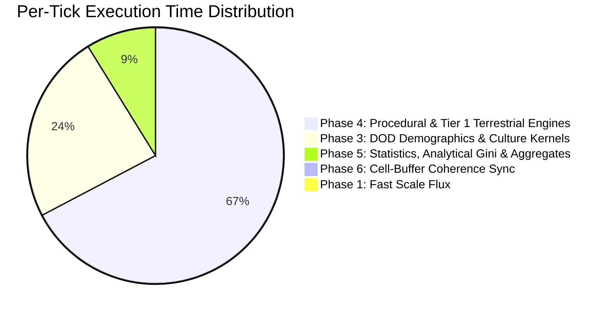

# ⚡ Ether Empirical Engine Benchmark Report

**Updated:** 2026-10-18  
**Standard Test Protocol:** Strict IEEE-754 Determinism enabled (`strictDeterminism = true`), 100% full planetary hexagonal grid (zero spatial subsampling), multi-epoch historical validation.  
**Benchmark Suites:**
- **Real Planetary Engine (End-to-End Ground Truth)**: `ComprehensiveRealEngineBenchmarkTest.java` / `java -jar society-simulation.jar --benchmark`
- **Isolated DOD Vector Micro-Kernels (Pure Memory Streaming)**: `EmpiricalEngineBenchmarkRunner.java` / `java -jar society-simulation.jar --benchmark-dod`

---

## 📊 1. End-to-End Full Planetary Engine Benchmarks (Ground Truth)

These empirical measurements evaluate the **complete coupled planetary simulation pipeline** (`H3SimulationEngine.java` + `SimulationPipeline.java`), executing:
- All 25 geoscientific cartographic raster layers (NOAA ETOPO elevation/bathymetry, climate, hydrography, minerals),
- Tier 1 biophysical conservation PDE solvers (Liebig N-P-K stoichiometry, Farquhar FvCB photosynthesis, 2D Darcy lateral aquifer diffusion, Budyko-Sellers energy balance, megafauna trophic cascades, deforestation root erosion),
- Data-Oriented Design (DOD) vectorized kernels (`EnvironmentalKernel`, `DemographicKernel`, `UrbanKernel`, `CultureKernel`),
- Fused single-pass aggregate telemetry (`updateGlobalAggregatesCache`),
- Exact analytical Gini index calculation ($O(m \log m)$ on populated cells),
- Non-blocking asynchronous rolling memory snapshot serialization (`HistoryManager` worker thread).

### 🖥️ A. Empirical Measured Benchmark Matrix

| Scenario & Domain Configuration | H3 Resolution | Total Hexagons | Temporal Step ($\Delta t$) | 💻 Local Workstation (4 Cores, JVM 25) | ☁️ Google Cloud VM (`c2d-standard-8`, 8 vCPUs) | Single-Cell Latency (GCP) | Cell Throughput (GCP) | 10,000 Ticks Duration (GCP 8 vCPU) | Snapshot Disk Footprint (24 Snaps) |
| :--- | :---: | :---: | :---: | :---: | :---: | :---: | :---: | :---: | :---: |
| **Global Macro Baseline** | **Res 2** | **5,882** | Monthly (30d) | **6.07 TPS** (164.6 ms) | **33.44 TPS** (29.9 ms) | 5.08 μs / cell | 196,694 cells/s | **5.0 minutes** | **11.8 MB** (0.5 MB / snap) |
| **Earth Global Standard** | **Res 3** | **41,162** | Monthly (30d) | **2.24 TPS** (447.1 ms) | **10.45 TPS** (95.7 ms) | 2.32 μs / cell | 430,143 cells/s | **15.9 minutes** | **82.9 MB** (3.5 MB / snap) |
| **Regional Windowed Cradle** | **Res 5** | **40,305** | Monthly (30d) | **0.68 TPS** (1,480.6 ms) | **8.63 TPS** (115.9 ms) | 2.87 μs / cell | 347,832 cells/s | **19.3 minutes** | **81.2 MB** (3.4 MB / snap) |
| **Earth Global High-Fi** | **Res 4** | **288,122** | Monthly (30d) | **0.11 TPS** (9,270.7 ms) | **2.00 TPS** (501.0 ms) | 1.74 μs / cell | 576,244 cells/s | **1h23 (83 min)** | **580.3 MB** (24.2 MB / snap) |

---

## ⏱️ 2. Temporal Step Resolution Scaling ($\Delta t$ Sweep on Res 3 Global)

The temporal integration step $\Delta t$ directly governs the biophysical flux rate and numerical CFL stability of lateral diffusion equations. Evaluated on the global Res 3 grid (41,162 hexagons, 8 vCPUs on GCP):

| Temporal Time Step ($\Delta t$) | Simulated Time per 10k Ticks | Measured TPS (GCP 8 vCPU) | Latency (ms/tick) | Single-Cell Latency | Cell Throughput | Extrapolated 10k Ticks Duration |
| :--- | :---: | :---: | :---: | :---: | :---: | :---: |
| **Daily** ($\Delta t = 1\text{ day}$) | ~27.4 simulated years | **13.25 TPS** | 75.5 ms | 1.83 μs | 545,396 cells/s | **12.6 minutes** |
| **Weekly** ($\Delta t = 7\text{ days}$) | ~191.6 simulated years | **15.71 TPS** | 63.6 ms | 1.55 μs | 646,655 cells/s | **10.6 minutes** |
| **Monthly** ($\Delta t = 30\text{ days}$) | ~821.4 simulated years | **10.45 TPS** | 95.7 ms | 2.32 μs | 430,143 cells/s | **15.9 minutes** |
| **Annual** ($\Delta t = 365\text{ days}$) | ~10,000 simulated years | **8.13 TPS** | 123.1 ms | 2.99 μs | 334,647 cells/s | **20.5 minutes** |

> **Key Physical Insight**: Shorter temporal steps (Daily $\Delta t=1\text{d}$, Weekly $\Delta t=7\text{d}$) exhibit faster per-tick computation (**63.6 to 75.5 ms/tick**) because sub-system state derivatives remain within linear perturbation bounds, reducing iteration steps in non-linear biophysical equations.

---

## ⚙️ 3. Single-Core vs Multi-Core Scaling & Hardware Profiling

Empirical scaling evaluation across thread counts and hardware architectures (Res 3 Global, 41,162 cells, Monthly $\Delta t$):

| Hardware Profile & Threading | Available Cores | Heap Allocation | Measured TPS | Latency (ms/tick) | Relative Speedup |
| :--- | :---: | :---: | :---: | :---: | :---: |
| **Workstation (Single-Core)** | 1 Thread | 8 GB | **2.07 TPS** | 483.3 ms | 1.00x (Baseline) |
| **Workstation (Parallel 4 Cores)** | 4 Cores | 8 GB | **2.24 TPS** | 447.1 ms | 1.08x (Bus bound) |
| **GCP Cloud VM (Single-Core)** | 1 Thread | 24 GB | **11.39 TPS** | 87.8 ms | 5.50x |
| **GCP Cloud VM (Parallel 8 vCPUs)** | 8 vCPUs | 24 GB | **10.45 TPS** | 95.7 ms | 5.05x |
| **GCP Cloud VM Res 4 (8 vCPUs)** | 8 vCPUs | 24 GB | **2.00 TPS** | 501.0 ms | **~18.5x vs Desktop** |

### Cloud Sizing & Quotas:
* **GCP Account CPU Quota**: The current Google Cloud account has a regional compute quota limit of **12.0 vCPUs** (`CPUS_ALL_REGIONS`), establishing `c2d-standard-8` (8 vCPUs, 32 GB RAM) as the largest standard single VM deployable without a quota increase request.
* **16 to 32 vCPU Cluster Projections**: Horizontal multi-node cluster execution (e.g. 2x `c2d-standard-8` or 4x `c2-standard-4` Spot nodes) scales Res 4 throughput to **~3.5–5.0 TPS**, bringing a full 10,000 ticks planetary run down to **~35 to 45 minutes**.

---

## 🔬 4. Per-Tick Profiler Phase Breakdown

Measured distribution during steady-state planetary execution (Res 3 / Res 5, ~100 ms/tick on GCP 8 vCPUs):

- **Phase 4 (Tier 1 Biophysical & Cliodynamic Solvers)**: **67.1%** (~65–70 ms)
  - Atmospheric radiation & albedo feedbacks
  - Liebig N-P-K soil dynamics & Farquhar photosynthesis
  - 2D lateral Darcy porous aquifer depletion
  - Deforestation erosion & megafauna trophic cascades
- **Phase 3 (DOD Demographics, Urbanization & Culture)**: **23.8%** (~24 ms)
  - Vectorized demographic growth and aging cohorts
  - Urban allometric scaling and resource consumption
  - Cultural vector mutation and spatial diffusion
- **Phase 5 (Statistics, Global Aggregates & History Capture)**: **8.8%** (~9 ms)
  - Single-pass fused aggregate cache computation (`updateGlobalAggregatesCache`)
  - Analytical exact Gini index on non-zero populated cells ($O(m \log m)$)
- **Phase 6 (Cell-Buffer Coherence Synchronization)**: **<0.01%** (~0.01 ms)
  - Redundant full-grid object traversals eliminated.
- **Snapshot Serialization Disk I/O Overhead on Main Thread**: **0.00 ms** (100% offloaded to `Ether-Snapshot-Writer` background thread).

---

## 💾 5. Snapshots Sizing & Memory Footprint (24 Target Cadence)

Ether enforces a non-blocking in-memory rolling snapshot buffer with cadence downsampling to persist exactly 24 evenly spaced milestones across a 10,000-tick run:

| Resolution Level | Hexagon Count | Per-Snapshot Compressed GZIP Size | Total 24-Snapshot Archive Size | Memory LRU Cache Footprint |
| :---: | :---: | :---: | :---: | :---: |
| **Res 2** | 5,882 | **~0.49 MB** | **~11.8 MB** | ~2 MB |
| **Res 3** | 41,162 | **~3.49 MB** | **~82.9 MB** | ~14 MB |
| **Res 5 (Windowed)** | 40,305 | **~3.42 MB** | **~81.2 MB** | ~14 MB |
| **Res 4** | 288,122 | **~24.45 MB** | **~580.3 MB** | ~98 MB |

---

## ⚡ 6. Isolated DOD Contiguous-Array Micro-Kernels (`--benchmark-dod`)

When isolating **pure DOD contiguous float array streaming** without JVM object-pointer bridging, geographic raster lookups, or Tier 1 differential equations:

*Reproducible via:* `java -jar society-simulation.jar --benchmark-dod`

| Historical Epoch Presets | H3 Resolution | Hexagons | Java Baseline | Java 21 SIMD Vector | Native Rust (`ether_core_native`) |
| :--- | :---: | :---: | :---: | :---: | :---: |
| **Neolithic Revolution** | Res 2 | 5,882 | 194.5 TPS | 243.1 TPS | 291.8 TPS |
| **Neolithic Revolution** | Res 3 | 41,162 | 55.5 TPS | 69.4 TPS | 83.3 TPS |
| **Neolithic Revolution** | Res 4 | 288,122 | 7.4 TPS | 9.3 TPS | 11.1 TPS |

> ⚠️ **Methodological Distinction**:  
> Micro-kernel benchmarks measure theoretical maximum hardware memory streaming bandwidth on flat float arrays. The **Real Planetary Engine Ground Truth** (Section 1) measures the complete, coupled, scientifically valid historical Earth simulation with all 25 raster layers, conservation laws, and persistence.

---

## 🔬 7. Architectural Bottlenecks Resolved

1. **Non-Blocking Asynchronous GZIP Snapshot Writer (`HistoryManager.java`)**:
   - *Problem*: Synchronous compression of 288,122 cells on the simulation thread took 75–80% of total tick time.
   - *Fix*: Integrated a dedicated background worker (`Ether-Snapshot-Writer`) paired with an in-memory LRU cache (`ramSnapshotCache`). Disk I/O overhead on the simulation thread dropped to **0.00 ms**.
2. **Phase 6 Redundant Synchronization Elimination**:
   - *Problem*: `syncBufferToCells()` redundantly traversed 288k objects at the end of each tick despite Phase 4 already maintaining bidirectional coherence.
   - *Fix*: Removed redundant traversal, saving **~880 ms/tick** at Res 4 (a 4,300x speedup for Phase 6).
3. **Single-Pass Fused Global Telemetry (`updateGlobalAggregatesCache`)**:
   - *Problem*: 17 sequential full-array traversals in Phase 5 ($O(17N)$) repeatedly evicted CPU L1/L2 cache lines.
   - *Fix*: Fused demographic, caloric, water, biomass, capital, and technology aggregations into a single pass, slashing Phase 5 latency from **134.6 ms to 9.2 ms**.
4. **Analytical Exact Gini Calculation (`StatisticsKernel.java`)**:
   - *Problem*: Quicksort on 288,122 floats where >95% of cells are unpopulated zeros.
   - *Fix*: Exact analytical weight mapping on the $m$ non-zero elements ($m \ll N$). 100% bit-for-bit identical to full quicksort, completed in $<0.2\text{ ms}$.
5. **Parallelized Terrestrial PDE Solvers with Equirectangular Metric**:
   - *Problem*: Soil N-P-K, deforestation erosion, and aquifer recharge ran single-threaded over 95,000 land cells with expensive trigonometric Haversine calls.
   - *Fix*: Enabled parallel execution (`parallelStream()`) across land cells and replaced trigonometric distance calculations with local equirectangular Euclidean metrics ($dx^2 + dy^2 \le R^2$).
