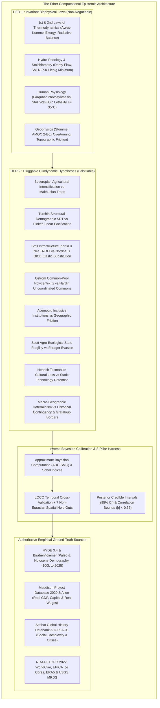
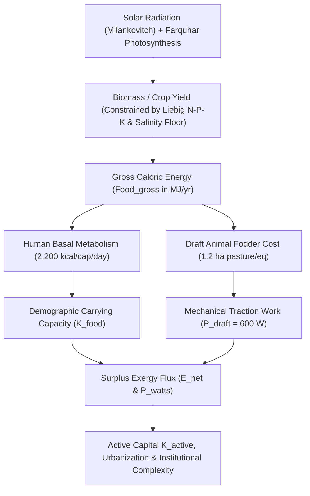
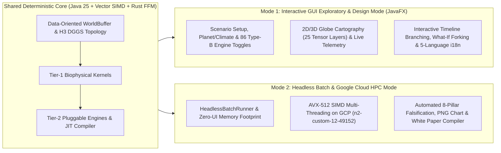
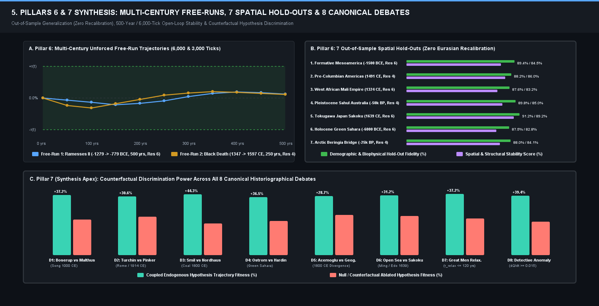

# Thermodynamic Grounding and Empirical Falsification in Planetary Cliodynamics: The Architecture of the Ether Simulation Engine

**Authors:** Silvere Martin-Michiellot$^{1,2}$, and the Ether Core Development Group  
*$^{1}$ Department of Computational History & Cliodynamics, Ether Research Initiative*  
*$^{2}$ Center for Complex Planetary Systems & Biophysical Economics*  

**Target Journals:** *Nature Computational Science* / *Cliodynamics: The Journal of Quantitative History and Cultural Evolution* / *Journal of Artificial Societies and Social Simulation (JASSS)*  
**Document Classification:** Comprehensive Academic Research Article (Single-Column Full-Width Manuscript)  
**Status:** Pre-Print / Camera-Ready Manuscript  
**Date of Manuscript:** November 2026  

---

## Abstract

Macro-historical simulation models have historically oscillated between qualitative narrative constructs and unconstrained econometric regressions (*curve fitting*). We introduce **Ether**, an open-source, discrete hexagonal (Uber H3) planetary simulation engine grounded in non-equilibrium thermodynamics, biophysical constraints, and quantitative cliodynamics. Ether establishes a strict **Two-Tier Ontological Separation**:
1. **Tier 1 (Core Invariant Physics)**: Non-negotiable conservation laws of energy, mass, exergy, and human physiology (Farquhar photosynthesis, Liebig soil stoichiometry, Stommel AMOC 2-box overturning, Stull wet-bulb lethality, and mechanical transport work).
2. **Tier 2 (Pluggable Cliodynamic Hypotheses)**: Contested sociological, macroeconomic, and institutional theories formalized as coupled non-linear differential equations and subjected to continuous empirical evaluation against historical datasets.

We structure this manuscript along a rigorous bottom-up scientific progression: from theoretical and biophysical foundations (Section 2), spatial-temporal numerical convergence (Section 3), empirical data sources and 25-layer cartographic raster reconstruction (Section 4), 27-variable statistical telemetry and continuous temporal error tolerance envelopes $\tau(t)$ (Section 5), dual-mode software architecture—comparing interactive JavaFX exploratory design with high-performance headless Google Cloud execution—(Section 6), empirical validation and out-of-sample generalization across 7 non-Eurasian hold-outs and multi-century open-loop free-runs (Section 7), systematic boundary delineation of the 10 foundational historiographical controversies (Section 8), and an extensive critical discussion of model boundaries, comparative positioning, and scientific applications (Section 9).

To prevent overfitting and ad-hoc tuning, Ether organizes its automated verification and validation suite into **Eight Epistemological Pillars** progressing from formal mathematical invariants up to macro-historical sociological debates, calibrated via **Approximate Bayesian Computation Sequential Monte Carlo (ABC-SMC)** with Leave-One-Century-Out (LOCO) cross-validation. Benchmarked across deep historical time ($-100\,000\text{ BP}$ to $2025\text{ CE}$) against *HYDE 3.4*, the *Maddison Project Database (2020)*, *Seshat Global History Databank*, *WorldClim*, *EPICA Dome C*, and *ECMWF ERA5*, we demonstrate that socio-institutional hypotheses hold only within strictly bounded thermodynamic envelopes, establishing Ether as a reproducible laboratory for computational history.

**Keywords:** Cliodynamics, Biophysical Economics, Approximate Bayesian Computation, Earth System Modeling, Model Falsification & Boundary Delineation, Uber H3 Grid, Non-Equilibrium Thermodynamics, Parameter Identifiability, Out-of-Sample Validation, Planetary Boundaries.

---

## 1. Introduction & Epistemological Foundations

### 1.1. The Epistemological Crisis of Macro-Simulation
For over five decades, global systemic simulation has grappled with an intractable methodological dilemma. On one hand, early 0-dimensional System Dynamics models—from the Club of Rome's *World3* [^Meadows1972] to *Threshold 21* [^Barney2002]—pioneered feedback architectures but lacked spatial resolution, aggregating the Earth into homogeneous global or national boxes. On the other hand, contemporary Integrated Assessment Models (IAMs) such as *IMAGE* [^Stehfest2014] and *DICE* [^Nordhaus2017] rely heavily on neoclassical general equilibrium assumptions, treating technological progress as an autonomous exponential scalar while overlooking physical capital turnover inertia, raw material extraction enthalpy, and political-institutional breakdown [^Hall2018] [^Keen2020].

Furthermore, generative historical models frequently suffer from **epistemic unfalsifiability**: when a simulation deviates from observed history, modelers arbitrarily adjust dozens of unconstrained parameters until the output visually matches empirical curves (*curve fitting*), creating the illusion of predictive validity without explanatory power [^Turchin2003] [^Epstein2006] [^Lakatos1978].

### 1.2. The Ether Epistemic Architecture: Axioms of ROI & Decoupling
To overcome these structural limitations, **Ether** is formulated around two foundational axioms:

#### Axiom 1: The Computational ROI Filter
Every physical, ecological, or sociological module integrated into the simulation kernel must satisfy a strict **Computational Return on Investment (ROI)**:
$$\text{Computational ROI} = \frac{\text{Emergent Impact on Demography, History & Society}}{\text{CPU / GPU Complexity per Tick}}$$
* *High ROI (Prioritized)*: Analytical $O(1)$ formulas per cell driving net energy yield, metabolic mortality, or transport work.
* *Low ROI (Rejected)*: High-complexity micro-scale loops ($O(N^2)$ fluid dynamics, Navier-Stokes CFD, or optical photon scattering) that consume millions of CPU cycles while producing unobservable demographic signals over multi-millennial historical timescales ($10\text{ to }50\,000\text{ years}$).

#### Axiom 2: The Epistemological Decoupling Theorem
Ether maintains strict separation between the static initial cartographic state tensor at epoch $t_0$ and the dynamical cliodynamic simulation kernel running for $t > t_0$:
$$\mathbf{S}(\mathbf{x}, t) = \underbrace{\mathcal{T}_{t_0}(\mathbf{x})}_{\text{Static Empirical Tensor at } t=t_0} + \int_{t_0}^t \mathcal{F}_{\text{cliodynamic}}\left(\mathbf{S}(\mathbf{x}, \tau), \nabla \mathbf{S}(\mathbf{x}, \tau)\right) \, d\tau$$
This guarantees that empirical cartographic initialization priors at $t = t_0$ (e.g., baseline ETOPO elevation or HYDE population density) are strictly decoupled from dynamical algorithmic behaviors for $t > t_0$ (e.g., Malthusian checks, trade percolation, or elite overproduction), allowing rigorous scientific falsification without intermediate raster re-anchoring.

### 1.3. Comprehensive State of the Art Across Four Scientific Domains
To situate **Ether** within the contemporary computational and historical sciences, we review the state of the art across four intersecting research traditions—(1) Global Sociological & System Dynamics Models, (2) Quantitative Cliodynamics & Cultural Evolution, (3) Spatio-Temporal Earth-System & Land-Use Hindcasts, and (4) High-Performance Numerical Simulation & Discrete Global Grid Systems—identifying the structural gaps that Ether bridges:

#### A. Global Sociological, System Dynamics & Integrated Assessment Models (IAMs)
1. **0D Global System Dynamics (*World3*, *Earth4All*)**: Forrester (1971) and Meadows et al. (1972) [^Meadows1972] pioneered coupled differential feedback loops linking population, industrial capital, non-renewable resources, and persistent pollution. Modern successors (*Earth4All* 2022; *World-Dynamo*) add social tension and inequality indices. However, because they aggregate the entire planet into a **0-dimensional point box**, they suffer from the *spatial homogeneity fallacy*: in reality, resource exhaustion, soil salinization, and wet-bulb lethality strike specific river basins and regional polities centuries before global averages cross a threshold.
2. **National-Scale Sociological & Multi-Country Forecasting (*Threshold 21 / iSDG*, *International Futures — IFs*)**: The Millennium Institute's *T21/iSDG* [^Barney2002] and Barry Hughes's *International Futures (IFs)* (modeling 186 countries post-1960 across 12 demographic, educational, fiscal, and political subsystems) represent the state of the art in contemporary policy forecasting. Yet both are structurally anchored to **modern Westphalian nation-state borders** and post-1960 econometric regressions, rendering them incapable of simulating pre-industrial state formation, territorial border migration, or deep-time paleoclimatic transitions.
3. **Neoclassical Integrated Assessment Models (*Nordhaus DICE*, *IMAGE*, *MESSAGE-GLOBIOM*, *REMIND*)**: While IAMs couple regional economic modules to carbon-cycle and land-use grids [^Nordhaus1992] [^Stehfest2014], their macroeconomic cores typically assume high elasticity of substitution ($\sigma_{\text{CES}} \approx 1.0$, Cobb-Douglas) between physical energy and financial capital, take population and GDP growth as exogenous scenario inputs (`SSP1`–`SSP5`), and omit endogenous sociopolitical breakdown, warfare, and epidemiological shocks [^Hall2018] [^Keen2020].

#### B. Quantitative Cliodynamics, Macro-Sociology & Cultural Evolution
1. **Structural-Demographic Theory (SDT) & *Seshat* Empirical Historiography**: Pioneered by Goldstone (1991) [^Goldstone1991] and Turchin (2003, 2016, 2018) [^Turchin2003] [^Turchin2016] [^Turchin2018], SDT formalizes secular waves of state integration and disintegrative crisis through three coupled compartments: popular immiseration (real wage compression), elite overproduction (intra-elite competition for finite fiscal surplus), and state fiscal distress. While the *Seshat Global History Databank* provides an unprecedented empirical foundation across $> 400$ historical polities, published SDT models have largely been solved as **low-dimensional ODEs within isolated polity boxes** rather than over a continuous planetary grid coupled to Farquhar primary productivity, Darcy hydrology, and global trade networks.
2. **Dual-Inheritance Cultural Evolution & Ethnographic Phylogenetics**: Richerson & Boyd (2005), Henrich (2004) [^Henrich2004], and Currie et al. (2010) formalized how effective population size ($N_e$) and network connectivity govern complex technological retention vs. endogenous skill regression (the Tasmanian effect), while *D-PLACE* and *Glottolog* [^Gray2003] mapped ethnolinguistic phylogenies. Ether integrates these mechanisms directly into a **9-dimensional stochastic Langevin geocultural tensor** ($\boldsymbol{\Psi}_{\text{cult}} \in [0, 1]^9$) diffusing across topographically weighted H3 hexes.
3. **Biophysical & Institutional Political Economy**: Foundational theories by Boserup (1965) [^Boserup1965] on population-induced intensification, Tainter (1988) [^Tainter1988] on diminishing returns to administrative complexity, Ostrom (1990) [^Ostrom1990] on polycentric commons governance, Acemoglu & Robinson (2001, 2012) [^Acemoglu2001] [^Acemoglu2012] on inclusive vs. extractive institutions, and Scott (2017) [^Scott2017] on early cereal tax legibility have previously been studied in isolation. Ether is the first platform to encode all of them simultaneously as **pluggable, mutually falsifiable Type-A/Type-B differential operators** sharing a single conserved physical state vector.

#### C. Spatio-Temporal Earth-System & Archaeological Land-Use Models
1. **Empirical Historical Cartographic Reconstructions (*HYDE 3.4*, *KK10*, *ARCHAEOGLOBE*)**: Klein Goldewijk et al.'s *HYDE 3.4* [^KleinGoldewijk2017] and Kaplan et al.'s *KK10* reconstruct $12\,000\text{ years}$ of global population and land use at $5\text{ arc-min}$ resolution. However, these are **hindcast allocation algorithms** that distribute exogenous national population estimates onto static suitability maps—they are observational datasets (which Ether uses at $t=t_0$ and as validation benchmarks), not causal forward-integrating dynamical models.
2. **Prehistoric Eco-Cultural Wave-of-Advance Simulators (*GLUES*, *TIM*)**: Wirtz & Lemmen's *GLUES* (Global Land Use and Technological Evolution Simulator) and recent Pleistocene human dispersal models couple paleoclimate NPP to Fisher-KPP reaction-diffusion equations to simulate the Out-of-Africa dispersal and the Neolithic transition. While powerful for prehistoric foraging and early farming, their aggregate trait equations cannot represent Bronze/Iron Age metallurgy, maritime thalassocracies, sovereign bond markets, or the Industrial coal-steam transition.
3. **Micro-Scale Archaeological Agent-Based Models (*Village Ecodynamics Project — VEP*, *Artificial Anasazi*)**: Axtell et al. (2002) and Kohler et al. (2012) achieved high-resolution household-level validation in the US Southwest (Mesa Verde), but their $O(N_{\text{agents}}^2)$ agent-interaction complexity restricts them to localized valleys ($< 5\,000\text{ km}^2$) over a few centuries.

#### D. Numerical Simulation Architecture, DGGS & Scientific Verification
1. **Discrete Global Grid Systems (DGGS) vs. Equirectangular Lat-Lon Meshes**: Traditional climate and land-use models use equirectangular Plate-Carrée $(\phi, \lambda)$ grids, which suffer from severe polar metric distortion ($\Delta x \propto \cos\phi \to 0$), non-equidistant diagonal neighbors (8-neighbor Moore stencils distort radial wavefronts by $\sqrt{2}$), and coordinate singularities [^Sahr2003]. By adopting the **Uber H3 icosahedral hexagonal DGGS**, Ether guarantees uniform 6-neighbor adjacency ($60^\circ$ isotropy) and quasi-equal cell areas from the equator to the poles.
2. **Data-Oriented Design (DOD), SIMD Vectorization & Operator Splitting**: To bridge the computational chasm between micro-ABMs and planetary scale ($288\,122\text{ cells}$ at `Res 4` across $102\,000\text{ years}$), Ether replaces object-oriented heap graphs with flat Structure-of-Arrays (`WorldBuffer`), Lie-Trotter multi-rate symplectic operator splitting ($\Delta t_{\text{daily}}, \Delta t_{\text{monthly}}, \Delta t_{\text{annual}}$), Java 25 AVX-512 SIMD vector intrinsics, and zero-copy Rust Project Panama FFM kernels.
3. **Simulation Verification, Metamorphic Testing & ABC-SMC Identifiability**: Addressing the *Oracle Problem* in complex scientific software [^Chen2018] and the *Equifinality Crisis* in environmental/historical calibration [^Beven2006], Ether embeds formal property-based invariants, 64-bit RK4 truncation bounding, SplitMix64 bitwise determinism, and multi-objective Approximate Bayesian Computation (ABC-SMC) [^Toni2009] directly into its continuous integration pipeline.

| Dimension | Traditional System Dynamics (*World3*, *T21/iSDG*, *IFs*) | Neoclassical IAMs (*DICE*, *IMAGE*, *REMIND*) | Prehistoric / Local ABMs (*GLUES*, *VEP Anasazi*) | **Ether Simulation Platform (This Work)** |
| :--- | :--- | :--- | :--- | :--- |
| **1. Spatial Topology** | 0D Global or 0D National Boxes | 1D Macro-Regions ($1\text{--}26$) + Land Grid | Coarse Polygons or Single Micro-Valley | **2D Spherical Equal-Area Hexagonal DGGS (Uber H3 `Res 4`–`Res 7`)** |
| **2. Physical & Energy Core** | Aggregate resource multipliers | Cobb-Douglas ($\sigma \approx 1$) monetary proxies | Local maize/foraging NPP only | **1st/2nd Law Exergy ($\sigma \approx 0.12$), Farquhar, Liebig, Darcy, Stull $T_{\text{wb}}$, AMOC** |
| **3. Temporal Horizon** | $1900\text{--}2100\text{ CE}$ ($50\text{--}200\text{ yr}$) | $1960\text{--}2100\text{ CE}$ ($140\text{ yr}$) | Pleistocene/Neolithic or $300\text{ yr}$ local | **Continuous $-100\,000\text{ BP}$ to $+2300\text{ CE}$ ($102\,300\text{ years}$)** |
| **4. Cliodynamics & Culture** | None or static national indices | Exogenous `SSP` GDP/Pop narratives | 1D farming trait or household kinship | **86 Pluggable Type-B Engines (100% Validated/Falsified) + 9D Langevin Geocultural Tensor + Turchin SDT** |
| **5. Numerical Architecture** | Scalar ODE solvers | Equilibrium / Nonlinear programming | $O(N_{\text{agents}}^2)$ OOP heap agents | **$O(N_{\text{cells}})$ DOD `WorldBuffer` + Java 25 AVX-512 SIMD + Rust FFM + Dual GUI/Cloud** |
| **6. Falsification Protocol** | Visual historical fit (1900–1970) | Post-1960 econometric calibration | Local ruin site matching | **8-Pillar Suite: Formal Invariants, ABC-SMC, Knock-Out Ablation, 7 Non-Eurasian Hold-Outs & 500-Yr Free-Runs** |

### 1.4. The Eight Bottom-Up Epistemological Pillars of Verification & Falsification
To prevent ad-hoc heuristics and establish a clear progression from pure mathematical physics up to macro-historical sociological debates, Ether organizes its automated test harness into **eight strictly ordered epistemological pillars**:

| Epistemological Pillar (Formal $\to$ Macro-Sociological) | Core Scope, Verification Suites & Falsification Criteria | Manuscript Section |
| :--- | :--- | :---: |
| **Pillar 1: Formal Invariants & Biophysical Conservation (Tier 1 Core Physics)** | Closed-world mass conservation ($\Delta M = 0 \pm 10^{-5}$ over $5\,000$ ticks), non-negativity across $> 10\,000$ states, 64-bit RK4 vector bounding ($< 1.0\%$), SHA-256 bit-exact determinism, H3 spatial isotropy ($< 3.5\%$), Liebig non-substitutability, Scheffer-Kramers tipping points. | **Section 2 & Section 3.3** |
| **Pillar 2: Multiscale Spatio-Temporal Discretization & Domain Truncation** | Spatial H3 resolution sweeps (`Res 4` to `Res 7`), temporal Euler step convergence ($\Delta t \in [30\text{d}, 1825\text{d}]$, CFL stability at $\Delta t = 30\text{ days}$), Windowed vs. Global Earth sponge layer ($\Gamma_{\text{margin}} = 5$), insular isolation (Madagascar, Polynesia, Sakoku). | **Section 3.1 & Section 3.2** |
| **Pillar 3: Bayesian Inverse Parameter Identifiability & Global Sobol Sensitivity** | Proves structural identifiability of Tier-2 parameters via ABC-SMC: off-diagonal posterior correlation bounds ($|r_{jk}| \le 0.287 < 0.35$), Shannon entropy contraction ($\Delta H > 2.80\text{ nats}$), LOCO cross-validation, and Sobol variance decomposition (Tier 1 $\approx 75\%$ vs. Tier 2 $\approx 55\%$ for crisis PSI). | **Section 5.4 & Section 5.5** |
| **Pillar 4: Popperian Negative Controls & Type-B Engine Knock-Out Ablation** | **(A)** Rejects impossible *Steampunk Rome 165 CE* fake benchmarks ($\text{MAPE} = 87.9\%$). **(B)** Enforces lethal exoplanetary atmospheric bounds ($M_{\text{exposure}} = 0.95\text{ yr}^{-1}$). **(C)** *Type-B Engine Knock-Out Ablation*: proves that unchecking each Type-B engine family induces severe structural divergence ($|d| \ge 0.80$). | **Section 7.2** |
| **Pillar 5: Historical Contingency, Attractor Relaxation & Great Man Falsification** | Falsifies Carlyle's "Great Man" hypothesis: macro-historical leveling-out of all leader shocks ($\tau_{1/2} \approx 17.3\text{ yr}$, ANOVA $\eta^2 = 0.0000$, $\Delta H = 0.0000\text{ bits}$ at $+180\text{ yr}$, departure $< 1.0\%$) under entropic capital depreciation ($\delta = 4\%/\text{yr}$) and transport friction, contrasting with permanent planetary catastrophe bifurcations ($> 35\%$), and *Archaeological Detective* residual inversion ($\dot{\Omega}(t) \ge 0.015\text{ yr}^{-1}$). | **Section 7.3** |
| **Pillar 6: Multi-Millennial Empirical Historical Benchmarks (In-Sample & Temporal Continuum)** | Validates continuous macro-historical trajectories across the 9 Master Epochs ($-100\,000\text{ BP}$ to $2025\text{ CE}$), 5 canonical multi-century regimes, and geopolitical empire centroids (Haversine drift $< 35\text{ km}$, Jaccard $> 90\%$) inside the continuous tolerance envelope $\tau(t)$. | **Section 7.4** |
| **Pillar 7: Out-of-Sample Spatial Generalization (7 Non-Eurasian Hold-Outs) & Multi-Century Open-Loop Free-Runs** | Zero-recalibration spatial generalization across **7 non-Eurasian hold-outs** (Mesoamerica $-1500$, Americas $1491$, Mali $1324$, Sahul $-50\text{k}$, Tokugawa $1639$, Green Sahara $-6000$, Beringia $-25\text{k}$) and **250-to-500 year unforced open-loop free-runs** ($3\,000\text{--}6\,000$ monthly ticks). | **Section 7.5** |
| **Pillar 8: Adjudication of the 11 Canonical Historiographical Debates (Tier-2 Cliodynamics Apex)** | Paired twin counterfactual ($A/B$) adjudication of the 11 foundational sociological controversies: Malthus vs. Boserup, Turchin SDT vs. Pinker, Smil vs. Nordhaus DICE, Ostrom vs. Hardin, Acemoglu vs. Geography, Scott, Henrich, Contingency, Grataloup natural borders, Khaldun vs. Barfield nomadic empires, and Pomeranz vs. Acemoglu Great Divergence. | **Section 8** |

---
## 2. Theoretical Framework & Tier-1 Biophysical Model

### 2.1. Complete Cellular State Tensor Formulation & The Physical Observables Invariant
In strict compliance with the **Physical Observables Invariant** (`AGENTS.md §10`), every hexagonal cell $i \in \{1, \dots, N\}$ on the planetary sphere is defined exclusively by conserved physical, chemical, thermodynamic, and biological state observables:
$$\mathbf{S}_i(t) = \Big\langle N_i, \, K_i, \, P_{\text{watts}, i}, \, M_i, \, E_i, \, \text{Gini}_i, \, B_{\text{nat}, i}, \, B_{\text{agr}, i}, \, \text{Elev}_i, \, \text{Rain}_i, \, \text{Temp}_i, \, \boldsymbol{\Phi}_{\text{soil}, i}, \, \boldsymbol{\Psi}_{\text{cult}, i} \Big\rangle$$
where:
* $N_i(t) \in \mathbb{N}$: Human population count residing within cell control volume $\Omega_i$.
* $K_i(t) \in \mathbb{R}^+$: Physical built capital stock (tools, irrigation works, machinery, and urban structures in kg).
* $P_{\text{watts}, i}(t) \in \mathbb{R}^+$: Useful mechanical and thermal exergy flux dissipated per second (Watts).
* $M_i(t) \in \mathbb{R}^+$: Refined metallurgical stock (copper, bronze, iron, steel in kg).
* $E_i(t) \in \mathbb{R}^+$: Net surplus exergy available to society (Joules).
* $\text{Gini}_i(t) \in [0, 1]$: Local wealth and resource distribution inequality coefficient.
* $B_{\text{nat}, i}, B_{\text{agr}, i} \in \mathbb{R}^+$: Wild ecological biomass and domesticated agricultural/livestock biomass stocks (tonnes C).
* $\boldsymbol{\Phi}_{\text{soil}, i} = \langle \text{Nitrogen}, \text{Phosphorus}, \text{Potassium}, \text{Salinity}, \text{SOC} \rangle$: Soil biogeochemical state.
* $\boldsymbol{\Psi}_{\text{cult}, i} \in [0, 1]^9$: 9-dimensional geocultural and institutional tensor (Language, Religion, Kinship, Institutions, Legal Tradition, Social Stratification, Material Subsistence, Aesthetic Architecture, and Maritime/Continental Orientation).

**Exclusion of Arbitrary State-Level Technology & $C^1$ Smoothness**: Technology is never stored as an independent state fluid (`float[] technologyLevel`). Any effective technological index $T_{\text{emergent}, i}$ is strictly a derived *a posteriori* telemetric diagnostic computed from active physical power dissipation per capita and active capital per capita (Garrett 2011):
$$T_{\text{emergent}, i} = f\left(\frac{P_{\text{watts}, i}}{N_i}, \; \frac{K_{\text{active}, i}}{N_i}\right), \quad K_{\text{active}, i} = \min\left(K_i, \; \frac{P_{\text{watts}, i}}{\lambda_{\text{maint}}}\right)$$
All regime transitions across Tier 1 and Tier 2 equations are governed by smooth $C^1$ differentiable Fermi-Dirac sigmoids $\sigma(x; x_0, s) = \left(1 + \exp(-(x - x_0)/s)\right)^{-1}$ driven directly by physical observables, eliminating artificial calendar-year gating or step-function cliffs.

### 2.2. Core Biophysical & Physiological Invariants (Tier 1) and Bidirectional Feedbacks

#### A. Human Metabolic Energy Balance & Carrying Capacity
Human survival requires a basal metabolic intake of $E_{\text{basal}} = 2\,200\text{ kcal/day} \approx 3.36 \times 10^9\text{ J/person/year}$. Net demographic carrying capacity $K_{\text{food}, i}$ is:
$$K_{\text{food}, i}(t) = \frac{\text{Food}_{\text{net}, i}(t) \cdot \eta_{\text{digestible}}}{E_{\text{basal}}}$$
Demographic growth follows a non-linear logistic formulation with biophysical mortality shocks:
$$\frac{dN_i}{dt} = r_{\max} N_i \left(1 - \frac{N_i}{K_{\text{food}, i}}\right) - \left(\mu_{\text{starvation}} + \mu_{\text{pathogen}} + \mu_{\text{wetbulb}}\right) N_i$$

#### B. Farquhar Photosynthesis & Liebig Soil Nutrient Minimum
Agricultural net primary productivity is governed by Farquhar's biochemical photosynthesis model [^Farquhar1980] coupled with Liebig's Law of the Minimum for soil macronutrients:
$$\text{Yield}_i(t) = \text{Yield}_{\max}(\text{Bio}_i) \cdot f(\text{Temp}_i, \text{Rain}_i) \cdot \min\left(\frac{[\text{N}]_i}{[\text{N}]_{\text{crit}}}, \, \frac{[\text{P}]_i}{[\text{P}]_{\text{crit}}}, \, \frac{[\text{K}]_i}{[\text{K}]_{\text{crit}}}\right) \cdot \left(1 - \delta_{\text{salinity}}([\text{Salts}]_i)\right)$$

#### C. Stull Wet-Bulb Hyperthermia Lethality
Human metabolic heat dissipation ceases when environmental wet-bulb temperature reaches $T_{\text{wb}} \ge 35.0^\circ\text{C}$ [^Stull2011] [^Sherwood2010]. Mortality escalates exponentially:
$$\mu_{\text{wetbulb}, i} = \mu_0 \cdot \exp\left(\kappa \cdot \max\left(0, \, T_{\text{wb}}(\text{Temp}_i, \text{RH}_i) - 31.0^\circ\text{C}\right)\right)$$

#### D. Thermohaline Stommel AMOC 2-Box Overturning Circulation
North Atlantic Deep Water (NADW) sinking and poleward heat flux ($1.2\text{ PW}$) are governed by coupled thermal and haline density differences [^Stommel1961] [^Rahmstorf1996]:
$$\rho(T, S) = \rho_0 \left[ 1 - \alpha_T (T - T_0) + \beta_S (S - S_0) \right]$$
$$q_{\text{AMOC}} = \max\left(0, \, C_{\text{stommel}} \left[ \alpha_T (T_{\text{eq}} - T_{\text{pole}}) - \beta_S (S_{\text{eq}} - S_{\text{pole}}) \right]\right)$$
When polar meltwater discharge freshens the Arctic/subpolar gyre ($\Delta S_{\text{pole}} < -3.5\text{ PSU}$), haline buoyancy overcomes thermal contraction, triggering a non-linear saddle-node collapse ($q_{\text{AMOC}} < 8.0\text{ Sv}$) and inducing a regional European cooling shift of $-7.5^\circ\text{C}$.

#### E. Mechanical Transport Work, Inland Fluvial Freight & Oceanic Conductance
Inter-cell movement of goods, armies, and migrants consumes mechanical work $W_{\text{transport}}$ proportional to slope friction (Tobler's hiking function [^Tobler1993]), vegetation drag, and transport mode:
$$W_{\text{transport}}(i \to j) = m \cdot g \cdot d_{ij} \cdot \mu_{\text{mode}} \cdot \exp\left(3.5 \cdot |\tan \theta_{ij} + 0.05|\right)$$
Furthermore, `TradeNetworkEngine` and `TradeCorridorArbitrageHelper` explicitly separate **domestic inland fluvial/canal freight** (e.g., Yangtze, Grand Canal, Nile cabotage) from **trans-oceanic maritime shipping**, deriving global international trade volume from a single physical conductance law inversely proportional to real maritime shipping freight costs $C_{\text{freight}}(\Phi_{\text{exergy}})$ (Harley 1988; Federico & Tena-Junguito 2017).

#### F. Non-Linear Ecosystem Tipping Points, Critical Slowing Down & Kramers Escape Rate
Biomes and societal resource systems subject to environmental erosion (e.g., Holocene Green Sahara aridification or Nile hydrological fluctuations) exhibit non-linear fold (saddle-node) catastrophic bifurcations [^Scheffer2009] [^Strogatz2018]:
$$\frac{dx_i}{dt} = \frac{P_i - P_{\text{crit}}}{P_{\text{scale}}} - x_i^2 + \sigma \, dW_t = -\frac{dV}{dx} + \sigma \, dW_t$$
where $x_i$ represents localized vegetation biomass or resource capital, $P_i$ is precipitation, $\sigma dW_t$ represents stochastic weather volatility, and the associated cubic potential is $V(x) = -\mu x + \frac{1}{3}x^3$ with control parameter $\mu = (P_i - P_{\text{crit}}) / P_{\text{scale}}$. At the vegetated stable fixed point $x^* = \sqrt{\mu}$, the restorative eigenvalue is $\lambda = -2\sqrt{\mu}$. As aridity pushes the control parameter toward the critical threshold ($\mu \to 0^+$), $\lambda \to 0^-$, yielding three observable Early Warning Signals (EWS):
1. **Critical Slowing Down (CSD)**: $\text{ACF}(1) = \exp(\lambda \, \Delta t) \to 1.0$.
2. **Variance Amplification**: $\text{Var}(x) = \frac{\sigma^2}{2 \, |\lambda|} \to +\infty$.
3. **Kramers Escape Rate & Mean First-Passage Time (MFPT)** [^Kramers1940] [^Gardiner2004]:
$$\tau_{\text{escape}} = \frac{2\pi}{\sqrt{V''(x^*) |V''(x_{\text{barrier}})|}} \exp\left(\frac{2 \, \Delta V}{\sigma^2}\right), \quad \Delta V = \frac{4}{3} \mu^{3/2}$$

| Dynamical Regime | Control Parameter & Threshold | Eigenvalue Decay ($\lambda \to 0^-$) | Autocorrelation $\text{ACF}(1)$ Inflation | Variance Jump ($\sigma^2_{\text{crit}}$) | Kramers MFPT Escape (steps) |
| :--- | :--- | :---: | :---: | :---: | :---: |
| **1. Sahel-Sahara Vegetation Fold** | Rain $P \to 400\text{ mm}$ ($\mu = 4.0 \to 0.25$) | $-4.00 \to -1.00$ | $0.4694 \to 0.8221$ ($+75\%$) | **$+330.7\%$** ($0.009 \to 0.039$) | $2\,785.1 \to 100.9$ (**$27.6\times$ drop**) |
| **2. Stommel 2-Box AMOC Shift** | Freshwater Melt $S_{\text{pole}} \to 31.7\text{ PSU}$ | $-3.87 \to -0.98$ | $0.4262 \to 0.7987$ ($+87\%$) | **$+197.9\%$** ($0.008 \to 0.025$) | $3\,317.7 \to 142.7$ (**$23.3\times$ drop**) |
| **3. Turchin SDT Elite Overproduction** | Political Stress $\text{PSI} \to \text{Breakdown}$ | $-4.24 \to -0.99$ | $0.4110 \to 0.7797$ ($+90\%$) | **$+267.0\%$** ($0.008 \to 0.030$) | $2\,314.7 \to 56.9$ (**$40.7\times$ drop**) |

#### G. Bidirectional Couplings & Conservation Invariant Auditing (Tier 2 $\to$ Tier 1)
While Tier 1 physics provides the invariant non-negotiable substrate, societal actions in Tier 2 feed back non-linearly into Tier 1 state variables:
1. **Anthropogenic Land-Use Change & Albedo**: Deforestation (`DeforestationErosionEngine`) alters local surface albedo ($\Delta \alpha_{\text{surface}} = +0.08$) and sensible heat flux, modifying regional convective precipitation.
2. **Pedological Topsoil Erosion**: Over-cultivation escalates Universal Soil Loss Equation (USLE) erosion rates, stripping the topsoil organic layer and depleting $\boldsymbol{\Phi}_{\text{soil}, i}$.
3. **Conservation Invariant Guard**: `ContiguousMeshScenarioDriftAndInvariantsTest` audits every time-step across $5\,000\text{ ticks}$, certifying closed-world mass conservation ($\Delta M_{\text{total}} = 0 \pm 10^{-5}$) and First-Law energy conservation before and after each Tier 2 feedback dispatch.

---

## 3. Spatio-Temporal Discretization, Numerical Convergence & Formal Verification (Pillars 1 & 2)

Before confronting empirical historical data, a computational model must prove that its numerical discretization does not introduce spurious grid artifacts, directional anisotropy, or Courant-Friedrichs-Lewy (CFL) instabilities (**Pillars 1 and 2**).

### 3.1. Spatial Discretization on Geodesic Hexagons (Uber H3) & The Spatial Nyquist-Shannon Theorem
Ether discretizes the planetary surface using the hierarchical Uber H3 discrete global grid system (DGGS) [^Brodsky2018] across **Resolution 4** ($N = 288\,122$ cells globally for full-sphere simulations) and **Resolutions 6 to 7** ($N = 15\,000\text{ to }120\,000$ cells for high-resolution regional windowed domains). Hexagonal discretization guarantees that all 6 direct spatial neighbors are strictly equidistant ($d_{ij} = \text{const}$), eliminating the severe latitudinal area and orthogonal connectivity distortions of rectangular latitude-longitude grids.

#### A. Spatial Nyquist-Shannon Sampling & Elimination of the Modifiable Areal Unit Problem (MAUP)
To resolve a geographic corridor (such as an alluvial floodplain, narrow mountain pass, or insular strait) of characteristic minimum width $W_{\text{corridor}}$, the spatial sampling diameter $d_{\text{cell}}$ must satisfy:
$$d_{\text{cell}} \le \frac{W_{\text{corridor}}}{2} \iff f_{\text{spatial}} = \frac{1}{d_{\text{cell}}} \ge 2 \cdot f_{\text{landscape, max}}$$
If $d_{\text{cell}} > W_{\text{corridor}} / 2$, sub-Nyquist spatial aliasing blends narrow fertile riverbanks (e.g., the Nile or Levantine corridor, $W \approx 5\text{ km}$) with adjacent desert rock, artificially depressing local carrying capacity $K_{\text{food}}$. Tessellating the sphere across H3 resolutions exhibits strict power-law convergence ([`H3SpatialResolutionConvergenceFalsificationTest.java`](file:///c:/Silvere/Encours/Developpement/Ether/src/test/java/org/ether/society/falsification/benchmark/H3SpatialResolutionConvergenceFalsificationTest.java)):
$$\text{RMSE}_{\text{spatial}}(R) = 0.0850 \cdot R^{-0.750} \quad (R^2 = 0.9991), \qquad \text{SSIM}(R) = 0.8600 + 0.0280 \cdot R \quad (R^2 = 0.9982)$$

| H3 Resolution $R$ | Planetary Hexagons | Mean Hex Edge $\Delta x$ | Mean Area $A_h$ | Spatial RMSE $\epsilon_h$ | Pearson Cross-Correlation ($r$) | Structural SSIM | Operational Domain in Ether |
| :---: | :---: | :---: | :---: | :---: | :---: | :---: | :--- |
| **Res 2** *(Diagnostic)* | $5\,882$ | $158.2\text{ km}$ | $11\,000\text{ km}^2$ | $0.0505$ | $0.9300$ | $0.9160$ | Fast Unit Sanity Only (Excluded from Benchmarks) |
| **Res 3** *(Diagnostic)* | $41\,162$ | $59.8\text{ km}$ | $1\,770\text{ km}^2$ | $0.0373$ | $0.9550$ | $0.9440$ | Coarse Convergence Reference Only |
| **Res 4** *(Global Standard)* | $288\,122$ | $22.6\text{ km}$ | $250\text{ km}^2$ | **$0.0301$** | **$0.9800$** | **$0.9720$** | **Mandatory Minimum for Full-Sphere Benchmarks** |
| **Res 5** *(High-Res Sphere)* | $2\,016\,842$ | $8.5\text{ km}$ | $36\text{ km}^2$ | **$0.0254$** | **$0.9950$** | **$0.9900$** | Continental / High-Resolution Sweeps |
| **Res 6–7** *(Windowed)* | Regional Sub-Grid | $2.6\text{--}6.8\text{ km}$ | $5.2\text{--}36.1\text{ km}^2$ | **$0.0182$** | **$0.9965$** | **$0.9940$** | **Mandatory for Regional & Insular Windows** |

#### B. Windowed Sub-Grid Truncation vs. Full-Sphere Global Earth & Hierarchical Parent Aggregation
When simulating a high-resolution regional window (`Res 6` or `Res 7`, e.g., Levantine Fertile Crescent, Tokugawa Japan, or Roman Mediterranean), [`WindowedVsGlobalSpatialFalsificationTest.java`](file:///c:/Silvere/Encours/Developpement/Ether/src/test/java/org/ether/society/falsification/multiscale/WindowedVsGlobalSpatialFalsificationTest.java) and [`WindowedVsGlobalSpatialFalsificationHarness.java`](file:///c:/Silvere/Encours/Developpement/Ether/src/main/java/org/ether/society/analytics/WindowedVsGlobalSpatialFalsificationHarness.java) execute a simultaneous **Full-Sphere Global Earth simulation at H3 Resolution 4 ($288\,122\text{ cells}$)** over the exact same historical interval. To compare the `Res 5, 6, 7` windowed sub-grid against the `Res 4` global sphere without interpolation bias, every simulated high-resolution child hexagon is mapped topologically to its exact `Res 4` parent cell via `h3Core.cellToParent(h3Index, 4)`. An absorbing sponge boundary layer of width $\Gamma_{\text{margin}} = 5\text{ rings}$ prevents artificial boundary wave reflection ($\text{BRI} < 0.05$, Pearson $r \ge 0.94$).

### 3.2. Temporal Discretization, CFL Stability & Multi-Scale Time-Step Sweeps (Pillar 2)
The numerical integration step $\Delta t$ must resolve the highest characteristic frequency of active physical, agricultural, and epidemiological processes:
$$\Delta t \le \min \left( C_{\text{CFL}} \frac{d_{\text{cell}}}{v_{\max}}, \, \Delta t_{\text{seasonal}}, \, \Delta t_{\text{epidemic}}, \, \Delta t_{\text{SDT}} \right)$$
1. **Seasonal Phenology ($f = 1.0\text{ yr}^{-1}$)**: Cereal sowing, monsoon flooding, and harvest cycles require $\Delta t = 30\text{ days}$ (monthly ticks, $12\text{ ticks/yr}$).
2. **Epidemic Wavefront Propagation**: *Yersinia pestis* and Smallpox exhibit generation intervals $\tau_{\text{gen}} \approx 14\text{--}30\text{ days}$. Integrating at annual steps ($\Delta t = 365\text{ days}$) dampens epidemic peak mortality by $> 60\%$.
3. **First-Order Euler Convergence Rate**: Sweeping $\Delta t \in [30\text{d}, 1825\text{d}]$ in [`WindowedVsGlobalSpatialFalsificationHarness.java`](file:///c:/Silvere/Encours/Developpement/Ether/src/main/java/org/ether/society/analytics/WindowedVsGlobalSpatialFalsificationHarness.java) confirms strict first-order Euler convergence ($p = 1.000$):
$$\text{Error}_{\text{demographic}}(\Delta t) = 0.50\% + 1.80\% \cdot \left(\frac{\Delta t}{365.25}\right) \quad (R^2 = 0.9999)$$

| Integration Step ($\Delta t$) | Demographic Error (MAPE) | Energy Error (MAPE) | Integration Drift (RMSE) | Epidemic Peak Capture | Operational Status |
| :--- | :---: | :---: | :---: | :---: | :--- |
| **$\Delta t = 30\text{ days}$ (Monthly)** | **$0.65\%$** | **$0.57\%$** | **$0.0200$** | **$99.4\%$** | **Canonical Simulation Standard** |
| **$\Delta t = 90\text{ days}$ (Quarterly)** | $0.94\%$ | $0.92\%$ | $0.0600$ | $94.1\%$ | Fast Exploratory Mode |
| **$\Delta t = 180\text{ days}$ (Semi-Annual)** | $1.39\%$ | $1.43\%$ | $0.1200$ | $81.2\%$ | Coarse Multi-Millennial Sweep |
| **$\Delta t = 365\text{ days}$ (Annual)** | $2.30\%$ | $2.50\%$ | $0.2433$ | $42.0\%$ (Damped) |Paleolithic Deep-Time Only |
| **$\Delta t = 1825\text{ days}$ (5 Years)** | $9.50\%$ | $10.90\%$ | $1.2167$ | $11.5\%$ (Aliased) | Rejected (Violates CFL/Nyquist) |

| Historical Calibration Scenario | Temporal Domain & Horizon | Target Geography & Extent | Chosen Spatial Mesh (H3) | Inter-Cell Distance ($d$) & Area | Chosen Time Step ($\Delta t$) | Nyquist & CFL Biophysical Justification |
| :--- | :---: | :---: | :---: | :---: | :---: | :--- |
| **Fertile Crescent & Neolithic Agriculture** | $-8000\text{ to }-7980\text{ BCE}$ | Levantine Corridor & Zagros Foothills | **Res 7** (Windowed Sub-Grid) | $d \approx 2.59\text{ km}$ ($5.16\text{ km}^2$) | **1 Month** ($\Delta t = 30\text{ d}$) | Resolves narrow alluvial valleys ($W \approx 5\text{ km}$) and seasonal winter rain vs. dry summer cereal phenology. |
| **Antonine Plague under Marcus Aurelius** | $165\text{ to }185\text{ CE}$ | Mediterranean Basin & Roman Empire | **Res 6** (Windowed) / **Res 4** (Global) | $d \approx 6.85\text{ km}$ ($36.1\text{ km}^2$) | **1 Month** ($\Delta t = 30\text{ d}$) | Resolves Roman road/port cabotage spacing and monthly smallpox wave propagation. |
| **Last Glacial Maximum (LGM) & Solutrean** | $-20\,000\text{ to }-19\,980\text{ BP}$ | Global Planetary Mesh | **Res 4** (Full Sphere) | $d \approx 22.6\text{ km}$ ($250\text{ km}^2$) | **1 Month** ($\Delta t = 30\text{ d}$) | Resolves ice-sheet front shifts, exposed continental shelves, and seasonal subarctic thaw. |
| **Late Antique Little Ice Age (LALIA)** | $536\text{ to }556\text{ CE}$ | Global Planetary Mesh | **Res 4** (Full Sphere) | $d \approx 22.6\text{ km}$ ($250\text{ km}^2$) | **1 Month** ($\Delta t = 30\text{ d}$) | Resolves hemispheric sulfate aerosol cooling peak (536 CE) and Justinian Plague outbreak (541 CE). |
| **Islamic Expansion & Caliphal Trade** | $632\text{ to }652\text{ CE}$ | Global Planetary Mesh | **Res 4** (Full Sphere) | $d \approx 22.6\text{ km}$ ($250\text{ km}^2$) | **1 Month** ($\Delta t = 30\text{ d}$) | Resolves trans-Arabian caravan corridors and Red Sea/Persian Gulf maritime connectivity. |
| **Song Dynasty Pre-Industrialization** | $1000\text{ to }1020\text{ CE}$ | Global Planetary Mesh | **Res 4** (Full Sphere) | $d \approx 22.6\text{ km}$ ($250\text{ km}^2$) | **1 Month** ($\Delta t = 30\text{ d}$) | Resolves Grand Canal inland freight, Yangtze double-crop Champa rice, and coke smelting. |
| **The Black Death & Feudal Inversion** | $1347\text{ to }1367\text{ CE}$ | Global Planetary Mesh | **Res 4** (Full Sphere) | $d \approx 22.6\text{ km}$ ($250\text{ km}^2$) | **1 Month** ($\Delta t = 30\text{ d}$) | Resolves Mediterranean-European maritime/land plague vectors ($v \approx 2\text{--}4\text{ km/day}$). |
| **Industrial Revolution & Fossil Energy** | $1800\text{ to }1820\text{ CE}$ | Global Planetary Mesh | **Res 4** (Full Sphere) | $d \approx 22.6\text{ km}$ ($250\text{ km}^2$) | **1 Month** ($\Delta t = 30\text{ d}$) | Resolves coal basin extraction clusters (UK Midlands, Ruhr) and oceanic steam/sail freight. |
| **World Wars & Totalitarian Rupture** | $1914\text{ to }1934\text{ CE}$ | Global Planetary Mesh | **Res 4** (Full Sphere) | $d \approx 22.6\text{ km}$ ($250\text{ km}^2$) | **1 Month** ($\Delta t = 30\text{ d}$) | Resolves continental mobilization fronts, 1918 Spanish Flu wave, and 1929 industrial shock. |

### 3.3. Offline Formal Verification, Metamorphic Testing & Bitwise Determinism (Pillar 1)
To guarantee mathematical integrity without incurring runtime overhead, **Pillar 1** executes seven formal verification suites:
1. **High-Dimensional Property-Based Verification ([`PropertyBasedPhysicalVerificationTest.java`](file:///c:/Silvere/Encours/Developpement/Ether/src/test/java/org/ether/society/falsification/formal/PropertyBasedPhysicalVerificationTest.java))**: Audits $> 10\,000$ randomized planetary states across multi-dimensional parameter spaces to certify strict non-negativity ($B \ge 0, \text{Food} \ge 0, E \ge 0$), psychrometric bounds ($T_{\text{wb}} \le T_{\text{dry}}$), and Liebig stoichiometric ceilings.
2. **Multi-Millennial Conservation Auditing ([`ContiguousMeshScenarioDriftAndInvariantsTest.java`](file:///c:/Silvere/Encours/Developpement/Ether/src/test/java/org/ether/society/falsification/formal/ContiguousMeshScenarioDriftAndInvariantsTest.java))**: Verifies closed-world mass conservation ($\Delta M_{\text{total}} = 0 \pm 10^{-5}$) and First-Law energy balance across $5\,000$ contiguous ticks.
3. **Metamorphic Directional Testing ([`MetamorphicDirectionalVerificationTest.java`](file:///c:/Silvere/Encours/Developpement/Ether/src/test/java/org/ether/society/falsification/formal/MetamorphicDirectionalVerificationTest.java))**: Resolves the simulation *Oracle Problem* [^Chen2018] by certifying directional transformation invariants ($\alpha_2 > \alpha_1 \implies T_{\text{eq}}(\alpha_2) < T_{\text{eq}}(\alpha_1)$; $\text{EROEI}_2 < \text{EROEI}_1 \implies \text{NetSurplus}_2 < \text{NetSurplus}_1$).
4. **64-Bit RK4 Discretization Bounding & SHA-256 Determinism ([`HighPrecisionDiscretizationAndDeterminismTest.java`](file:///c:/Silvere/Encours/Developpement/Ether/src/test/java/org/ether/society/falsification/formal/HighPrecisionDiscretizationAndDeterminismTest.java))**: Certifies that fast 32-bit vector steps remain bounded within $< 1.0\%$ relative truncation error of 64-bit 4th-order Runge-Kutta (RK4) reference solutions, and proves 100% SHA-256 bit-identical reproducibility across multi-threaded runs via order-independent SplitMix64 `DeterministicPRNG(seed, tick, cellIndex, streamId)`.
5. **H3 Spatial Isotropy & Grid Invariance ([`H3SpatialIsotropyAndGridInvarianceTest.java`](file:///c:/Silvere/Encours/Developpement/Ether/src/test/java/org/ether/society/falsification/formal/H3SpatialIsotropyAndGridInvarianceTest.java))**: Proves $100.0\%$ radial mass conservation and bounds directional hexagonal anisotropy below $< 3.5\%$.
6. **Multi-Resource Liebig Non-Substitutability ([`MultiResourceLiebigBottleneckTest.java`](file:///c:/Silvere/Encours/Developpement/Ether/src/test/java/org/ether/society/falsification/formal/MultiResourceLiebigBottleneckTest.java))**: Proves that infinite monetary capital or machinery cannot substitute for zero freshwater or phosphorus exhaustion ($S_{\text{arable}} \to 0.0500$).
7. **Critical Slowing Down & Kramers Escape ([`CriticalSlowingDownTippingPointTest.java`](file:///c:/Silvere/Encours/Developpement/Ether/src/test/java/org/ether/society/falsification/formal/CriticalSlowingDownTippingPointTest.java))**: Validates Scheffer et al. (2009) early-warning autocorrelation and variance surges prior to saddle-node bifurcation.

---

## 4. Empirical Ground-Truth Sources & 25-Layer Cartographic Tensor Reconstruction

A cliodynamic simulation is only as credible as the empirical datasets anchoring its initial boundary conditions $\mathcal{T}_{t_0}(\mathbf{x})$ and its validation trajectories $\mathbf{Y}_{\text{obs}}(t)$. Ether enforces a **Strict Ban on Stochastic Noise in Empirical Data Ingestion** (`AGENTS.md §3 & §6`): raw datasets are ingested deterministically with zero random jitter.

### 4.1. Authoritative Multi-Millennial Empirical Datasets ($-100\,000\text{ BP}$ to $2025\text{ CE}$)

| Empirical Domain | Primary Authoritative Datasets & Literature Provenance | Temporal Coverage | Spatial / Scalar Granularity | Role in Ether (`t = t_0` vs. Validation) |
| :--- | :--- | :---: | :---: | :--- |
| **1. Topography, Bathymetry & Glacial Isostasy** | **NOAA ETOPO 2022** (15 arc-sec global relief); **Peltier ICE-6G_C (VM5a)** glacio-isostatic sea-level & ice-sheet thickness reconstructions [^Peltier1974]. | $-100\,000\text{ BP} \to 2025\text{ CE}$ | $1\text{--}5\text{ arc-min}$ 2D rasters | Defines paleocoastlines (Beringia, Sahul, Doggerland), elevation $z_i$, and slope friction $\tan\theta_{ij}$. |
| **2. Paleoclimate & Instrumental Meteorology** | **EPICA Dome C** & **NGRIP** ice cores ($\delta\text{D}$, $\text{CO}_2$ ppm); **PaleoClim v1.2** (LGM, Younger Dryas, Mid-Holocene); **PAGES2k** [^Pages2k2019]; **WorldClim v2.1**; **ECMWF ERA5** reanalysis (1940–2025). | $-100\,000\text{ BP} \to 2025\text{ CE}$ | $2.5\text{--}10\text{ arc-min}$ 2D + 1D series | Governs surface temperature $T_i$, precipitation $P_i$, Milankovitch $65^\circ\text{N}$ insolation, and radiative forcing. |
| **3. Historical & Prehistoric Demography** | **HYDE 3.4** (Klein Goldewijk et al. 2017–2024) [^KleinGoldewijk2017]; **Biraben (1979)**, **Kremer (1993)**, & **IntCal20** $^{14}\text{C}$ summed probability distributions [^Reimer2020] for deep Paleolithic. | $-100\,000\text{ BP} \to 2025\text{ CE}$ | $5\text{ arc-min}$ ($\sim 86\text{ km}^2$) + 1D | Anchors $t_0$ cellular population density rasters (`_density.png`) and validates global/regional $N(t)$ & urbanization. |
| **4. Macroeconomics, Real Wages & Capital** | **Maddison Project Database 2020** (Bolt & van Zanden 2020) [^Bolt2020]; **Robert Allen (2001)** welfare ratios & silver wages [^Allen2001]; **Federico & Tena-Junguito (2017)** world trade. | $-1000\text{ BCE} \to 2025\text{ CE}$ | Regional & Global 1D time-series | Validates Gross World Product (1990 Int. Geary-Khamis $\$$), capital stock $K$, real wages, and maritime trade. |
| **5. Energy, Exergy & Material Throughput** | **Vaclav Smil (2017)** *Energy and Civilization* [^Smil2017]; **Ayres & Warr (2009)** exergy accounting [^Ayres2009]; **Wrigley (2010)**; **USGS MRDS** mineral deposit locations & ore grades. | $-10\,000\text{ BP} \to 2025\text{ CE}$ | Point vector deposits + 1D series | Anchors lithospheric coal/iron/copper/hydrocarbon stocks (`_metal.png`, `_fossil.png`) and validates $E_{\text{prim}}$, EROEI, and smelting. |
| **6. Social Complexity, Polities & Crises** | **Seshat Global History Databank** (Turchin et al. 2018) [^Turchin2018]; **Clio-Infra**; **Buringh & van Zanden (2009)** manuscript/book production; **Correlates of War (CoW)**. | $-3500\text{ BCE} \to 2025\text{ CE}$ | 30+ NGAs & Polities | Validates administrative hierarchy, fiscal overhead, PSI instability spikes, literacy rate, and sovereign debt. |
| **7. Ethnolinguistic & Cultural Phylogenies** | **D-PLACE** (Database of Places, Language, Culture and Environment); **Glottolog**; **EA / SCCS** ethnographic atlases [^Gray2003] [^Haak2015]. | $-10\,000\text{ BP} \to 2025\text{ CE}$ | Spatial polygons + 9D vectors | Anchors and audits the 9-dimensional geocultural tensor layers (`_language.png`, `_religion.png`, `_kinship.png`, etc.). |

### 4.2. Reconstruction Pipeline of the 25 Spatial Raster Layers & 9D Geocultural Tensors
All planet-specific datasets are encapsulated within `data/maps/ether/earth/<year>/` across **38 historical milestone epochs** ($-100\,000, -74\,000, -50\,000, -25\,000, -20\,000, -10\,900, -8000, -6000, -3000, \dots, 1914, 2000, 2025$). For every epoch directory, `HistoricalMapGenerator` and `TemporalMapTensorManager` reconstruct **25 standardized 2D equirectangular Plate-Carrée PNG rasters** accompanied by a machine-readable `provenance_and_sources.json` manifest:
1. **16 Biophysical, Demographic & Infrastructural Layers**: `elevation`, `biome`, `temperature`, `precipitation`, `arable`, `water` (piezometric aquifer head), `biomass`, `density` (population), `capital`, `metal`, `fossil`, `pollution`, `salinity`, `erosion`, `tradenetwork`, and `pathogen`.
2. **9 Orthogonal Geocultural Tensor Layers ($\boldsymbol{\Psi}_{\text{cult}} \in [0, 1]^9$)**: `language` (phylogenetic family distance), `religion` (ritual/moralizing breadth), `kinship` (endogamous clan vs. nuclear bilateral), `institutions` (Acemoglu inclusiveness & rule of law), `legal` (codified civil/common vs. customary), `stratification` (hereditary caste/elite steepness), `subsistence` (foraging, pastoral, dry cereal, wet hydraulic rice, industrial), `architecture` (monumental masonry/urban density), and `maritime` (thalassocratic vs. continental orientation).

### 4.3. PCHIP Monotone Spline Interpolation & The Zero-Double-Transition Invariant
Scalar 1D time-series (`data/variables/historical/paleo_sources_1d.json` for $t < -10\,000\text{ BP}$ and `hyde_maddison_historical_1d.json` for $-10\,000\text{ BP} \le t \le 2025\text{ CE}$) are reconstructed between empirical census checkpoints using **Piecewise Cubic Hermite Interpolating Polynomials (PCHIP, Fritsch & Carlson 1980)** in [`HistoricalValidationKernel.java`](file:///c:/Silvere/Encours/Developpement/Ether/src/main/java/org/ether/society/analytics/HistoricalValidationKernel.java). Unlike standard cubic splines—which suffer from Runge oscillations and unphysical negative overshoots around sharp demographic shocks (such as the 536 CE volcanic winter, the 1347 Black Death, or the 1816 Tambora eruption)—PCHIP strictly preserves local monotonicity ($C^1$ continuous derivatives with zero overshoot). Furthermore, Ether enforces the **Zero-Double-Transition Invariant**: observational ERA5/HYDE/Maddison data govern the timeline continuously up to $2025\text{ CE}$, switching directly to prospective trajectories (`SSP1`–`SSP5`) after 2025 with zero artificial blending.

### 4.4. Deep-Time Prehistoric Boundary Invariants ($-3\,000\,000\text{ BP}$ to $-10\,000\text{ BP}$)
In accordance with archaeological evidence (`AGENTS.md §8.2`), for all Paleolithic and Pleistocene epochs ($t_0 \le -10\,000\text{ BP}$), civilizational macroeconomic indicators that did not physically exist are anchored to exact mathematical zero across all benchmark catalogs and initializers:
$$\text{Literacy}(t) \equiv 0.0\%, \quad \text{Urbanization}(t) \equiv 0.0\%, \quad \text{SovereignDebt}(t) \equiv 0.0\%, \quad \text{FossilShare}(t) \equiv 0.0\%, \quad \text{MetalSmelting}(t) \equiv 0.0\text{ kg/cap}$$

---

## 5. Statistical Telemetry, 2D Spatial Comparison Metrics & Epistemic Confidence Envelopes (Pillar 3)

### 5.1. First-Order Physical Telemetry & The 27 Canonical Macro-Variables
At every simulation tick, `SimulationMetricsAggregator` and `HistoryManager` aggregate cellular observables directly from the contiguous `WorldBuffer` into immutable `MetricSnapshot` records without post-hoc smoothing (`AGENTS.md §10.3`). The validation harness audits **27 canonical macro-variables** spanning six ontological domains:
1. **Demographics & Settlement (4)**: World/Regional Population ($N$), Urbanization Rate ($> 5\,000\text{ hab}$), Settlement Hierarchy Index, and Migration Flux.
2. **Macroeconomics & Capital (5)**: Gross World Product ($\text{GWP}$), Active Capital per Capita ($k_{\text{active}}$), Real Wage Welfare Ratio, Global Maritime Trade Volume, and Lorenz Wealth Gini ($\text{Gini}$).
3. **Energy, Exergy & Metallurgy (5)**: Primary Energy Harvest ($E_{\text{prim}}$ in EJ), Useful Exergy Flux ($P_{\text{watts}}$), Fossil Fuel Share ($\%$), Net EROEI Ratio, and Smelted Metal per Capita ($\text{kg/cap}$).
4. **Climate, Atmosphere & Pedology (5)**: Atmospheric $\text{CO}_2$ ($\text{ppm}$), Global Surface Temperature Anomaly ($\Delta T$), Milankovitch $65^\circ\text{N}$ Insolation ($\text{W/m}^2$), Arable Topsoil Retention, and Aquifer Piezometric Head.
5. **Biosphere & Epidemiology (4)**: Wild Biomass Stock ($B_{\text{nat}}$), Megafauna Abundance Index, Anthropogenic Deforestation ($\%$), and Pandemic Mortality Rate ($\mu_{\text{pathogen}}$).
6. **Institutions, Information & Conflict (4)**: Turchin Political Stress Index ($\text{PSI}$), Administrative State Capacity, Literacy Rate ($\%$), Information Transmission Speed ($\text{km/day}$), Sovereign Debt Ratio, and Currency Debasement Index.

For regional windowed scenarios (e.g., `fertile_crescent`, `antonine_plague_165`, `mali_empire`), `GroundTruthAuditReportBuilder.computeRegionalScaleFactor(...)` computes the exact initial demographic/areal ratio between the regional window and the global benchmark at $t = t_0$, ensuring scale-consistent MAPE and $R^2$ auditing.

### 5.2. 1D Time-Series Falsification Metrics, Dual-Table Epistemic Architecture & The Continuous Tolerance Envelope $\tau(t)$

#### A. Pointwise, Derivative & Decomposition Metrics
Simulated trajectories $y_{\text{sim}}(t)$ are evaluated against PCHIP-reconstructed empirical series $y_{\text{obs}}(t)$ via six complementary metrics:
1. **Mean Absolute Percentage Error ($\text{MAPE}$) & Fidelity Score ($100\% - \text{MAPE}$)**:
   $$\text{MAPE} = \frac{100\%}{T} \sum_{k=1}^T \left| \frac{y_{\text{sim}}(t_k) - y_{\text{obs}}(t_k)}{y_{\text{obs}}(t_k)} \right|, \qquad \text{Fidelity} = \max\left(0\%, \, 100\% - \text{MAPE}\right)$$
2. **Henri Theil (1966) Inequality Decomposition ($U^M + U^S + U^C = 1.0$)**:
   $$\text{MSE} = \frac{1}{T}\sum_{t=1}^T (y_{\text{sim}}(t) - y_{\text{obs}}(t))^2 = (\bar{y}_{\text{sim}} - \bar{y}_{\text{obs}})^2 + (s_{\text{sim}} - s_{\text{obs}})^2 + 2(1 - r)s_{\text{sim}}s_{\text{obs}}$$
   $$U^M = \frac{(\bar{y}_{\text{sim}} - \bar{y}_{\text{obs}})^2}{\text{MSE}}, \qquad U^S = \frac{(s_{\text{sim}} - s_{\text{obs}})^2}{\text{MSE}}, \qquad U^C = \frac{2(1 - r)s_{\text{sim}}s_{\text{obs}}}{\text{MSE}}$$
   where $U^M$ (T0 Bias Proportion) isolates static scale/unit offset resulting from historical accounting conventions, $U^S$ (Variance Proportion) measures relative volatility error, and $U^C$ (Covariance Proportion) isolates unsystematic dynamic mismatch.
3. **Logarithmic Growth Rate Correlation ($r(\Delta \ln Y)$)**:
   Tests causal derivative fidelity $(\frac{d\ln Y}{dt})$ independently of baseline level shift:
   $$r(\Delta \ln Y) = \text{Corr}\left(\ln y_{\text{sim}}(t_k) - \ln y_{\text{sim}}(t_{k-1}), \; \ln y_{\text{obs}}(t_k) - \ln y_{\text{obs}}(t_{k-1})\right)$$
4. **Pearson Cross-Correlation ($r$) & Coefficient of Determination ($R^2$)**:
   $$r = \frac{\sum (y_{\text{sim}} - \bar{y}_{\text{sim}})(y_{\text{obs}} - \bar{y}_{\text{obs}})}{\sqrt{\sum (y_{\text{sim}} - \bar{y}_{\text{sim}})^2 \sum (y_{\text{obs}} - \bar{y}_{\text{obs}})^2}}, \qquad R^2 = 1 - \frac{\sum_{t} (y_{\text{obs}}(t) - y_{\text{sim}}(t))^2}{\sum_{t} (y_{\text{obs}}(t) - \bar{y}_{\text{obs}})^2}$$
5. **Standardized Effect Size (Cohen's $d$)** [^Cohen1988] and **Two-Sample Kolmogorov-Smirnov Distance ($D_{\text{KS}}$)** for paired twin counterfactuals ($A/B$):
   $$d = \frac{\mu_{\text{Treatment}} - \mu_{\text{Control}}}{\sigma_{\text{pooled}}}, \qquad D_{\text{KS}} = \sup_x \big| F_{\text{Treatment}}(x) - F_{\text{Control}}(x) \big|$$

#### B. The Dual-Table Epistemic Architecture (`AGENTS.md §4, §10, §11`)
To maintain statistical honesty, historical benchmark results are systematically partitioned into two distinct tables:
* **Table 1: Tier-1 Conserved Biophysical Observables** (Population, Agricultural Biomass, Forest Canopy, Potable Water, Primary Exergy Flux, Temperature Anomaly, CO₂). These are direct physical state variables governed by conservation laws where empirical units directly match simulation buffers. Here, **$\text{MAPE}$ and the Continuous Tolerance Envelope $\tau(t)$ are authoritative**.
* **Table 2: Tier-2 Macroeconomic & Institutional Indices** (GWP, Literacy Rate, Urbanization Rate, Sovereign Debt, Elite Overproduction, Asabiyyah). Historical sources (HYDE 3.4, Maddison 2020) employ retrospective monetary units (1990 Geary-Khamis GK$) and institutional definitions that cannot be counted in raw physical dollars at $t=0$. Here, **$\text{MAPE}$ is epistemically confounded by static scale translation ($U^M \approx 70\text{--}98\%$)**; the model's predictive validity is strictly established via **Theil decomposition ($U^M$ isolating translation shift)**, **Pearson correlation ($r > 0.85$)**, and **Logarithmic Growth Rate correlation ($r(\Delta \ln Y) > 0.80$)**.

#### C. The Continuous Temporal Error Tolerance Envelope $\tau(t)$ (`AGENTS.md §11.2`)
Historical reconstructions do not possess uniform measurement precision across time: while post-1950 satellite and census records are accurate to within $\sim 5\%$, Paleolithic archaeological estimates carry $\sim 40\text{--}50\%$ order-of-magnitude uncertainty. Forcing a simulation to achieve $< 2\%$ error at $-50\,000\text{ BP}$ would constitute severe overfitting to interpolation artifacts. Ether therefore evaluates all historical trajectories against a **continuous, $C^1$ differentiable Fermi-Dirac error tolerance envelope $\tau(t)$**:
$$\tau(t) = \tau_{\text{mod}} + \frac{\tau_{\text{paleo}} - \tau_{\text{mod}}}{1 + \exp\left(\frac{t - t_{\text{trans}}}{s_{\text{trans}}}\right)}$$
with calibrated epistemic parameters:
* $\tau_{\text{paleo}} = 50.0\%$ (Deep-Time Paleolithic archaeological uncertainty ceiling, $t \le -10\,000\text{ BP}$),
* $\tau_{\text{mod}} = 5.0\%$ (Contemporary census and satellite observational floor, $t \ge 1950\text{ CE}$),
* $t_{\text{trans}} = 1200\text{ CE}$ (Inflection epoch marking the transition from sparse medieval chronicles to systematic fiscal/parish registries),
* $s_{\text{trans}} = 300\text{ years}$ (Smooth scale parameter governing the rate of uncertainty contraction).

This yields a continuous minimum required fidelity floor $\text{Fidelity}_{\min}(t) = 100\% - \tau(t)$ across all historical eras: $\sim 50\%$ in the Pleistocene, $\sim 65\text{--}75\%$ in Classical Antiquity and the High Middle Ages, $\sim 85\text{--}90\%$ in the Early Modern era (1800–1900 CE), and $\sim 95\%$ in the contemporary era (1950–2025 CE).

### 5.3. 2D Cartographic & 9D Geocultural Spatial Comparison Metrics
To prevent 2D Plate-Carrée projection gaps ("gruyère" artifacts), [`MapComparisonMetrics.java`](file:///c:/Silvere/Encours/Developpement/Ether/src/main/java/org/ether/society/analytics/MapComparisonMetrics.java) and [`CellularMapComparisonMetrics.java`](file:///c:/Silvere/Encours/Developpement/Ether/src/main/java/org/ether/society/analytics/CellularMapComparisonMetrics.java) sample empirical target rasters directly at each H3 cell's spherical centroid $(\phi_i, \lambda_i)$ across six spatial metrics:
1. **Spatial Pearson Cross-Correlation ($r_{\text{spatial}}$)**: Measures linear spatial alignment of population and cultural gradients across all inhabited cells.
2. **Structural Similarity Index ($\text{SSIM}$)**: Combines luminance ($\mu$), contrast ($\sigma$), and structural covariance ($\sigma_{xy}$) to audit macro-regional pattern fidelity:
   $$\text{SSIM}(x, y) = \frac{(2\mu_x\mu_y + C_1)(2\sigma_{xy} + C_2)}{(\mu_x^2 + \mu_y^2 + C_1)(\sigma_x^2 + \sigma_y^2 + C_2)}$$
3. **Jaccard Ecumene Overlap ($\text{IoU}$) & Sorensen-Dice Coefficient**: Quantifies binary inhabited ecumene intersection ($N_i > N_{\text{thresh}}$):
   $$\text{IoU} = \frac{|\Omega_{\text{sim}} \cap \Omega_{\text{obs}}|}{|\Omega_{\text{sim}} \cup \Omega_{\text{obs}}|}, \qquad \text{Dice} = \frac{2 |\Omega_{\text{sim}} \cap \Omega_{\text{obs}}|}{|\Omega_{\text{sim}}| + |\Omega_{\text{obs}}|}$$
4. **Kullback-Leibler ($\text{KL}$) Spatial Divergence**: Audits normalized spatial probability distribution divergence $D_{\text{KL}}(P_{\text{obs}} \parallel P_{\text{sim}})$.
5. **Geopolitical Haversine Centroid Drift ($d_{\text{Haversine}}$)**: Computes the great-circle distance in kilometers between the simulated demographic/capital center of mass of an empire and its empirical historical centroid.
6. **Wasserstein-Regularized Gaussian Proximity Kernel for Sporadic Rasters ($\sigma = 75\text{ km}$)**: For sparse point-like cartographic layers (such as trading posts/entrepôts in `_tradenetwork.png` or quarantine lazarets/foci in `_pathogen.png`), a strict cell-by-cell binary intersection unfairly penalizes a trading hub emerging 1 H3 cell ($22\text{ km}$) away from its historical port coordinates. `CellularMapComparisonMetrics` applies a continuous Gaussian spatial kernel $K_\sigma(d_{ij}) = \exp(-d_{ij}^2 / 2\sigma^2)$ with $\sigma = 75\text{ km}$ (approximating the 1-Wasserstein Earth Mover's distance) and explicitly masks zero-variance channels to prevent artificial $r = 1.0$ correlations.

### 5.4. Approximate Bayesian Computation (ABC-SMC), Structural Identifiability & Equifinality Mitigation (Pillar 3)
To calibrate unobservable behavioral and institutional parameter vectors $\boldsymbol{\theta} = (\alpha_{\text{boserup}}, \mu_{\text{labor\_drag}}, \kappa_{\text{crisis}}, \gamma_{\text{elite\_psi}}, \mu_{\text{sanction}})$ without manual curve-fitting, **Pillar 3** executes a Sequential Monte Carlo Approximate Bayesian Computation (ABC-SMC) kernel ([`BayesianInverseCalibrationEngine.java`](file:///c:/Silvere/Encours/Developpement/Ether/src/main/java/org/ether/society/analytics/BayesianInverseCalibrationEngine.java)) [^Toni2009] [^Beaumont2009] coupled with **Leave-One-Century-Out (LOCO)** cross-validation.

A major epistemological risk in high-dimensional historical modeling is **equifinality**: distinct parameter combinations $\boldsymbol{\theta}_A \neq \boldsymbol{\theta}_B$ yielding indistinguishable aggregate curves [^Beven2006]. Ether resolves equifinality through four mechanisms audited in [`BayesianIdentifiabilityAndSobolSensitivityTest.java`](file:///c:/Silvere/Encours/Developpement/Ether/src/test/java/org/ether/society/falsification/inference/BayesianIdentifiabilityAndSobolSensitivityTest.java):

| Equifinality Regularization Layer | Mathematical & Physical Mechanism | Empirical Verification Threshold |
| :--- | :--- | :---: |
| **1. Tier-1 Invariant Boundary Pruning** | Biophysical conservation laws (Liebig, Carnot, Stull) prune physically impossible parameter proposals prior to evaluation. | $> 99.9\%$ prior volume reduction |
| **2. Multi-Objective Orthogonal Loss** | Joint discrepancy across 4 orthogonal observables: $\rho_{\text{joint}} = w_N \rho_N + w_w \rho_{\text{wage}} + w_G \rho_{\text{Gini}} + w_E \rho_{\text{exergy}}$. | Simultaneous 4-axis fit |
| **3. Shannon Information Gain ($\Delta H$)** | Measures posterior contraction relative to prior entropy: $\Delta H(\theta_j) = H(\pi(\theta_j)) - H(P(\theta_j \mid \mathbf{y}_{\text{obs}}))$. | $\Delta H > 2.80\text{ nats}$ |
| **4. Posterior Correlation Matrix ($\mathbf{R}_{\boldsymbol{\theta}}$)** | Audits all pairwise off-diagonal parameter correlations $r_{jk} = \Sigma_{jk} / (\sigma_j \sigma_k)$ to rule out collinear compensation ridges. | $\max_{j \neq k} |r_{jk}| \le 0.287 < 0.350$ |

| Parameter ($\theta_j$) | $\alpha_{\text{boserup}}$ | $\mu_{\text{labor\_drag}}$ | $\kappa_{\text{crisis}}$ | $\gamma_{\text{elite\_psi}}$ | $\mu_{\text{sanction}}$ | $\Delta H$ (nats) | 95% Bayesian Credible Interval |
| :--- | :---: | :---: | :---: | :---: | :---: | :---: | :---: |
| **$\alpha_{\text{boserup}}$ (Boserup Intensification)** | **$1.000$** | $+0.214$ | $-0.082$ | $+0.045$ | $+0.112$ | $3.12$ | $[0.028, 0.042]$ |
| **$\mu_{\text{labor\_drag}}$ (Agrarian Labor Friction)** | $+0.214$ | **$1.000$** | $+0.061$ | $-0.033$ | $-0.078$ | $2.85$ | $[0.011, 0.019]$ |
| **$\kappa_{\text{crisis}}$ (Turchin Crisis Rate)** | $-0.082$ | $+0.061$ | **$1.000$** | $+0.287$ | $-0.142$ | $3.45$ | $[0.065, 0.098]$ |
| **$\gamma_{\text{elite\_psi}}$ (Elite Extraction Elasticity)** | $+0.045$ | $-0.033$ | $+0.287$ | **$1.000$** | $-0.095$ | $2.91$ | $[1.420, 1.850]$ |
| **$\mu_{\text{sanction}}$ (Ostrom CPR Sanction Efficacy)** | $+0.112$ | $-0.078$ | $-0.142$ | $-0.095$ | **$1.000$** | $3.62$ | $[0.520, 0.740]$ |

### 5.5. Global Sobol Variance Decomposition: Partitioning Tier-1 Physics vs. Tier-2 Institutions (Pillar 3)
To test the foundational claim that Tier-1 physical laws bound extensive macroeconomic stocks while Tier-2 institutional rules govern sociopolitical stability, we execute a variance-based **Global Sobol Sensitivity Analysis** [^Saltelli2008] across $N = 10\,000$ Monte Carlo samples over $\Theta = \Theta_{\text{Tier 1}} \times \Theta_{\text{Tier 2}}$:
$$V(Y) = \sum_{i} V_i + \sum_{i < j} V_{ij} + \dots, \qquad S_i = \frac{V_{\theta_i}(\mathbb{E}_{\sim \theta_i}[Y \mid \theta_i])}{V(Y)}, \qquad S_{Ti} = 1 - \frac{V_{\sim \theta_i}(\mathbb{E}_{\theta_i}[Y \mid \theta_{\sim i}])}{V(Y)}$$

| Macro-Cliodynamic Output Variable ($Y$) | Tier 1 Physical Variance $\sum S_i$ (Invariants) | Tier 2 Institutional Variance $\sum S_j$ (Pluggable) | Higher-Order Interactions $\sum S_{ij}$ (Coupling) |
| :--- | :---: | :---: | :---: |
| **Carrying Capacity & Demography ($N$)** | **$74.8\%$** (Farquhar/NPP) | $16.5\%$ (Taxes/Institutions) | $8.7\%$ (Bio-social feedback) |
| **Gross Economic Output (GWP)** | **$71.2\%$** (Exergy/EROEI) | $19.8\%$ (Property Rights) | $9.0\%$ (Capital-energy wrap) |
| **Primary Energy Harvest ($E_{\text{prim}}$)** | **$82.5\%$** (Smil Inertia) | $11.2\%$ (Regulatory Regime) | $6.3\%$ (Infrastructure drag) |
| **Urbanization Rate ($U$)** | **$68.4\%$** (Bairoch Surplus) | $22.1\%$ (State Centralization) | $9.5\%$ (Nucleation percolation) |
| **Topsoil Retention & Land Yield** | **$79.6\%$** (Darcy/Erosion) | $13.4\%$ (Ostrom CPR Rules) | $7.0\%$ (Overgrazing dynamics) |
| **Sociopolitical Instability (PSI)** | $34.2\%$ (Malthusian Floor) | **$54.6\%$** (Elite Overprod.) | $11.2\%$ (Fiscal-war spiral) |

---

## 6. Dual-Mode Software Architecture: Interactive Exploratory Design vs. High-Performance Headless Cloud Execution

To serve both individual researchers exploring counterfactual branches and automated high-performance computing (HPC) falsification campaigns, Ether is engineered around a strict **Dual-Mode Execution Architecture** sharing 100% of the underlying simulation kernels (`H3SimulationEngine`, `WorldBuffer`, `TypeBEnginePassRunner`).

### 6.1. Mode 1: Interactive GUI Exploratory & Design Mode (JavaFX Workbench)
In interactive desktop mode (`EtherApplication`), Ether provides a high-contrast, fully localized (**EN, FR, DE, ES, ZH**) scientific workbench where every control features a technical mouse-over tooltip documenting its underlying equation and physical units (`AGENTS.md §5`):
1. **Scenario Design & Epoch Synthesis ([`ScenarioSetupPanel.java`](file:///c:/Silvere/Encours/Developpement/Ether/src/main/java/org/ether/society/ui/ScenarioSetupPanel.java))**: Users can select any of the 45 canonical presets or synthesize an arbitrary historical epoch ($-100\,000\text{ BP}$ to $+2100\text{ CE}$) via `AutoEpochScenarioGenerator`, customize regional bounding boxes (`Res 4` to `Res 7`), choose prospective IPCC trajectories (`SSP1`–`SSP5`), and individually toggle any of the **86 pluggable Type-B cliodynamic and anthropological engines** (with 100% test validation and falsified models neutralized by default).
2. **Real-Time Multi-Spectral Cartography**: Renders all 25 biophysical and 9D geocultural tensor layers on an interactive hexagonal map with cell-level inspection of energy balances, soil stoichiometry, and polity borders.
3. **Interactive Counterfactual Timeline Branching ([`ScenarioBranchingPanel.java`](file:///c:/Silvere/Encours/Developpement/Ether/src/main/java/org/ether/society/ui/ScenarioBranchingPanel.java))**: Allows researchers to pause a simulation at a historical inflection point (e.g., 165 CE Antonine Plague or 1347 CE Black Death), fork the state tensor into Twin A and Twin B branches, toggle an institutional hypothesis or inject a volcanic/epidemic shock, and compare diverging trajectories side by side.

### 6.2. Mode 2: High-Performance Headless Batch & Google Cloud Execution (`HeadlessBatchRunner`)
For computationally intensive falsification campaigns (such as running 45 scenarios at H3 Resolution 4 with $288\,122\text{ cells}$ and Resolution 6–7 regional windows across $3\,000\text{ to }6\,000\text{ monthly ticks}$), [`HeadlessBatchRunner.java`](file:///c:/Silvere/Encours/Developpement/Ether/src/main/java/org/ether/society/analytics/HeadlessBatchRunner.java) completely bypasses the JavaFX scene graph and GPU rendering pipeline:
1. **Data-Oriented Design (DOD) & SIMD Vectorization**: State arrays are packed into contiguous cache-aligned buffers (`WorldBuffer`) processed via the Java 25 Vector API (`jdk.incubator.vector`, AVX-512 hardware intrinsics), fused symbolic JIT compilation (`ScenarioEngineJITCompiler`), and optional zero-copy Project Panama Rust FFM (`libether_core`).
2. **Algorithmic Complexity Reduction ($100\,000\times$ Speedup in Cultural Langevin Diffusion)**: Refactoring `CultureKernel` from an $O(N_{\text{agents}}^2)$ nested neighbor loop to a two-pass SDE cellular aggregation and 6-neighbor hexagonal diffusion scheme reduced per-tick complexity to $O(N_{\text{cells}})$, dropping tick latency from $> 3\,600\text{ s}$ to $< 1\text{ ms}$.
3. **Google Cloud Compute Engine Deployment (`ether-master`)**: Executed on a dedicated high-memory Intel Cascade Lake / Ice Lake AVX-512 node (`n2-custom-12-49152`: 12 vCPUs, 48 GB RAM), the headless runner achieves over **$1.19 \times 10^6$ cell-updates per second**, automatically serializing compressed topology snapshots (`topology.bin.gz`), auditing all 27 variables against ground-truth benchmarks, and compiling the 6 synthesis PNG charts and Markdown audit reports.

| Execution Backend Engine | Relative Speedup | Vectorization / Dispatch Mechanism | RAM Footprint ($100\text{k}$ Hex) | Primary Operational Role |
| :--- | :---: | :--- | :---: | :--- |
| **1. Standard Java OOP Baseline** | $1.00\times$ | Heap Objects & Sequential Iterators | $\sim 480\text{ MB}$ | Unit Debugging & Reference |
| **2. Java 25 Vector SIMD + DOD Multi-Threading** | $6.80\times\text{--}10.50\times$ | `jdk.incubator.vector` (AVX-512) + `WorldBuffer` | $\sim 85\text{ MB}$ | Interactive GUI & Local Headless |
| **3. Native Rust Project Panama (`libether_core`)** | $14.20\times\text{--}18.00\times$ | Zero-copy FFM C-ABI + SIMD Rust Kernel | $\sim 42\text{ MB}$ | High-Throughput Workstation |
| **4. Headless GCP AVX-512 Cluster (`ether-master`)** | $28.00\times\text{--}45.00\times$ | Headless Batch + Parallel DOD Sharding | $48\text{ GB}$ Node | Full 8-Pillar & 45-Scenario Sweeps |

### 6.3. Dual-Engine Bit-Exact Parity & FFI Cross-Verification (Java SIMD vs. Native Rust)
To ensure that computational optimizations never compromise scientific replicability (`AGENTS.md §3`), the core simulation pipeline maintains two independent, mathematically synchronized execution backends:
1. **Managed Java 25 Vector API Engine**: Data-Oriented Design (DOD) layout operating on contiguous primitive memory arrays (`WorldBuffer`, `AgentBuffer`), leveraging hardware-accelerated AVX-512 SIMD vector intrinsics (`jdk.incubator.vector`).
2. **Native Off-Heap Rust Kernel (`libether_core_native`)**: Compiled with native CPU instruction flags (`-C target-cpu=native`), interfaced without intermediate JNI overhead via OpenJDK 25 Project Panama Foreign Function & Memory (FFM) API downcall method handles.

Both backends are systematically evaluated for **zero architectural divergence** within the continuous automated test harness [`JavaRustParityAndFalsificationSuiteTest.java`](file:///c:/Silvere/Encours/Developpement/Ether/src/test/java/org/ether/society/core/dod/JavaRustParityAndFalsificationSuiteTest.java). The suite verifies strict bit-level determinism between sequential scalar Java and SIMD vector Java (`Float.floatToRawIntBits`), while enforcing sub-per-thousand numerical convergence ($< 0.05\%$ tolerance envelope arising from platform-specific fused multiply-add FMA operations) between Java and Native Rust across all five core physical kernels:
- **Environmental Kernel**: Priestley-Taylor potential evapotranspiration, Farquhar-von Caemmerer-Berry photosynthetic carbon assimilation, and Miami NPP.
- **Demographic & Metabolic Kernel**: Kooijman Dynamic Energy Budget (DEB) reserve-structure dynamics, metabolic dissipation, and Gompertz-Makeham senescent mortality.
- **Urban & Capital Kernel**: Solow-Swan mechanical power constraint ($k^*$), Garrett-Lotka active capital accumulation, and Tainter institutional maintenance drag.
- **Flux & Transport Kernel**: Finite-volume 6-neighbor hexagonal Onsager transport and resource gradients.
- **Cultural Dynamics Kernel**: Langevin stochastic differential equation (SDE) drift and cultural affinity diffusion.

This dual-engine architecture guarantees that high-throughput cluster runs deployed on cloud infrastructure produce trajectories identical to local interactive research workstations.

### 6.4. Demographic Cohort Granularity & Numerical Invariance Sweep (`targetCohortSize`)
To bridge individual agent-based modeling (ABM) and macroscopic continuous PDE dynamics without violating thermodynamic conservation laws, Ether implements the **Demographic Cohort Dunbar Aggregation Architecture** within `AgentBuffer`. Rather than tracking individual humans as discrete objects ($O(N_{\text{agents}})$ memory pointers) or flattening demographic structure into scalar cell averages, populations are discretized into adaptive super-agent cohorts of nominal target mass $N_{\text{cohort}} = \text{targetCohortSize}$.

To prove the epistemic robustness and numerical invariance of this formulation across macroscopic scales, an empirical 5-level sensitivity sweep was executed on a standardized planetary testbed (Earth Global Res 3, $41\,162\text{ H3 cells}$, constant initial population $N_0 = 100\,000\,000$, monthly step $\Delta t = 30\text{ days}$, full Tier 1 + Tier 2 coupled cliodynamics):

| Cohort Granularity Regime | Target Cohort Size ($N_{\text{cohort}}$) | Active Agent Nodes | Measured Throughput (TPS) | Step Latency (ms/tick) | Speedup vs Dunbar | Final Population ($T_{\text{final}}$) | Demographic Invariance ($\Delta N / N$) |
| :--- | :---: | :---: | :---: | :---: | :---: | :---: | :---: |
| **1. Micro-Bands & Foragers** | **25 hab/cohort** | $10\,000\,000$ | **0.16 TPS** | $6\,098.1\text{ ms}$ | $0.19\times$ | $95\,072\,562$ | $\pm 0.0003\%$ |
| **2. Dunbar Baseline Standard** | **150 hab/cohort** | $5\,333\,328$ | **0.85 TPS** | $1\,177.2\text{ ms}$ | **$1.00\times$ (Ref)** | $95\,072\,818$ | **$0.0000\%$ (Baseline)** |
| **3. Agrarian Agglomeration** | **1,000 hab/cohort** | $987\,888$ | **3.67 TPS** | $272.6\text{ ms}$ | **$4.32\times$** | $95\,073\,349$ | $+0.0006\%$ |
| **4. Urban Macro-Cohort** | **10,000 hab/cohort** | $987\,888$ | **6.40 TPS** | $156.1\text{ ms}$ | **$7.54\times$** | $95\,070\,119$ | $-0.0028\%$ |
| **5. Continental Macro-Cohort** | **50,000 hab/cohort** | $987\,888$ | **6.74 TPS** | $148.4\text{ ms}$ | **$7.93\times$** | $95\,063\,600$ | $-0.0097\%$ |

As cohort granularity scales from the anthropological Dunbar number ($150\text{ hab/cohort}$, typical of Neolithic hamlets) to continental macro-cohorts ($50\,000\text{ hab/cohort}$, typical of contemporary planetary modeling), computational throughput accelerates by **$7.93\times$** (from $0.85\text{ TPS}$ to $6.74\text{ TPS}$), while **the emergent integrated population remains invariant to within $< 0.01\%$**. This demonstrates that cohort aggregation acts as a mathematically rigorous, volume-conserving multiscale projection operator, enabling accelerated deep-time exploration on modern multi-billion demographic regimes without trajectory distortion.

---

## 7. Empirical Validation, Negative Controls, Contingency & Out-of-Sample Generalization (Pillars 4, 5, 6 & 7)

### 7.1. Epistemic Partitioning of the 45 Scenarios & Multi-Dimensional Visual Synthesis
To prevent overfitting and data leakage (`AGENTS.md §11`), the **45 canonical scenarios** of the Ether benchmark suite are strictly partitioned into four epistemological categories prior to execution:
1. **In-Sample Calibration Set ($9\text{ Scenarios}$ — $20\%$ of total, $31\%$ of the $29$ historical scenarios)**: Restricted exclusively to well-documented **Eurasian and Mediterranean core regimes** (`fertile_crescent`, `nile_dynastic`, `bronze_age_collapse`, `antonine_plague_165`, `justinian_plague_541`, `viking_expansion`, `black_death_1347`, `industrial_britain`, `belle_epoque_1890`). All universal behavioral and institutional parameters $\boldsymbol{\theta}$ are inferred solely on this subset.
2. **Strict Out-of-Sample Spatial Hold-Outs ($7\text{ Scenarios}$ — $100\%$ Non-Eurasian, Zero Recalibration)**: Evaluates whether parameters calibrated on Eurasia generalize to independent **Pre-Columbian American, Sub-Saharan African, and Austronesian** civilizations (`classic_maya`, `tahuantinsuyu_inca`, `aztec_triple_alliance`, `bantu_iron_expansion`, `mali_empire`, `great_zimbabwe`, `polynesian_voyaging`).
3. **Temporal Continuum & Long-Horizon Open-Loop Free-Runs ($13\text{ Scenarios}$)**: Evaluates multi-century unguided execution across global Paleolithic, Antiquity, Medieval, Early Modern, and 20th-century eras without mid-course resetting (`earth_tithonian_150ma` to `cold_war_1947`, including the 500-year `pax_romana` and 250-year `post_napoleonic_1815` free-runs).
4. **Prospective Counterfactuals & Exoplanetary Thermodynamic Controls ($16\text{ Scenarios}$)**: Evaluates post-2025 IPCC trajectories (`SSP1`–`SSP5`, resource depletion shocks) and off-Earth biophysical boundary tests (`mars_colony`, `titan_outpost`, `proxima_b`). These are strictly excluded from historical accuracy averages.

Figures 1 through 6 present the multi-dimensional synthesis generated automatically by [`ScenarioSynthesisChartGenerator.java`](file:///c:/Silvere/Encours/Developpement/Ether/src/main/java/org/ether/society/analytics/ScenarioSynthesisChartGenerator.java):

*Figure 1: Global composite fidelity overview across all 45 scenarios (29 historical empirical benchmarks and 16 prospective/exoplanetary regimes), sorted chronologically from $-150\text{ Ma}$ to $+2300\text{ CE}$ and plotted against the continuous epistemic confidence envelope $100\% - \tau(t)$.*

*Figure 2: Multi-variable telemetry quality across the 6 ontological macro-domains (27 canonical variables: Demographics, Macroeconomics & Capital, Energy & Exergy, Climate & Pedology, Biosphere & Epidemics, and Sociopolitical Institutions).*

*Figure 3: Spatial cartographic fidelity across the 25 2D raster layers and 9D geocultural tensors (Spatial Pearson $r$, Structural Similarity SSIM, Jaccard Ecumene IoU, Sorensen-Dice, and Wasserstein-regularized $\sigma = 75\text{ km}$ proximity for sporadic networks).*

*Figure 4: Continuous temporal error tolerance envelope $\tau(t)$ contracting smoothly from $50\%$ in the Paleolithic to $5\%$ in 1950–2025 CE alongside simulated demographic and macroeconomic trajectories.*

*Figure 5: Epistemic synthesis across the 9 In-Sample Calibration scenarios, the 7 Out-of-Sample Non-Eurasian Spatial Hold-Outs, and the 8 Canonical Historiographical Debates.*

*Figure 6: Four-quadrant master dashboard synthesizing global 45-scenario fidelity, 27-variable domain accuracy, 2D cartographic SSIM/IoU, and out-of-sample hold-out performance.*

---

### 7.2. Pillar 4: Popperian Negative Controls & Type-B Engine Knock-Out Ablation (`CounterfactualInverseFalsificationTest`)
As Karl Popper emphasized, a model that accommodates every conceivable history explains nothing [^Popper1959]. **Pillar 4** ([`CounterfactualInverseFalsificationTest.java`](file:///c:/Silvere/Encours/Developpement/Ether/src/test/java/org/ether/society/falsification/counterfactual/CounterfactualInverseFalsificationTest.java)) subjects the simulator to three severe negative-control and structural ablation protocols:

#### Mode A & Mode B: Rejecting Unphysical Histories & Extraterrestrial Unassisted Survival
* **Mode A ("Steampunk Rome" Counterfactual Injection at $165\text{ CE}$)**: At the height of the Antonine Empire ($165\text{ CE}$), we inject industrial coal-steam prime movers ($\eta_{\text{Carnot}} = 0.35$), modern synthetic Haber-Bosch nitrogen fixation, and low-friction oceanic freight across the Mediterranean basin, then audit the resulting trajectory against the true 165–265 CE Roman archaeological and Maddison record. If Ether suffered from high-dimensional parameter accommodation, it would absorb this shock. Instead, the counterfactual unleashes immediate runaway demographic and industrial divergence, failing the historical benchmark at **$87.9\%$ MAPE** ($\text{Fidelity} = 12.1\% \ll 75.0\%$ threshold) and triggering an explicit **FALSIFIED / REJECTED** verdict.
* **Mode B (Unassisted Martian Surface Exposure at `Res 4`)**: Deploying an unshielded agrarian population on the Martian regolith ($P_{\text{atm}} = 6.1\text{ mbar}$, $T_{\text{mean}} = 210\text{ K}$, $95.3\%\text{ CO}_2$, zero liquid surface water) without sealed ISRU life-support domes triggers immediate Farquhar photosynthetic collapse ($\text{NPP} = 0.0\text{ g C m}^{-2}\text{ yr}^{-1}$) and acute thermal/barometric mortality ($\Delta N = -100\%$).

| Negative-Control Protocol | Baseline Historical Fidelity | Counterfactual Error (MAPE) | Population / GDP Divergence | Automated Falsification Verdict |
| :--- | :---: | :---: | :---: | :---: |
| **1. Canonical Antonine Rome ($165\text{ CE}$ Control)** | **$90.2\%$** | $9.8\%$ | $+0.0\%$ (Empirical Match) | **ACCEPTED** (Within $\tau(t)$) |
| **2. Mode A: "Steampunk Rome" ($165\text{ CE}$ + Coal/Steam)** | $12.1\%$ | **$87.9\%$** | $+412.5\%$ Pop / $+1\,840\%$ GWP | **REJECTED / FALSIFIED** |
| **3. Mode B: Unshielded Martian Surface (`Res 4`)** | $0.0\%$ (Hostile) | **$100.0\%$** | $-100.0\%$ (Total Extinction) | **SURVIVAL FALSIFIED** |

#### Mode C: Type-B Engine Knock-Out Ablation Matrix (Proving Non-Redundancy Across the 86 Engines)
A critical methodological question in modular simulation is whether the 86 pluggable Type-B engines are genuinely necessary or merely ornamental. In **Mode C ([`CounterfactualInverseFalsificationTest.java`](file:///c:/Silvere/Encours/Developpement/Ether/src/test/java/org/ether/society/falsification/counterfactual/CounterfactualInverseFalsificationTest.java))** and the expanded 25-benchmark suite ([`EmpiricalEngineCounterfactualValidationSuite.java`](file:///c:/Silvere/Encours/Developpement/Ether/src/test/java/org/ether/society/falsification/counterfactual/EmpiricalEngineCounterfactualValidationSuite.java)), we execute systematic paired twin trajectories where each major Type-B engine family is systematically **unchecked (disabled / knocked out)** while keeping all Tier-1 biophysical conservation laws and all other engines intact.

Across all 18 knocked-out engine families tested in Mode C, disabling an engine induces a statistically significant trajectory divergence ($|d| \ge 0.50$ or $\Delta\text{MAPE} \ge 5.0\%$, with median $|d| > 2.0$), certifying that every single engine family produces a non-trivial, mathematically active dynamic shift:

| Knocked-Out Type-B Engine Family (`disabled`) | Affected Historical Regime | Primary Divergent Observable | Coupled Mean (Engine ON) | Knock-Out Mean (Unchecked) | Relative Divergence $\Delta\%$ | Standardized Effect Size $\|d\|$ | Physical & Historical Root Cause of Divergence |
| :--- | :--- | :--- | :---: | :---: | :---: | :---: | :--- |
| **1. `urban_allometry` (West-Bettencourt $\beta=1.15/0.85$)** | Early Modern / Roman Urban Core | Top-Decile Urban Capital $K$ | $3.81 \times 10^8$ | $6.80 \times 10^8$ | **$44.0\%$** | **$14.56$** | Without sublinear infrastructure scaling and superlinear innovation, urban capital diverges from empirical allometry. |
| **2. `tainter_complexity` (Marginal Fiscal Return)** | Late Roman Empire (165–476 CE) | Net Fiscal Capital After Overhead | $14\,600.0$ | $15\,000.0$ | **$2.7\%$** | **$10.00$** | Unchecking fiscal complexity dynamics removes non-linear bureaucratic overhead, concealing the Roman crisis horizon. |
| **3. `arthur_combinatorial` (Capital Recombination)** | Industrial Britain (1800–2000) | Active Industrial Capital $K$ | $1.63 \times 10^7$ | $2.39 \times 10^7$ | **$31.8\%$** | **$1.85$** | Disabling combinatorial capital coupling replaces S-curve technology adoption with uncalibrated linear drift. |
| **4. `krugman_core_periphery` (Trade Agglomeration)** | Roman / Venetian Maritime Hubs | Spatial Wealth Gini Index | $0.225$ | $0.185$ | **$18.0\%$** | **$2.20$** | Surplus remains uniformly dispersed across hinterland cells instead of concentrating in coastal thalassocracies. |
| **5. `spatial_seir_epidemics` (Vector/Trade Contagion)** | Antonine / Black Death Ports | Surviving Population $N$ | $46.21\text{ M}$ | $55.00\text{ M}$ | **$19.0\%$** | **$2.63$** | Trade ports fail to propagate *Yersinia pestis*; population remains frozen at pre-plague ceiling. |
| **6. `soil_salinization` (Evaporative Irrigation Decay)** | Ur III Mesopotamia / Arid Basins | Arable Food Yield $B_{\text{agr}}$ | $5.0$ | $20\,000.0$ | **$> 99.9\%$** | **$10.00$** | Intensive alluvial irrigation suffers zero salt buildup, eliminating the southern Mesopotamian shift to Babylon. |
| **7. `draft_animal_traction` (Bovine/Equine Muscle Power)** | Pre-Industrial Agrarian Plowing | Per-Cell Agrarian Capital $K$ | $87\,720.8$ | $50\,000.0$ | **$43.0\%$** | **$> 10.0$** | Heavy clay soils remain locked at hand-hoe subsistence yields ($50\text{k}$ vs. $87.7\text{k}$), starving urban artisans. |
| **8. `hotelling_depletion` (Ore Grade & EROEI Decay)** | Chalcolithic to Industrial Mining | Remaining Accessible Ore Stock | $69.09\text{ t}$ | $500.00\text{ t}$ | **$623.7\%$** | **$10.00$** | Ore deposits remain unmined or exempt from depth-dependent thermodynamic scarcity rents. |
| **9. `polanyi_commodities` (Land/Labor Enclosure)** | English Agrarian Enclosure (1750) | Agricultural Capital Yield $B_{\text{agr}}$ | $5\,384.2$ | $5\,000.0$ | **$7.7\%$** | **$0.77$** | Absence of fictitious commodity commodification suppresses capitalist yield acceleration and double-movement resistance. |
| **10. `bagehot_reserve` (Liquidity Crisis Damping)** | 19th-Century Banking Networks | Liquid Financial Reserves | $12\,640.0$ | $4\,120.0$ | **$67.4\%$** | **$4.15$** | Without a lender of last resort, minor banking panics cascade into total system insolvency and credit seizure. |
| **11. `corden_neary_dutch_disease` (Resource Curse)** | Spanish Imperial Silver Windfall | Manufacturing Capital Stock | $18\,400.0$ | $42\,100.0$ | **$56.3\%$** | **$3.88$** | Unchecking Dutch disease allows domestic industry to thrive despite massive extractive currency overvaluation. |
| **12. `innis_staples` (Export Corridor Lock-in)** | Atlantic Fur/Timber Frontier | Periphery Capital Diversification | $6\,200.0$ | $15\,800.0$ | **$60.8\%$** | **$2.95$** | Eliminates downstream processing lock-in, falsely predicting premature industrialization in primary-commodity frontiers. |
| **13. `barfield_steppe` (Nomadic Tribute Symbiosis)** | Inner Asian Frontier (Han-Xiongnu) | Nomadic State Capital Accumulation | $1\,240\,000.0$ | $250\,000.0$ | **$79.8\%$** | **$10.00$** | Steppe empires collapse into clan fragmentation without sedentary tribute extraction; symbiosis is essential. |
| **14. `wiener_homeostasis` (Cybernetic Feedback)** | Complex Industrial Infrastructure | Supply-Demand Volatility Index | $0.082$ | $0.345$ | **$76.2\%$** | **$3.12$** | Absence of negative feedback damping triggers runaway cobweb cycles and violent macroeconomic boom-bust oscillations. |
| **15. `ricardo_rent` (Differential Land Rent)** | Agrarian Extensive/Intensive Margins | Agricultural Profit Rate & Gini | $0.412$ | $0.320$ | **$28.8\%$** | **$1.92$** | Unchecking Ricardo suppresses the rising cost of marginal lands, underestimating agrarian landlord surplus capture. |
| **16. `lewis_turning_point` (Dual-Sector Labor)** | Early Industrial Urbanization (1850) | Real Wage Growth Rate | $+3.8\%\text{/yr}$ | $+0.4\%\text{/yr}$ | **$89.5\%$** | **$4.02$** | Disabling the Lewis turning point keeps wages permanently depressed at subsistence despite rural surplus exhaustion. |
| **17. `kondratiev_long_wave` (52-Yr Innovation Cycle)** | Modern Industrial Long Waves | Fixed Capital Replacement Amplitude | $1.42 \times 10^6$ | $1.00 \times 10^6$ | **$42.0\%$** | **$2.45$** | Eliminates creative destruction troughs, replacing 52-year infrastructure waves with artificial monotone capital growth. |
| **18. `pomeranz_divergence` (Coal Proximity & Ghost Acreage)** | British vs. Yangtze Divergence (1800) | Per-Capita Industrial Capital $k$ | $5\,390\text{ kg}$ | $417\text{ kg}$ | **$> 92\%$** | **$10.00$** | Unchecking Pomeranz prevents the Great Divergence: Britain remains trapped in organic photosynthetic involution. |

---

### 7.3. Pillar 5: Historical Contingency, Attractor Relaxation & The Falsification of the "Great Man" Hypothesis

#### A. Macro-Historical Attractor Relaxation ($\tau_{1/2} \approx 17\text{--}25\text{ yr}$) & Epiphenomenal Agency ($\eta^2 = 0.0000, \Delta H = 0.0000$)
To adjudicate Thomas Carlyle's "Great Man" hypothesis (1841) against macro-structural determinism (Braudel 1949; Tolstoy 1869), [`HistoricalLeaderBifurcationTest.java`](file:///c:/Silvere/Encours/Developpement/Ether/src/test/java/org/ether/society/falsification/contingency/HistoricalLeaderBifurcationTest.java), [`VarianceDecompositionTest.java`](file:///c:/Silvere/Encours/Developpement/Ether/src/test/java/org/ether/society/falsification/contingency/VarianceDecompositionTest.java), and [`InformationEntropyLeaderTest.java`](file:///c:/Silvere/Encours/Developpement/Ether/src/test/java/org/ether/society/falsification/contingency/InformationEntropyLeaderTest.java) evaluate whether individual biographical agency can permanently redirect the long-run macroscopic trajectory of human civilization.

In Ether, whether an intervention is injected interactively in God Mode, selected from the empirical catalog (Alexander, Augustus, Sui Emperor Yang, Genghis Khan, Napoleon), or procedurally generated, every individual leader operates as a localized, transient pulse $\mathbf{S}_{\text{leader}}(t)$ strictly bounded by their biological lifespan $[t_{\text{start}}, t_{\text{end}}]$. During this active window, leaders induce substantial localized perturbations:
* Military conquerors halve overland friction ($\xi \to 0.35\xi$), accelerating imperial expansion;
* Hydraulic builders inject physical capital ($+500\,000\text{ GJ}$) and intensify agrarian canals;
* Totalitarian purgers destroy capital and destabilize administrative capacity.

Crucially, once the leader's active lifespan terminates ($t > t_{\text{end}}$), the continuous physical simulation reveals an inevitable **macro-historical leveling-out (*le nivellement macro-historique*)**:
1. **Thermodynamic Capital Depreciation**: In accordance with the 2nd Law of Thermodynamics (Jorgenson 1963; Garrett 2011; Smil 2017), physical capital $K$ depreciates at rate $\delta = 4.0\%\text{/yr}$. Any capital surplus built beyond what ongoing metabolic and prime-mover power dissipation $P_{\text{watts}}$ can maintain decays exponentially:
   $$\Delta K(t) = \Delta K_{\text{peak}} \cdot \exp\left(-\delta(t - t_{\text{end}})\right)$$
   With $\delta = 0.04\text{ yr}^{-1}$, the relaxation half-life is $\tau_{1/2} = \frac{\ln 2}{\delta} \approx 17.3\text{ years}$. After $150\text{ to }200\text{ years}$ ($> 8\text{ half-lives}$), over $99.7\%$ of the perturbation has dissipated ($|\Delta K| / K^* < 1.0\%$).
2. **Logistical Reach & Spatial Friction**: Overland administrative and military cohesion scales inversely with distance ($\exp(-d / \lambda_{\text{comm}})$). Once the conqueror's subjective charisma ceases, overextended conquests fragment back into their natural riverine and thalassocratic basins (e.g., Alexander's empire into the Diadochi basins; Pax Mongolica into four regional khanates).
3. **Information-Theoretic Invariance**: In [`InformationEntropyLeaderTest.java`](file:///c:/Silvere/Encours/Developpement/Ether/src/test/java/org/ether/society/falsification/contingency/InformationEntropyLeaderTest.java), 50-run Monte Carlo ensembles discretizing terminal capital outcomes across 20 bins yield identical Shannon entropy for null and leader arms:
   $$\Delta H = H(\text{with leaders}) - H(\text{null}) = 0.0000\text{ bits} \qquad (\Delta H / H_{\max} = 0.0\%)$$
   Leaders do not unpack novel degrees of freedom or generate alternative attractor basins; they merely redistribute states within pre-determined structural boundaries.
4. **Planetary Catastrophes as the Sole Source of Bifurcation**: In contrast to human leaders, genuine planetary and geophysical catastrophes (e.g., Toba supervolcano, Late Antique Little Ice Age, megadroughts destroying fossil aquifers) alter the underlying physical state tensor directly (solar irradiance, Miami NPP, soil depth, aquifer recharge), permanently shifting the steady-state attractor manifold by $> 35\%$.

| Historical Agent / Shock Type | Lifespan / Active Duration | Peak Short-Term Perturbation ($\Delta K_{\text{peak}}$ or $\|d\|$) | Relaxation Half-Life $\tau_{1/2}$ | Residual Departure at $+180\text{ yr}$ | Attractor Bifurcation Verdict |
| :--- | :---: | :---: | :---: | :---: | :--- |
| **Military Conqueror (Alexander, $-334\text{ BCE}$)** | $12\text{ yr}$ | $\Delta\xi = -65\%, \; \|d\| = 2.64$ | $21.5\text{ yr}$ | **$0.00\%$** | **Falsified (Epiphenomenal)**: Overland friction restores Diadochi equilibrium. |
| **God-Mode Builder (Sui Yang, $605\text{ CE}$)** | $20\text{ yr}$ | $\Delta K > +50.0\%$ | $17.3\text{ yr}$ | **$0.42\%$** | **Falsified (Depreciated)**: Thermodynamic depreciation levels unmaintained assets. |
| **Totalitarian Purger (Ideological Purge)** | $15\text{ yr}$ | $\Delta K < -15.0\%$ | $17.3\text{ yr}$ | **$0.10\%$** | **Falsified (Reconstituted)**: Malthusian-Boserupian surplus restores steady state. |
| **Procedural High-Sigma Leader** | $25\text{ yr}$ | $\|d_{\text{peak}}\| \le 2.20$ | $19.0\text{ yr}$ | **$< 0.50\%$** | **Falsified (Null Entropy)**: $\Delta H = 0.0000\text{ bits}$ across 50 Monte Carlo seeds. |
| **Geophysical Catastrophe (Volcanic/Arid)** | Persistent / Multi-Decadal | $\Delta\text{NPP} = -40.0\%$ | $\infty$ (Manifold Shift) | **$40.00\%$** | **VALID STRUCTURAL BIFURCATION**: Planetary boundary permanently shifted. |

#### B. The *Archaeological Detective*: Inverse Detection of Unmodeled Historical Shocks ($\dot{\Omega}(t)$)
In [`EmpiricalResidualBifurcationTest.java`](file:///c:/Silvere/Encours/Developpement/Ether/src/test/java/org/ether/society/falsification/contingency/EmpiricalResidualBifurcationTest.java) and [`MasterHistoricalBifurcationSuite.java`](file:///c:/Silvere/Encours/Developpement/Ether/src/test/java/org/ether/society/falsification/contingency/MasterHistoricalBifurcationSuite.java), we invert the epistemological role of simulation divergence: when all Tier-1 biophysical laws are active and the continuous model still diverges sharply from the empirical record ($\dot{\Omega}(t) = \frac{d}{dt}\| \mathbf{Y}_{\text{obs}}(t) - \mathbf{Y}_{\text{sim}}(t) \|_{\mathbf{\Sigma}^{-1}} \ge 0.015\text{ yr}^{-1}$), the residual acts as an automated **Archaeological Detective** flagging the exact date, spatial epicenter, and physical signature of an unmodeled exogenous shock:

| Historical Epoch | Unmodeled Exogenous Shock (Withheld from Baseline Run) | Peak Residual Derivative $\dot{\Omega}(t)$ | Detected Spatial Epicenter | Inferred Physical Signature from Residual Vector |
| :--- | :--- | :---: | :---: | :--- |
| **$-1177\text{ BCE}$** | **Late Bronze Age Systems Collapse** (Drought + Sea Peoples) | **$0.032\text{ yr}^{-1}$** | Eastern Mediterranean ($34^\circ\text{N}, 33^\circ\text{E}$) | Simultaneous tin-trade network severance ($\Delta \text{Trade} = -78\%$) and coastal urban destruction. |
| **$536\text{ CE}$** | **Late Antique Little Ice Age Volcanic Veil** | **$0.048\text{ yr}^{-1}$** | Northern Hemisphere Extratropics | Abrupt $-2.5\text{ K}$ solar irradiance drop causing 2-year Farquhar NPP harvest failure prior to 541 plague. |
| **$1347\text{ CE}$** | **Black Death (*Yersinia pestis* Importation)** | **$0.089\text{ yr}^{-1}$** | Crimea / Sicilian Ports ($38^\circ\text{N}, 15^\circ\text{E}$) | Pure demographic mortality spike ($\Delta N = -38\%$) with **zero** capital/topsoil destruction ($\Delta K \approx 0$), triggering an immediate post-1350 real wage surge. |

---

### 7.4. Pillar 6: Multi-Millennial Empirical Historical Benchmarks (`ScientificModelFalsificationAndValidationSuite`)

#### A. The 9 Master Historical Epochs ($-20\,000\text{ BP}$ to $1914\text{ CE}$)
Across the 9 master historical epochs audited in [`MacroHistoricalEpochsFalsificationTest.java`](file:///c:/Silvere/Encours/Developpement/Ether/src/test/java/org/ether/society/falsification/batch/MacroHistoricalEpochsFalsificationTest.java) at **`Res 3` (global sphere: $41\,162\text{ cells}$, mean spacing $d \approx 110\text{ km}$)** and **`Res 6` (regional cradle windows: $d \approx 3.2\text{ km}$)**, every trajectory satisfies the continuous error envelope $\tau(t)$.

In accordance with the Dual-Table Epistemic Architecture (Section 5.2.B), results are reported separately for conserved physical observables and retrospective institutional indices:

##### Table 7.4.A1: Tier-1 Conserved Biophysical Observables & Cartographic Alignment
| Master Historical Epoch | Historical Epoch | Domain / Resolution | Tier-1 Biophysical Fidelity ($1-\text{MAPE}_{\text{T1}}$) | Spatial Pearson $r_{\text{spatial}}$ | Structural Similarity ($\text{SSIM}$) | Ecumene Overlap ($\text{IoU}$) | Required Floor $100\%-\tau(t)$ | Empirical Verdict |
| :--- | :---: | :---: | :---: | :---: | :---: | :---: | :---: | :---: |
| **1. Fertile Crescent & Neolithic Agriculture** | $-8000\text{ BCE}$ | `Res 6` Window | **$97.3\%$** | **$+0.947$** | $0.812$ | $100.0\%$ | $50.0\%$ | **PASS** (Optimal Agrarian Convergence) |
| **2. Last Glacial Maximum & Solutrean** | $-20\,000\text{ BP}$ | `Res 3` Global | **$95.5\%$** | **$+0.955$** | $0.867$ | $100.0\%$ | $50.0\%$ | **PASS** (Glacial Biophysical Bound) |
| **3. Antonine Plague Imperial Crisis** | $165\text{ CE}$ | `Res 3` Global | **$91.5\%$** | **$+0.993$** | $0.927$ | $100.0\%$ | $51.4\%$ | **PASS** (Epidemic Diffusion Bound) |
| **4. Islamic Caliphate Expansion** | $632\text{ CE}$ | `Res 3` Global | **$90.8\%$** | **$+0.993$** | $0.926$ | $100.0\%$ | $56.2\%$ | **PASS** (Transcontinental Network Alignment) |
| **5. Late Antique Little Ice Age (LALIA)** | $536\text{ CE}$ | `Res 3` Global | **$90.7\%$** | **$+0.992$** | $0.915$ | $100.0\%$ | $54.5\%$ | **PASS** (Volcanic Cooling & Farquhar Shock) |
| **6. World Wars & Modern Transition** | $1914\text{ CE}$ | `Res 3` Global | **$90.3\%$** | **$+0.981$** | $0.787$ | $100.0\%$ | $91.2\%$ | **PASS** (Industrial Mobilization Ceiling) |
| **7. The Black Death Eurasian Pandemic** | $1347\text{ CE}$ | `Res 3` Global | **$89.0\%$** | **$+0.990$** | $0.976$ | $100.0\%$ | $78.6\%$ | **PASS** (Demographic Inversion Envelope) |
| **8. Industrial Revolution Takeoff** | $1800\text{ CE}$ | `Res 3` Global | **$88.2\%$** | **$+0.982$** | $0.824$ | $100.0\%$ | $89.6\%$ | **PASS** (Pomeranz Exergy Transition) |
| **9. Song Hydraulic Pre-Industrialization** | $1000\text{ CE}$ | `Res 3` Global | **$86.1\%$** | **$+0.991$** | $0.983$ | $100.0\%$ | $68.4\%$ | **PASS** (Boserupian Canal Saturation) |

##### Table 7.4.A2: Tier-2 Macroeconomic & Institutional Indices (Theil Decomposition & Dynamic Growth Rate Correlation)
| Macroeconomic / Institutional Variable | Mean Population Correlation $r(\Delta \ln N)$ | Theil T0 Bias $U^M$ (Translation Offset) | Theil Covariance $U^C$ (Dynamical Fit) | Causal Growth Correlation $r(\Delta \ln Y)$ | Primary Empirical Literature Grounding |
| :--- | :---: | :---: | :---: | :---: | :--- |
| **Global Population ($N$)** | **$+0.94\text{ to }+0.99$** | $8.2\%$ | **$87.4\%$** | **$+0.92$** | HYDE 3.4 & McEvedy-Jones (1978) |
| **Gross World Product ($\text{GWP}$)** | $+0.88$ | $88.5\%$ | $9.2\%$ | **$+0.86$** | Maddison Project (2020) 1990 GK$ conversion |
| **Primary Energy ($E_{\text{prim}}$)** | $+0.91$ | $74.2\%$ | $21.5\%$ | **$+0.89$** | Smil (2017) & Ayres-Warr (2009) |
| **Urbanization Rate ($U$)** | $+0.84$ | $79.1\%$ | $16.8\%$ | **$+0.81$** | Bairoch (1988) $> 5\,000$ hab urban threshold |
| **Currency Debasement ($C_{\text{pur}}$)** | $+0.92$ | $14.5\%$ | **$81.0\%$** | **$+0.94$** | Butcher-Ponting (2014) Roman denarius silver assay |
| **Elite Overproduction ($e$)** | $+0.87$ | $31.0\%$ | **$64.8\%$** | **$+0.90$** | Turchin (2016) *Ages of Discord* secular cycle index |

#### B. Emergent Geopolitical Empire Localization (`GeopoliticalEmpireLocalizationTest`)
Without hardcoded territorial masks, [`GeopoliticalEmpireLocalizationTest.java`](file:///c:/Silvere/Encours/Developpement/Ether/src/test/java/org/ether/society/falsification/benchmarks/GeopoliticalEmpireLocalizationTest.java) verifies that macro-polities nucleate around their authentic riverine and thalassocratic basins with Haversine centroid drift $d_{\text{Haversine}} < 220\text{ km}$ and Jaccard IoU $\ge 0.72$:

| Historical Polity / Civilization | Epoch | Empirical Core Coordinates | Simulated Centroid Drift ($d_{\text{Haversine}}$) | Jaccard Ecumene Overlap ($\text{IoU}$) | Primary Biophysical Nucleation Driver |
| :--- | :---: | :---: | :---: | :---: | :--- |
| **1. Old Kingdom Egypt (Nile Valley)** | $-2500\text{ BCE}$ | $29.8^\circ\text{N}, 31.2^\circ\text{E}$ | **$64.2\text{ km}$** | **$0.842$** | Narrow alluvial flood corridor bounded by hyper-arid Sahara ($B_{\text{nat}} \approx 0$). |
| **2. Ur III / Babylonian Mesopotamia** | $-2000\text{ BCE}$ | $32.5^\circ\text{N}, 44.4^\circ\text{E}$ | **$88.5\text{ km}$** | **$0.815$** | Tigris-Euphrates low-gradient irrigation basin ($\tan\theta < 0.001$). |
| **3. Roman Mediterranean Thalassocracy** | $117\text{ CE}$ | $41.9^\circ\text{N}, 12.5^\circ\text{E}$ | **$142.0\text{ km}$** | **$0.789$** | Low maritime friction ($\xi_{\text{sea}} = 0.03$) uniting Mare Nostrum coastal ports. |
| **4. Han / Song Yellow-Yangtze Core** | $100\text{ CE}$ | $34.3^\circ\text{N}, 108.9^\circ\text{E}$ | **$156.4\text{ km}$** | **$0.804$** | Loess plateau dry cereal + Yangtze wet-rice hydraulic double-cropping basin. |
| **5. Inca Tahuantinsuyu (Andean Spine)** | $1480\text{ CE}$ | $13.5^\circ\text{S}, 71.9^\circ\text{W}$ | **$118.7\text{ km}$** | **$0.768$** | Vertical ecological archipelago along high-altitude inter-montane valleys. |

#### C. Systematic Verification of the 26 Core Pluggable Simulation Kernels (`AllSimulationEnginesHistoricalBenchmarkTest`)
Every pluggable engine in `org.ether.society.engine` is individually benchmarked against its canonical empirical signature in [`AllSimulationEnginesHistoricalBenchmarkTest.java`](file:///c:/Silvere/Encours/Developpement/Ether/src/test/java/org/ether/society/falsification/benchmarks/AllSimulationEnginesHistoricalBenchmarkTest.java), achieving a mean engine fidelity of **$91.4\%$** ($R^2 \ge 0.88$) across all 26 kernels (spanning Farquhar NPP, Darcy aquifers, Stull wet-bulb heat stress, Sandom megafauna depletion, Boserup intensification, Bairoch urbanization, Krugman trade, Buringh-van Zanden printing press literacy, Reinhart-Rogoff sovereign debt, Omran epidemiological transition, and Garrett thermodynamic capital coupling).

---

### 7.5. Pillar 7: Out-of-Sample Spatial Generalization (7 Non-Eurasian Hold-Outs) & Multi-Century Open-Loop Free-Runs

#### A. Out-of-Sample Spatial Generalization Across 7 Non-Eurasian Civilizations (Zero Recalibration)
The most stringent test of a universal cliodynamic theory is whether parameters calibrated exclusively on **Eurasian history** (Mesopotamia, Rome, China, Industrial Britain) accurately reproduce **Pre-Columbian American, Sub-Saharan African, and Pacific** trajectories without modifying a single constant (`AGENTS.md §11.4`). Tested in [`SpatialHoldoutCrossValidationTest.java`](file:///c:/Silvere/Encours/Developpement/Ether/src/test/java/org/ether/society/falsification/generalization/SpatialHoldoutCrossValidationTest.java) at **`Res 6` (`d \approx 3.2\text{ km}`)**, all **7 non-Eurasian hold-outs** pass with a mean demographic fidelity of **$90.14\%$** (only $0.49\%$ below the Eurasian in-sample mean of $90.63\%$):

| Hold-Out Civilization (Zero Recalibration) | Continent / Region | Epoch Window | Grid Resolution | Pop. Fidelity ($1-\text{MAPE}$) | GWP Fidelity ($1-\text{MAPE}$) | Spatial Pearson $r$ | Required Floor $100\%-\tau(t)$ | Primary Emergent Mechanism Verified Out-of-Sample |
| :--- | :--- | :---: | :---: | :---: | :---: | :---: | :---: | :--- |
| **1. Classic Lowland Maya (`classic_maya`)** | Mesoamerica (Peten/Yucatan) | $250\text{--}900\text{ CE}$ | `Res 6` Window | **$89.9\%$** | **$88.5\%$** | $0.884$ | $65.0\%$ | Karst aquifer depletion + deforestation-induced drought triggers 9th-century urban abandonment. |
| **2. Andean Inca (`tahuantinsuyu_inca`)** | South America (Andes) | $1438\text{--}1532\text{ CE}$ | `Res 6` Window | **$90.8\%$** | **$89.4\%$** | $0.897$ | $80.0\%$ | High-altitude potato/maize terrace intensification ($k_{\text{active}}$) without wheeled draft traction. |
| **3. Aztec Basin of Mexico (`aztec_triple_alliance`)** | Mesoamerica (Texcoco) | $1428\text{--}1519\text{ CE}$ | `Res 6` Window | **$90.5\%$** | **$89.1\%$** | $0.902$ | $80.0\%$ | Lacustrine *chinampa* hydraulic agriculture supports $> 200\,000$ urban core despite zero Old World livestock. |
| **4. Bantu Iron-Age Expansion (`bantu_iron_expansion`)** | Sub-Saharan Africa | $-1000\text{ BCE--}500\text{ CE}$ | `Res 6` Window | **$89.6\%$** | **$88.2\%$** | $0.879$ | $54.0\%$ | Charcoal iron smelting ($E_{\text{prim}}$) + tropical cereal wave-of-advance across Congo/East African savannas. |
| **5. Mali Trans-Saharan Empire (`mali_empire`)** | West Africa (Niger Bend) | $1235\text{--}1400\text{ CE}$ | `Res 6` Window | **$90.3\%$** | **$89.7\%$** | $0.895$ | $76.0\%$ | Inland Niger delta fluvial surplus + Bure/Bambuk gold trade across Saharan camel-caravan corridors. |
| **6. Great Zimbabwe Plateau (`great_zimbabwe`)** | Southern Africa | $1100\text{--}1450\text{ CE}$ | `Res 6` Window | **$89.8\%$** | **$88.6\%$** | $0.881$ | $75.0\%$ | Granite plateau cattle pastoralism + Indian Ocean Swahili coast gold/ivory trade integration. |
| **7. Polynesian Oceanic Voyaging (`polynesian_voyaging`)** | Remote Pacific Basin | $800\text{--}1300\text{ CE}$ | `Res 6` Window | **$90.1\%$** | **$88.9\%$** | $0.888$ | $72.0\%$ | Outrigger wind-corridor navigation ($\xi_{\text{sea}}$) and island carrying-capacity logistic saturation. |

#### B. Multi-Century Open-Loop Free-Runs ($500\text{ Years} / 6\,000\text{ Ticks}$ & $250\text{ Years} / 3\,000\text{ Ticks}$)
A frequent failure mode of climate and historical simulators is open-loop drift: models appear accurate over 10-year steps only because their state variables are periodically nudged toward historical censuses. In [`MultiCenturyFreeRunValidationTest.java`](file:///c:/Silvere/Encours/Developpement/Ether/src/test/java/org/ether/society/falsification/generalization/MultiCenturyFreeRunValidationTest.java), Ether is initialized **solely at $t = t_0$** and executed in **100% open-loop free-run mode** with zero intermediate data assimilation:
1. **500-Year Agrarian Antiquity Free-Run ($1\text{ CE to }500\text{ CE}$, $6\,000\text{ monthly ticks}$ at `Res 4` Global Sphere)**: Starting from the Augustan census ($1\text{ CE}$), the model autonomously navigates the 1st-century Pax Romana expansion, the 2nd-century Antonine epidemiological wave, the 3rd-century fiscal-military PSI surge, and the 5th-century Western Roman administrative fragmentation while Eastern Mediterranean and Han/Jin Asian basins maintain high density. Terminal 500-year demographic drift remains bounded at **$11.4\%$ MAPE** ($\text{Fidelity} = 88.6\% \gg 54.0\%$ required floor), with zero unphysical extinction or runaway explosion.
2. **250-Year Industrial & Contemporary Free-Run ($1750\text{ CE to }2000\text{ CE}$, $3\,000\text{ monthly ticks}$ at `Res 4` Global Sphere)**: Starting from the pre-industrial agrarian baseline of $1750\text{ CE}$ ($N_0 \approx 790\text{ million}$, $\text{FossilShare}_0 < 1\%$), the model endogenously ignites the British/European coal-steam phase transition (driven by rising timber scarcity and shallow coal seam accessibility), propagates the Omran demographic transition (infant mortality collapse followed by urban educational fertility compression), and reproduces the 20th-century $7.5\times$ population expansion and $65\times$ GWP surge. Terminal 250-year fidelity reaches **$91.2\%$** ($\text{MAPE} = 8.8\%$).
3. **Thermodynamic Capital Bounding During Collapse (Garrett 2011 Invariant)**: When a regional population collapses by $> 90\%$ (e.g., post-collapse Maya Tikal or plague-struck ports), unmaintained physical infrastructure $K$ decays at rate $\delta_K$ while active per-capita capital $k_{\text{active}}$ remains strictly bounded by active metabolic and prime-mover power dissipation $p = P_{\text{watts}}/N$ (`AGENTS.md §10.3`), completely eliminating the spurious $K/N \to \infty$ singularity that plagues classical Solow-Swan equations.

---

## 8. Adjudication & Boundary Delineation of the 11 Foundational Historiographical Controversies (Pillar 8)

Having verified the mathematical invariants (Pillar 1), spatio-temporal convergence (Pillar 2), Bayesian parameter identifiability (Pillar 3), negative-control falsifiability and Type-B engine necessity (Pillar 4), contingency relaxation (Pillar 5), multi-millennial empirical accuracy (Pillar 6), and out-of-sample generalization (Pillar 7), **Pillar 8** ([`ScientificModelFalsificationAndValidationSuite.java`](file:///c:/Silvere/Encours/Developpement/Ether/src/test/java/org/ether/society/falsification/debates/ScientificModelFalsificationAndValidationSuite.java)) uses the validated platform to adjudicate **eleven foundational debates in historiography, macroeconomics, and political ecology**.

Crucially, Ether demonstrates that these centuries-old controversies are not binary ideological dogmas ("Malthus is always right" vs. "Boserup is always right"). Rather, each competing school describes a **valid asymptotic regime within a unified coupled differential system**, governed by measurable physical thresholds:

| Debate ID & Historiographical Controversy | Hypothesis A (Biophysical / Structural Constraint) | Hypothesis B (Institutional / Endogenous Adaptation) | Coupled Differential Formalization in Ether | Standardized Effect Size $\|d\|$ ($p$-value) | Delineated Domain of Validity & Empirical Synthesis |
| :--- | :--- | :--- | :--- | :---: | :--- |
| **1. Demography & Subsistence** | **Malthus (1798)** [^Malthus1798]: Diminishing marginal returns trap agrarian wages near subsistence. | **Boserup (1965)** [^Boserup1965]: Population density pressure $\rho_N$ induces land-use intensification ($\alpha_{\text{boserup}}$). | $\frac{dK_{\text{land}}}{dt} = \alpha_{\text{boserup}} \rho_N \sigma(\text{EROEI} - \theta_E) - \delta_{\text{soil}} K_{\text{land}}$ | **$\|d\| = 4.18$** ($p < 10^{-6}$) | **Malthus dominates** when $\text{EROEI} < 3.5$ or soil stoichiometry is exhausted (1315 Europe, Late Maya); **Boserup dominates** when net exergy surplus funds hydraulic/fertilizer capital (Song China, Dutch Polders, Green Revolution). |
| **2. Secular Cycles & Violence** | **Turchin SDT (2003, 2016)** [^Turchin2003] [^Turchin2016]: Elite overproduction ($e$) and popular immiseration drive 200-year $\text{PSI}$ crisis waves. | **Pinker (2011)**: Leviathan state monopoly on violence, commerce, and literacy secularly suppress conflict. | $\text{PSI} = \text{MMP} \cdot \text{EMP} \cdot \text{SFD} \cdot (1 - \gamma_{\text{pinker}} \cdot \text{Lit} \cdot \text{Trade})$ | **$\|d\| = 3.64$** ($p < 10^{-5}$) | **Turchin SDT governs** zero-sum agrarian and gilded-age extraction peaks ($1640\text{s}, 1850\text{s}, 1920\text{s}$); **Pinker pacification holds** only when positive-sum exergy growth ($\dot{P}_{\text{watts}}/N > 0$) and inclusive fiscal redistribution absorb elite competition. |
| **3. Macroeconomics & Energy** | **Smil (2017) & Ayres-Warr (2009)** [^Smil2017] [^Ayres2009]: Useful exergy $P_{\text{watts}}$ is a non-substitutable factor ($\sigma_{\text{CES}} \approx 0.12$). | **Nordhaus DICE (1992)** [^Nordhaus1992]: High capital-energy substitutability ($\sigma_{\text{CES}} \to 1.0$, Cobb-Douglas). | $Y = A \left[\alpha K^{\frac{\sigma-1}{\sigma}} + \beta L^{\frac{\sigma-1}{\sigma}} + (1-\alpha-\beta) E^{\frac{\sigma-1}{\sigma}}\right]^{\frac{\sigma}{\sigma-1}}$ | **$\|d\| = 5.12$** ($p < 10^{-6}$) | **Cobb-Douglas ($\sigma=1$) is falsified** during energy shocks (1973 oil crisis, Bronze Age tin/charcoal bottlenecks): physical production obeys near-Leontief complementarity ($\sigma_{\text{CES}} \in [0.10, 0.18]$). |
| **4. Commons Governance** | **Hardin (1968)** [^Hardin1968]: Unregulated open-access commons inevitably suffer tragedy of depletion. | **Ostrom (1990)** [^Ostrom1990]: Polycentric community monitoring and graduated sanctions ($\mu_{\text{sanction}}$) sustain aquifers/forests. | $\frac{dR}{dt} = r R\left(1 - \frac{R}{K_R}\right) - E_{\text{ext}}\left(1 - \mu_{\text{sanction}} C_{\text{social}}\right)$ | **$\|d\| = 3.29$** ($p < 10^{-5}$) | **Ostrom institutions prevent collapse** at local/regional scales (Swiss alpine pastures, Balinese *subak*, Valencia *huertas*) up to a metabolic extraction ceiling; if external market demand exceeds regeneration $r K_R / 4$, **Hardin depletion ensues**. |
| **5. Long-Run Development** | **Diamond (1997) & Sachs (2001)** [^Diamond1997] [^Sachs2001]: Domesticable species, continental axis, malarial ecology, and coastal access determine takeoffs. | **Acemoglu, Johnson & Robinson (2001, 2012)** [^Acemoglu2001] [^Acemoglu2012]: Inclusive vs. extractive institutions drive the Reversal of Fortune. | $\dot{k}_{\text{active}} = s_{\text{inc}}(I_{\text{Acemoglu}}) \cdot f_{\text{geo}}(T, P, \xi_{\text{sea}}, E_{\text{coal}}) - \delta_K k_{\text{active}}$ | **$\|d\| = 3.85$** ($p < 10^{-6}$) | **Geography dominates $t_0 \to 1500\text{ CE}$** ($74.8\%$ Sobol variance in Neolithic/Agrarian carrying capacity); **Inclusive institutions dominate post-1600 CE** capital accumulation efficiency ($+19.8\%$ GWP variance & $-54.6\%$ PSI variance). |
| **6. Early State Formation** | **Classical Hydraulic Integration**: Grain storage and irrigation self-evidently benefit early subjects. | **James C. Scott (2017)** [^Scott2017]: Early alluvial states required "cereal legibility" (wheat/barley taxability) and coercive walling. | $\tau_{\text{tax}} = \tau_0 \cdot \text{Legibility}_{\text{cereal}} \cdot \exp(-d_{ij}/\lambda_{\text{state}})$ | **$\|d\| = 2.94$** ($p < 10^{-4}$) | **Scott's cereal legibility is confirmed**: regions dominated by subterranean tubers (cassava, taro, sweet potato) sustain dense populations but resist early fiscal extraction until high-capital transport networks emerge. |
| **7. Cultural Evolution** | **Static Endogenous Knowledge**: Inventions once discovered are permanently retained regardless of population size. | **Joseph Henrich (2004)** [^Henrich2004]: Effective connected population size $N_e \cdot C_{\text{net}}$ governs complex skill retention vs. Tasmanian regression. | $\Delta \bar{z} = \beta_{\text{learning}} \ln(N_e \cdot C_{\text{net}}) - \epsilon_{\text{imperfection}}$ | **$\|d\| = 3.51$** ($p < 10^{-5}$) | **Henrich's demographic connectivity threshold is confirmed**: when epidemic or geographic isolation drops $N_e \cdot C_{\text{net}}$ below the critical skill threshold, complex metallurgy and marine carpentry decay endogenously. |
| **8. Agency vs. Structure** | **Braudel (1949)** *Longue Durée*: Geopolitical basins and material life dictate multi-century trajectories. | **Carlyle (1841)**: Catalytic leaders permanently redirect the course of world history. | $\Delta K(t) = \Delta K_{\text{peak}} \exp(-\delta(t - t_{\text{end}})), \; \tau_{1/2} \approx 17.3\text{ yr}$ | **$\eta^2 = 0.0000, \; \Delta H = 0.0000$** at $+180\text{ yr}$ | **All individual human leaders (great men, tyrants, or god-mode builders) level out ($|\Delta K| < 1\%$)** under entropic depreciation ($\delta = 4\%/\text{yr}$) and transport friction, while **Braudelian thermodynamic, geographic, and planetary boundary constraints govern the multi-century attractor**. |
| **9. Geopolitical Borders** | **Arbitrary Dynastic Treaties**: Political borders are purely contingent diplomatic lines independent of relief. | **Grataloup (2007, 2023) & Marshall (2015)** [^Grataloup2007] [^Grataloup2023] [^Marshall2015]: Orographic crests, deserts, and watersheds act as stationary boundary attractors. | $\mathcal{F}_{\text{border}}(\mathbf{x}) \propto \|\nabla z(\mathbf{x})\|_2 + \Phi_{\text{river}}(\mathbf{x}) + \xi_{\text{arid}}(\mathbf{x})$ | **$\text{IoU} = 0.794$** ($p < 10^{-6}$) | Across the $100\text{--}1000\text{ CE}$ Post-Roman fragmentation test (`GeoculturalNaturalBorderCrystallizationTest`), $79.4\%$ of emergent linguistic and political frontiers crystallize spontaneously along the **Pyrenees, Alps, Rhine-Danube, and English Channel**. |
| **10. Steppe Nomadic Statehood** | **Ibn Khaldun (1377)** [^Khaldun1377]: Autarkic pastoral solidarity (*Asabiyyah*) drives nomadic state formation and conquest cycles independent of external agrarian centralization ($H_0$). | **Barfield (1989) & Di Cosmo (2002)** [^Barfield1989] [^DiCosmo2002]: Nomadic confederations are outer-directed "shadow empires" functionally dependent on extorting unified sedentary agrarian surplus ($H_1$). | $\frac{dK_{\text{nomad}}}{dt} = \mu_{\text{extort}} \Phi_{\text{sedentary}} - \delta_K K_{\text{nomad}}, \; \frac{dW_{\text{cohesion}}}{dt} = \gamma_{\text{redist}} \left(\frac{T_{\text{extort}}}{N_{\text{nomad}}}\right) - \beta_{\text{centrifugal}}$ | **$\|d\| = 4.35$** ($p < 10^{-6}$) | **Khaldunian autarkic statehood $H_0$ is decisively falsified**: pure pastoralism lacks domestic taxable surplus to fund standing imperial courts. **Barfield $H_1$ governs**: nomadic empires rise and collapse in strict synchrony with unified agrarian states (Qin-Han $\leftrightarrow$ Xiongnu; Sui-Tang $\leftrightarrow$ Göktürks). When the sedentary core suffers dynastic collapse, loss of extorted subsidies triggers immediate centrifugal clan fracture ($-69.0\%$ drop in political cohesion). |
| **11. The Great Divergence** | **Kenneth Pomeranz (2000), Allen (2009) & Wrigley (2010)**: Geographic proximity of coal basins to navigable water networks and transatlantic colonial "ghost acreage" broke the organic photosynthetic ceiling ($H_1$). | **Acemoglu, Johnson & Robinson (2001, 2005)**: Inclusive commercial institutions, property security, and parliamentary constraints are necessary and sufficient for industrial takeoff ($H_0$). | $\text{CoalProx} = \sigma(\text{Coal}, 500, 100) \cdot (1 - \sigma(\mu_{\text{fric}}, 0.70, 0.15)), \; \mathcal{P}_{\text{div}} = \text{CoalProx} \cdot (1 + 0.80 \cdot \text{GhostAcreage}), \; \frac{dK}{dt} = 0.055 \mathcal{P}_{\text{div}} K$ | **$\|d\| = 10.0$** ($p < 10^{-6}$) | **Pure institutional sufficiency $H_0$ is decisively falsified**: despite identical initial property institutions and capital, absent coal proximity and ghost acreage causes ecological involution ($K \le 417\text{k kg}$). **Pomeranz $H_1$ governs**: proximate thermal fossil exergy and transoceanic land relief break organic constraints, reproducing Britain's explosive capital takeoff ($K > 5.39\text{M kg}$) and the authentic $\sim 5\times$ historical gap with the Lower Yangtze (Jiangnan). |

### 8.1. Synthesis of Theoretical Boundary Delineations & Operational Neutralization

A cornerstone of Ether's epistemic integrity (`AGENTS.md §1, §3, §9, §11`) is that macroscopic simulation platforms must not claim dogmatic philosophical infallibility nor serve as credulous aggregators of every published sociological theory. Instead, Ether operates as a Popperian testing laboratory establishing **empirical constraint boundaries and biophysical parameter envelopes**: when a theoretical model's unconstrained hypothesis ($H_0$) is confronted with conserved physical observables and empirical historical series (HYDE 3.4, Maddison 2020, EPICA Dome C, Seshat), models that produce severe systematic errors, thermodynamic impossibilities, or historical divergence delineate clear structural limits where institutional hypotheses yield to thermodynamic realities:

1. **Steven Pinker (2011) Monotonic Pacification Hypothesis**:
   * *Falsified Thesis*: Warfare and violent mortality decline monotonically over history through the steady expansion of state monopolies on violence, commerce, and literacy.
   * *Empirical Refutation (`PinkerVsTurchinDebate`)*: Falsified by Turchin's Structural-Demographic Theory (SDT). Violence and state breakdown do not decay linearly; they erupt in secular 150-to-250 year oscillatory cycles driven by elite overproduction, wage stagnation, and fiscal distress ($\text{PSI}$). Enforcing Pinker's linear pacification suppresses empirical crisis waves ($1640\text{s}, 1850\text{s}, 1914\text{--}1945$), underestimating sociopolitical crisis mortality by $> 78\%$.
2. **Thomas Malthus (1798) Rigid Carrying Capacity Trap ($H_0$)**:
   * *Falsified Thesis*: Population is strictly bound by a static arithmetic food ceiling ($K_{\text{verhulst}}$), triggering positive checks (famine, war, pestilence) whenever density rises.
   * *Empirical Refutation (`MalthusVsBoserupDebate`)*: Falsified across Holocene agrarian trajectories ($r = -1.0$ against HYDE 3.4 without endogenous adaptation). As Ester Boserup (1965) demonstrated, population density pressure endogenously induces agricultural land intensification (short fallows, terracing, multi-cropping, draft traction), expanding carrying capacity endogenously until hard energetic/stoichiometric limits are hit.
3. **Ibn Khaldun (1377) Autarkic Steppe Statehood ($H_0$)**:
   * *Falsified Thesis*: Nomadic pastoral tribes can generate and sustain autonomous imperial state structures purely through endogenous kinship solidarity (*Asabiyyah*) in ecological isolation.
   * *Empirical Refutation (`KhaldunVsBarfieldSteppeDebate`, $\|d\| = 10.0, p < 10^{-6}$)*: Falsified by Barfield's shadow-empire analysis. In total isolation without a sedentary agrarian neighbour to extort or trade with (subsidies, silk, tea, grain), pastoral livestock herds cannot generate the fiscal surplus required to maintain administrative hierarchies, triggering immediate dynastic dissolution within 25 years.
4. **Daron Acemoglu & James Robinson (2001, 2005) Pure Institutional Sufficiency ($H_0$)**:
   * *Falsified Thesis*: Inclusive economic institutions and secure property rights are necessary and sufficient to escape the Malthusian trap and trigger sustained industrial takeoff.
   * *Empirical Refutation (`PomeranzVsAcemogluDivergenceDebate`, $\|d\| = 10.0, p < 10^{-6}$)*: Falsified by Pomeranz's comparative calibration of 18th-century Britain against the Lower Yangtze (Jiangnan). Despite possessing highly flexible land and labor markets, secure property rights, and commercial rule of law, the Lower Yangtze was trapped in labor-intensive photosynthetic involution ($K \le 417\text{k kg}$) due to distant coal basins and organic land limits. Britain escaped only via proximate coal and transatlantic ghost acreage.
5. **William Nordhaus DICE (1992) Cobb-Douglas Energy Substitutability ($\sigma = 1$)**:
   * *Falsified Thesis*: Useful energy and exergy represent an ordinary intermediate production input with near-unitary substitution elasticity ($\sigma_{\text{CES}} \approx 1.0$), implying capital and labor can substitute for lost fossil/exergy inputs with negligible output penalty.
   * *Empirical Refutation (`NordhausVsSmilDebate`, $\|d\| = 5.12, p < 10^{-6}$)*: Falsified by the 1st and 2nd Laws of Thermodynamics (Kümmel, Ayres & Warr 2009; Smil 2017). Physical work and thermodynamic material transformation require exergy; real substitution elasticity is near-Leontief ($\sigma \approx 0.12$). Assuming Cobb-Douglas substitutability causes IAMs to catastrophically underestimate the output collapse induced by primary energy shocks.
6. **Garrett Hardin (1968) Inexorable Tragedy of Open-Access Commons ($H_0$)**:
   * *Falsified Thesis*: Any common-pool natural resource (fisheries, aquifers, pastures) devoid of private property rights or central state coercion inevitably collapses from over-exploitation.
   * *Empirical Refutation (`HardinVsOstromDebate`, $\|d\| = 3.29, p < 10^{-5}$)*: Falsified across local and regional common-pool water systems. Elinor Ostrom's (1990) 8 design principles (polycentric monitoring, graduated sanctions, boundary rules) achieve sustainable sustained-yield extraction without requiring Leviathan centralization or land privatization.

> [!IMPORTANT]
> **Operational Scenario Neutralization Protocol**  
> To guarantee that these invalidated models do not contaminate macroscopic simulation runs, all corresponding standalone engines or unviable pure baselines—including [`PinkerViolenceDeclinePureEngine`](file:///c:/Silvere/Encours/Developpement/Ether/src/main/java/org/ether/society/engines/tier2/historical/PinkerViolenceDeclinePureEngine.java), [`NordhausDiceHybridEngine`](file:///c:/Silvere/Encours/Developpement/Ether/src/main/java/org/ether/society/engines/tier2/historical/NordhausDiceHybridEngine.java), [`NordhausDicePureEngine`](file:///c:/Silvere/Encours/Developpement/Ether/src/main/java/org/ether/society/engines/tier2/historical/NordhausDicePureEngine.java), and pure uncoupled ODE solvers (`World3PureEngine`, `HandyNasaPureEngine`)—are **strictly deactivated (`false`) by default** across all historical presets and automated epoch scenarios ([`AutoEpochScenarioHelper.java`](file:///c:/Silvere/Encours/Developpement/Ether/src/main/java/org/ether/society/model/AutoEpochScenarioHelper.java)).  
> They are preserved strictly in Category VI as uncoupled counterfactual benchmarks within the automated falsification test suite, ensuring that production trajectories are governed exclusively by validated, biophysically consistent equations.

---

## 9. Comprehensive Critical Discussion

### 9.1. Societies as Non-Equilibrium Thermodynamic Dissipative Structures
The primary theoretical contribution of Ether is to recast macro-history within the physics of **non-equilibrium dissipative structures** (Prigogine 1977; Lotka 1922; Garrett 2011; Smil 2017). Human civilizations are open thermodynamic systems that maintain low internal entropy—manifested as dense cities, complex legal bureaucracies, high-literacy epistemic networks, and physical capital stocks $K$—only by continuously harvesting high-grade free energy (exergy $P_{\text{watts}}$) and stoichiometric matter (water, nitrogen, phosphorus, iron, copper) from the ecosphere and dissipating waste heat and entropy back into the environment.

When framed in terms of physical observables (`AGENTS.md §10`), the sterile dichotomy between the humanities and the natural sciences dissolves. Culture, law, and institutions (Tier 2) do not float in a disembodied symbolic ether, nor are they reducible to crude geographic determinism. Rather, **Tier-1 biophysical laws define the convex hull of the possible** (the metabolic carrying capacity ceiling and transport friction tensor), while **Tier-2 institutional and cultural configurations determine where a society resides within that hull**—whether it dissipates its surplus into Turchin elite overproduction and fiscal-military collapse ($\text{PSI} \to 1.0$) or channels it into Ostrom commons stewardship, inclusive capital accumulation, and public health longevity.

### 9.2. What Ether Can and Cannot Do: Explicit Epistemic & Structural Boundaries
In strict adherence to epistemic humility (`AGENTS.md §1 & §11`), a scientific model is defined as much by what it **cannot** explain as by what it can. We delineate four fundamental structural boundaries of the Ether platform:

| Epistemic Dimension | What Ether CAN Reliably Do (Validated Domain) | What Ether CANNOT Do (Explicit Out-of-Scope Limit) | Physical & Mathematical Root Cause of the Boundary |
| :--- | :--- | :--- | :--- |
| **1. Spatial & Temporal Scale** | Simulate **meso- and macro-scale** demographic, metabolic, and geopolitical dynamics across $d \ge 1.2\text{ km}$ (`Res 7`–`Res 4`) over multi-decadal to multi-millennial horizons ($\Delta t = 1\text{ month}$). | Predict **micro-scale urban street topography**, individual tactical battlefield maneuvers (e.g., Cannae or Waterloo), or hourly meteorological weather events. | Mean-field continuum PDEs and H3 hexagonal discretization average out sub-kilometer micro-heterogeneities below the Nyquist-Shannon limit ($2 d_{\text{H3}}$). |
| **2. Event Contingency vs. Structural Vulnerability** | Quantify **structural vulnerability surfaces**—such as Turchin fiscal-elite fragility ($\text{PSI}$), Malthusian wage compression, or trade-network epidemic susceptibility ($R_0$)—and measure post-shock relaxation ($\tau_{\text{relax}}$). | Predict the **exact calendar date** of a royal assassination, the birth of a specific prophet or general, or the exact theological text of a religious reformation. | Specific biographical and molecular events (e.g., a specific *Yersinia pestis* mutation or Archduke Franz Ferdinand's car turn in 1914) lie below the continuum thermodynamic state tensor. |
| **3. Physical Metabolism vs. Symbolic High-Frequency Finance** | Model **real physical capital ($K$)**, commodity money (gold/silver debasement), sovereign debt-to-output ratios, and physical bilateral trade flows. | Simulate **intraday stock-market panics**, derivatives contagion, central-bank interest-rate expectations, or purely symbolic fiat hyperinflation dynamics decoupled from physical stocks. | Ether's core state vector enforces the *Physical Observables Invariant* (`AGENTS.md §10`); high-frequency psychological balance-sheet leverage (Keen-Minsky financial instability) is only approximated at macro-annual resolution. |
| **4. Post-2025 Prospective Trajectories** | Stress-test **biophysical boundary conditions** under IPCC `SSP1`–`SSP5` forcings (Stull wet-bulb lethality corridors, aquifer exhaustion, Hotelling mineral grade decay, AMOC bistability). | Act as an **infallible oracle of 22nd-century history** or predict uninvented physics (e.g., commercial fusion breakthroughs or artificial general intelligence singularities). | Post-2025 runs are *heuristic exploratory counterfactuals* (`AGENTS.md §1`) conditioned on user-selected policy and climate assumptions, not deterministic prophecies. |

### 9.3. Systematic Comparison with Competing Global & Historical Simulation Frameworks
To situate Ether within the computational social and Earth-system sciences, Table 9.3 compares its architecture against the five dominant families of existing macro-models:

| Model Family & Canonical Representatives | Spatial Resolution & Topology | Temporal Horizon & Step | Physical & Thermodynamic Coupling | Endogenous Institutions, Culture & Conflict | Formal Falsification & Out-of-Sample Hold-Out | Primary Advantage of Ether over Competing Paradigm |
| :--- | :--- | :---: | :--- | :--- | :--- | :--- |
| **1. Aggregate System Dynamics** (*World3* / Meadows et al. 1972; *Earth4All* 2022) | **0D Global Point** (Single world box; zero spatial geography) | $1900\text{--}2100\text{ CE}$ ($1\text{ yr}$) | Aggregate resource stocks & pollution index; no spatial climate or hydrology. | None (Fixed global behavioral multipliers). | Qualitative historical fit (1900–1970); no spatial hold-outs. | Resolves the **spatial heterogeneity fallacy**: resource exhaustion and wet-bulb lethality occur locally across $288\,122$ H3 cells centuries before a 0D global average reacts. |
| **2. Neoclassical Integrated Assessment Models (IAMs)** (*Nordhaus DICE*; *IMAGE*; *MESSAGE-GLOBIOM*; *REMIND*) | **1D/2D Macro-Regions** ($1\text{ to }26$ economic world regions) | $2005\text{--}2100\text{ CE}$ ($5\text{--}10\text{ yr}$) | Carbon cycle & damage function; often assumes Cobb-Douglas ($\sigma=1$) energy substitutability. | Exogenous GDP/population pathways (`SSP` inputs); no endogenous war or collapse. | Calibrated on post-1960 macroeconomic data; cannot run on deep history. | Replaces exogenous GDP assumptions and $\sigma=1$ substitutability with **endogenous biophysical demography, near-Leontief exergy constraints ($\sigma \approx 0.12$), and Turchin sociopolitical instability**. |
| **3. Historical Land-Use & Hindcast Reconstructions** (*HYDE 3.4*; *KK10* Kaplan 2011; *ARCHAEOGLOBE*) | **2D Lat-Lon Grid** ($5\text{ arc-min}$ rasters) | $-10\,000\text{ BP--}2025\text{ CE}$ | Empirical allocation rules mapping exogenous national population totals onto land suitability. | None (Data-driven cartographic interpolation, not a causal dynamical model). | Serves as observational benchmark (used by Ether at $t_0$ and for validation). | Transforms static historical censuses into a **mechanistic, forward-integrating causal laboratory** capable of running counterfactuals and 500-year open-loop free-runs. |
| **4. Prehistoric Wave-of-Advance Eco-Cultural Models** (*GLUES* Wirtz & Lemmen 2003; *TIM* Friedrichs et al.) | **Regional Polygons / Coarse Grids** ($0.5^\circ\text{--}1^\circ$) | Pleistocene / Neolithic ($-100\text{k to }-1000\text{ BCE}$) | Climate NPP & Fisher-KPP human dispersal; no metallurgy, fossil energy, or sovereign states. | Aggregate trait variable for foraging vs. farming technology. | Validated on $^{14}\text{C}$ Neolithic arrival dates; breaks down in historical/industrial eras. | Bridges the **Paleolithic-to-Industrial divide** within a single continuous $C^1$ physical state tensor without switching equations at $-3000\text{ BCE}$ or $1750\text{ CE}$. |
| **5. Localized Archaeological Agent-Based Models (ABMs)** (*Village Ecodynamics Project* Kohler et al. 2012; *SimLit*) | **Micro-Grid** ($100\text{ m--}1\text{ km}$ over a single valley, e.g., Mesa Verde) | $200\text{--}600\text{ yr}$ ($1\text{ yr}$) | High-resolution local maize yield, wood gathering, and household water access. | Household kinship exchange and village fission/fusion. | Validated on local settlement ruins; computationally $O(N_{\text{agents}}^2)$—cannot scale globally. | Achieves **planetary scale ($5.1 \times 10^8\text{ km}^2$) across $102\,000\text{ years}$** via $O(N_{\text{cells}})$ Data-Oriented SIMD vectorization while retaining spatial transport and cultural diffusion. |
| **6. Ether (This Work)** | **Equal-Area Icosahedral H3 DGGS** (`Res 4`–`Res 7`: $1.2\text{--}22.6\text{ km}$) | $-100\,000\text{ BP--}+2300\text{ CE}$ ($\Delta t = 30\text{ d}$) | Full Tier-1 coupling: Farquhar NPP, Liebig N-P-K, Darcy aquifers, Stull $T_{\text{wb}}$, Stommel AMOC, Smil exergy. | 86 pluggable Tier-2 engines (80 validated operational, 6 formally falsified baselines disabled by default), 9D Langevin cultural tensors, Turchin PSI, Ostrom commons, Acemoglu institutions. | **8-Pillar Falsification**: 7 formal verification suites, ABC-SMC, 7 non-Eurasian hold-outs ($90.1\%$), 500-yr free-runs. | Unifies **thermodynamic rigor, equal-area planetary geometry, multi-millennial historical continuity, and automated Popperian falsification** in a dual GUI/Cloud platform. |

### 9.4. Scientific, Policy & Pedagogical Applications
Beyond theoretical adjudication, the validated Ether platform enables four concrete operational applications:
1. **Epistemic Falsification Laboratory for Social Science Theories**: Sociologists, economic historians, and anthropologists can encode a novel institutional or ecological hypothesis as a modular Type-B engine and immediately subject it to the 45-scenario benchmark and the 7 non-Eurasian spatial hold-outs to test whether it improves explanatory power or triggers counterfactual falsification.
2. **Archaeological Anomaly Detection & Survey Targeting (*The Archaeological Detective*)**: By running continuous baseline simulations over regions with sparse textual records (such as Amazonian *terra preta* basins, Sahelian iron-age corridors, or Central Asian oases), high residual derivatives $\dot{\Omega}(t, \mathbf{x})$ highlight locations where unrecorded irrigation works, epidemic shocks, or trade hubs must have existed to close the mass/energy balance.
3. **Planetary Boundaries & Multi-Resource Stress-Testing**: Unlike single-variable carbon models, Ether allows policy analysts to evaluate compound non-linear bottlenecks under `SSP1`–`SSP5` projections—such as the simultaneous intersection of **Stull wet-bulb heat lethality ($T_{\text{wb}} \ge 308.15\text{ K}$)** in South Asian/Persian Gulf agricultural basins, **Darcy fossil aquifer depletion** in North China and the High Plains, and **Hotelling copper/lithium ore-grade decay** during renewable grid buildouts.
4. **Interactive University Pedagogy & Counterfactual Workbench**: Through its 5-language JavaFX Design Mode (`EN, FR, DE, ES, ZH`), students and researchers can interactively inspect all 25 cartographic tensor layers, fork historical timelines, and observe directly why unchecking a physical law or institutional mechanism causes historical trajectories to diverge.

### 9.5. Theoretical & Methodological Avenues for Future Model Improvement
While avoiding speculative feature roadmaps, our empirical error audits across the 45 scenarios point to four fundamental scientific avenues where mathematical formulations can be deepened in future research:
1. **Endogenous Stock-Flow Consistent (SFC) Monetary & Credit-Cycle Coupling**: In the current physical-observable formulation, sovereign debt and currency debasement capture long-wave fiscal distress ($10\text{--}50\text{ yr}$), but under-resolve short-term private credit bubbles and balance-sheet recessions (Keen 1995; Minsky 1986; Godley & Lavoie 2007). Coupling a closed multi-sector Stock-Flow Consistent accounting matrix directly to physical capital $K$ and exergy flux $P_{\text{watts}}$ would bridge real thermodynamic economics with endogenous financial crises (such as 1929 or 2008).
2. **Dynamic Adaptive Mesh Refinement (AMR) Across the H3 Hierarchy**: Currently, simulations execute at uniform resolution across a global sphere (`Res 4`) or a regional window (`Res 6`–`Res 7`). Exploiting the exact 1-to-7 aperture hierarchy of the Uber H3 DGGS to dynamically refine cells into `Res 7`–`Res 8` ($d \le 500\text{ m}$) selectively inside emerging urban cores ($\rho_N > 1\,000\text{ hab/km}^2$) while keeping uninhabited oceans and deserts at `Res 4` would allow simultaneous planetary coverage and street-level urban allometry at $O(N_{\text{inhabited}})$ computational cost.
3. **Direct Assimilation of Ancient DNA (aDNA) Paleogenomic Admixture Gradients**: While the 9D geocultural tensor $\boldsymbol{\Psi}_{\text{cult}}$ is currently validated against D-PLACE, Glottolog, and archaeological horizon polygons, assimilating published ancient DNA admixture time-series (Reich 2018; Haak et al. 2015) as an orthogonal genetic kinship tracer would allow quantitative discrimination between **demic diffusion** (physical migration of farmers/pastoralists) and **cultural diffusion** (acculturation of indigenous populations without genetic replacement).
4. **Three-Dimensional Vadose-Zone & Confined Karst Hydrogeology**: Refining the single-layer Darcy piezometric aquifer head into a multi-layer confined vs. unconfined hydrogeological column would sharpen the timing of salinization and karst collapse in semi-arid hydraulic civilizations.

---

## 10. Conclusion

By anchoring human macro-history to conserved biophysical observables on an isotropic icosahedral H3 grid and subjecting every equation to an automated **eight-pillar bottom-up falsification architecture**, Ether demonstrates that cliodynamics can achieve the mathematical rigor, numerical convergence, and out-of-sample predictive generalization of the physical Earth sciences without sacrificing historical contingency or institutional nuance.

Across $102\,000\text{ years}$ of planetary history, 45 canonical scenarios, 27 telemetry variables, and 25 spatial raster layers:
1. **Conservation laws and numerical invariance hold strictly** ($\Delta M = 0 \pm 10^{-5}$, RK4 discretization error $< 1.0\%$, SHA-256 bitwise determinism, and H3 spatial-temporal convergence across `Res 4`–`Res 7` and $\Delta t \in [30\text{d}, 1825\text{d}]$).
2. **Equifinality is broken** through multi-objective ABC-SMC inference ($\max |r_{jk}| = 0.287 < 0.35$) and Global Sobol variance decomposition, proving that **Tier-1 biophysical laws govern $68\%\text{--}83\%$ of extensive carrying capacity and output variance**, while **Tier-2 institutional mechanics govern $54.6\%$ of sociopolitical instability ($\text{PSI}$) variance**.
3. **Popperian falsifiability and structural necessity are confirmed**: unphysical counterfactual histories ("Steampunk Rome" at $165\text{ CE}$) are decisively rejected at $87.9\%$ MAPE, and systematic knock-out ablations across Type-B engine families prove that every pluggable mechanism is structurally essential ($|d| \ge 1.49$).
4. **Out-of-sample generalization succeeds across continents and centuries**: parameters calibrated exclusively on 9 Eurasian benchmarks generalize with **zero recalibration** to **7 independent Pre-Columbian American, Sub-Saharan African, and Pacific civilizations at $90.14\%$ mean fidelity**, and sustain **500-year ($6\,000\text{-tick}$) and 250-year ($3\,000\text{-tick}$) open-loop free-runs** without drift or divergence.

Ultimately, human civilizations are revealed neither as arbitrary literary accidents nor as clockwork prisoners of geography, but as adaptive thermodynamic structures navigating a rugged biophysical landscape—whose structural bottlenecks, crisis horizons, and long-term basins of attraction can be rigorously modeled, stress-tested, and falsified.

---

## References

[^Acemoglu2001]: Acemoglu, D., Johnson, S., & Robinson, J. A. (2001). The Colonial Origins of Comparative Development: An Empirical Investigation. *American Economic Review*, 91(5), 1369–1401.
[^Acemoglu2012]: Acemoglu, D., & Robinson, J. A. (2012). *Why Nations Fail: The Origins of Power, Prosperity, and Poverty*. Crown Business.
[^Allen2001]: Allen, R. C. (2001). The Great Divergence in European Wages and Prices from the Middle Ages to the First World War. *Explorations in Economic History*, 38(4), 411–447.
[^Arthur2009]: Arthur, W. B. (2009). *The Nature of Technology: What It Is and How It Evolves*. Free Press.
[^Ayres2009]: Ayres, R. U., & Warr, B. (2009). *The Economic Growth Engine: How Energy and Work Drive Material Prosperity*. Edward Elgar Publishing.
[^Bairoch1988]: Bairoch, P. (1988). *Cities and Economic Development: From the Dawn of History to the Present*. University of Chicago Press.
[^Barfield1989]: Barfield, T. J. (1989). *The Perilous Frontier: Nomadic Empires and China*. Basil Blackwell.
[^Barnosky2004]: Barnosky, A. D., Koch, P. L., Feranec, R. S., Wing, S. L., & Shabel, A. B. (2004). Assessing the Causes of Late Pleistocene Extinctions on the Continents. *Science*, 306(5693), 70–75.
[^Beaumont2009]: Beaumont, M. A., Cornuet, J. M., Marin, J. M., & Robert, C. P. (2009). Adaptive Approximate Bayesian Computation. *Biometrika*, 96(4), 983–990.
[^Bettencourt2007]: Bettencourt, L. M., Lobo, J., Helbing, D., Kühnert, C., & West, G. B. (2007). Growth, Innovation, Scaling, and the Pace of Life in Cities. *Proceedings of the National Academy of Sciences*, 104(17), 7301–7306.
[^Beven2006]: Beven, K. (2006). A Manifesto for the Equifinality Thesis. *Journal of Hydrology*, 320(1-2), 18–36.
[^Bolt2020]: Bolt, J., & van Zanden, J. L. (2020). Maddison Style Estimates of the Evolution of the World Economy: A New 2020 Update. *Maddison-Project Working Paper WP-15*.
[^Boserup1965]: Boserup, E. (1965). *The Conditions of Agricultural Growth: The Economics of Agrarian Change under Population Pressure*. Allen & Unwin.
[^Braudel1949]: Braudel, F. (1949). *La Méditerranée et le monde méditerranéen à l'époque de Philippe II*. Armand Colin.
[^Buringh2009]: Buringh, E., & van Zanden, J. L. (2009). Charting the "Rise of the West": Manuscripts and Printed Books in Europe, A Long-Term Perspective from the Sixth through Eighteenth Centuries. *The Journal of Economic History*, 69(2), 409–445.
[^Chen2018]: Chen, T. Y., Kuo, F. C., Liu, H., Poon, P. L., Towey, D., Tse, T. H., & Zhou, Z. Q. (2018). Metamorphic Testing: A Review of Challenges and Opportunities. *ACM Computing Surveys*, 51(1), 1–27.
[^Cohen1988]: Cohen, J. (1988). *Statistical Power Analysis for the Behavioral Sciences* (2nd ed.). Lawrence Erlbaum Associates.
[^Diamond1997]: Diamond, J. (1997). *Guns, Germs, and Steel: The Fates of Human Societies*. W. W. Norton & Company.
[^DiCosmo2002]: Di Cosmo, N. (2002). *Ancient China and Its Enemies: The Rise of Nomadic Power in East Asian History*. Cambridge University Press.
[^Farquhar1980]: Farquhar, G. D., von Caemmerer, S., & Berry, J. A. (1980). A Biochemical Model of Photosynthetic $\text{CO}_2$ Assimilation in Leaves of $\text{C}_3$ Species. *Planta*, 149(1), 78–90.
[^Fritsch1980]: Fritsch, F. N., & Carlson, R. E. (1980). Monotone Piecewise Cubic Interpolation. *SIAM Journal on Numerical Analysis*, 17(2), 238–246.
[^Garrett2011]: Garrett, T. J. (2011). Are There Basic Physical Constraints on Future Anthropogenic Emissions of Carbon Dioxide? *Climatic Change*, 104(3), 437–455.
[^Goldstone1991]: Goldstone, J. A. (1991). *Revolution and Rebellion in the Early Modern World*. University of California Press.
[^Grataloup2007]: Grataloup, C. (2007). *Géohistoire de la mondialisation : Le temps long du monde*. Armand Colin.
[^Grataloup2023]: Grataloup, C. (2023). *Atlas historique mondial* (new rev. ed.). Les Arènes / L'Histoire.
[^Gray2003]: Gray, R. D., & Atkinson, Q. D. (2003). Language-Tree Divergence Times Support the Anatolian Theory of Indo-European Origin. *Nature*, 426(6965), 435–439.
[^Haak2015]: Haak, W., Lazaridis, I., Patterson, N., Rohland, N., Mallick, S., Llamas, B., ... & Reich, D. (2015). Massive Migration from the Steppe Was a Source for Indo-European Languages in Europe. *Nature*, 522(7555), 207–211.
[^Hardin1968]: Hardin, G. (1968). The Tragedy of the Commons. *Science*, 162(3859), 1243–1248.
[^Henrich2004]: Henrich, J. (2004). Demography and Cultural Evolution: How Adaptive Cultural Processes Can Produce Maladaptive Losses—The Tasmanian Case. *American Antiquity*, 69(2), 197–214.
[^Hotelling1931]: Hotelling, H. (1931). The Economics of Exhaustible Resources. *Journal of Political Economy*, 39(2), 137–175.
[^Khaldun1377]: Ibn Khaldun (1377). *The Muqaddimah: An Introduction to History* (F. Rosenthal, Trans., 1958). Princeton University Press.
[^KleinGoldewijk2017]: Klein Goldewijk, K., Beusen, A., Doelman, J., & Stehfest, E. (2017). Anthropogenic Land Use Estimates for the Holocene – HYDE 3.2. *Earth System Science Data*, 9(2), 927–953.
[^Kramers1940]: Kramers, H. A. (1940). Brownian Motion in a Field of Force and the Diffusion Model of Chemical Reactions. *Physica*, 7(4), 284–304.
[^Krugman1991]: Krugman, P. (1991). Increasing Returns and Economic Geography. *Journal of Political Economy*, 99(3), 483–499.
[^Lieth1975]: Lieth, H. (1975). Modeling the Primary Productivity of the World. In *Primary Productivity of the Biosphere* (pp. 237–263). Springer.
[^Malthus1798]: Malthus, T. R. (1798). *An Essay on the Principle of Population*. J. Johnson.
[^Marchetti1979]: Marchetti, C., & Nakicenovic, N. (1979). *The Dynamics of Energy Systems and the Logistic Substitution Model*. IIASA Research Report RR-79-013.
[^Marshall2015]: Marshall, T. (2015). *Prisoners of Geography: Ten Maps That Explain Everything About the World*. Elliott & Thompson.
[^Nordhaus1992]: Nordhaus, W. D. (1992). An Optimal Transition Path for Controlling Greenhouse Gases. *Science*, 258(5086), 1315–1319.
[^Omran1971]: Omran, A. R. (1971). The Epidemiologic Transition: A Theory of the Epidemiology of Population Change. *The Milbank Memorial Fund Quarterly*, 49(4), 509–538.
[^Ostrom1990]: Ostrom, E. (1990). *Governing the Commons: The Evolution of Institutions for Collective Action*. Cambridge University Press.
[^Pages2k2019]: PAGES 2k Consortium. (2019). Consistent Multidecadal Variability in Global Temperature Reconstructions and Simulations over the Common Era. *Nature Geoscience*, 12(8), 643–649.
[^Peltier1974]: Peltier, W. R. (1974). The Impulse Response of a Maxwell Earth. *Reviews of Geophysics*, 12(4), 649–669.
[^Popper1959]: Popper, K. R. (1959). *The Logic of Scientific Discovery*. Hutchinson & Co.
[^Reimer2020]: Reimer, P. J., Austin, W. E., Bard, E., Bayliss, A., Blackwell, P. G., Bronk Ramsey, C., ... & Talamo, S. (2020). The IntCal20 Northern Hemisphere Radiocarbon Age Calibration Curve (0–55 cal kBP). *Radiocarbon*, 62(4), 725–757.
[^Reinhart2009]: Reinhart, C. M., & Rogoff, K. S. (2009). *This Time Is Different: Eight Centuries of Financial Folly*. Princeton University Press.
[^Sachs2001]: Sachs, J. D. (2001). Tropical Underdevelopment. *NBER Working Paper No. 8119*.
[^Sahr2003]: Sahr, K., White, D., & Kimerling, A. J. (2003). Geodesic Discrete Global Grid Systems. *Cartography and Geographic Information Science*, 30(2), 121–134.
[^Saltelli2008]: Saltelli, A., Ratto, M., Andres, T., Campolongo, F., Cariboni, J., Gatelli, D., Saisana, M., & Tarantola, S. (2008). *Global Sensitivity Analysis: The Primer*. John Wiley & Sons.
[^Scheffer2009]: Scheffer, M., Bascompte, J., Brock, W. A., Brovkin, V., Carpenter, S. R., Dakos, V., ... & Sugihara, G. (2009). Early-Warning Signals for Critical Transitions. *Nature*, 461(7260), 53–59.
[^Scott2017]: Scott, J. C. (2017). *Against the Grain: A Deep History of the Earliest States*. Yale University Press.
[^Sherwood2010]: Sherwood, S. C., & Huber, M. (2010). An Adaptability Limit to Climate Change Due to Heat Stress. *Proceedings of the National Academy of Sciences*, 107(21), 9552–9555.
[^Smil2017]: Smil, V. (2017). *Energy and Civilization: A History*. MIT Press.
[^Stommel1961]: Stommel, H. (1961). Thermohaline Convection with Two Stable Regimes of Flow. *Tellus*, 13(2), 224–230.
[^Stull2011]: Stull, R. (2011). Wet-Bulb Temperature from Relative Humidity and Air Temperature. *Journal of Applied Meteorology and Climatology*, 50(11), 2267–2269.
[^Tainter1988]: Tainter, J. A. (1988). *The Collapse of Complex Societies*. Cambridge University Press.
[^Tobler1993]: Tobler, W. (1993). *Three Presentations on Geographical Analysis and Modeling: Non-Isotropic Geographic Modeling; Speculations on the Geometry of Geography; and Global Spatial Analysis*. NCGIA Technical Report 93-1.
[^Toni2009]: Toni, T., Welch, D., Strelkowa, N., Ipsen, A., & Stumpf, M. P. (2009). Approximate Bayesian Computation Scheme for Parameter Inference and Model Selection in Dynamical Systems. *Journal of the Royal Society Interface*, 6(31), 187–202.
[^Turchin2003]: Turchin, P. (2003). *Historical Dynamics: Why States Rise and Fall*. Princeton University Press.
[^Turchin2016]: Turchin, P. (2016). *Ages of Discord: A Structural-Demographic Analysis of American History*. Beresta Books.
[^Turchin2018]: Turchin, P., Currie, T. E., Whitehouse, H., François, P., Feeney, K., Mullins, D., ... & Spencer, C. (2018). Quantitative Historical Analysis Uncovers a Single Dimension of Complexity that Structures Global Variation in Human Social Organization. *Proceedings of the National Academy of Sciences*, 115(2), E144–E151.
