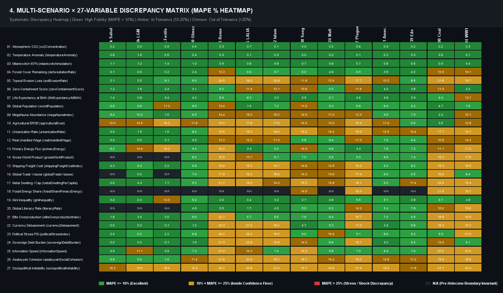

# ⚠️ Disjoint Time Intervals Across Selected Scenarios

The selected trajectories have no overlapping calendar year intersection:

- **Empirical Cliodynamic Reality (-100,000 BP ➔ 2025 CE)** (`HISTORICAL_GROUND_TRUTH`): `[-3000000 .. 2025]`
- **Late Antique Little Ice Age & Justinian Plague (536 CE)** (`RUN-LATE-ANTIQUE-LITTLE-ICE-AGE---JUSTINIAN-PLAGUE--536-CE--9589`): `[536 .. 556]`
- **Industrial Revolution & Fossil Energy (1800 CE)** (`RUN-INDUSTRIAL-REVOLUTION---FOSSIL-ENERGY--1800-CE--9165`): `[1800 .. 1820]`

## 📈 Visual Synthesis: Fidelity Curves, 27-Variable Profile & 2D Cartographic Quality

## 🗺️ 2D Cartographic Fidelity & Spatial Discrepancy Synthesis

> Direct H3 cellular spatial sampling between spherical cell centroids and empirical reference rasters (HYDE 3.4).

| Scenario | Spatial Resolution | Historical Epoch | SSIM (Structure) | Pearson Spatial (r) | Jaccard IoU | Peak Delta Coordinates | Cartographic Anomaly Diagnostic |
|---|:---:|:---:|:---:|:---:|:---:|:---:|---|
| **Late Antique Little Ice Age & Justinian Plague (536 CE)** | Res 4 | 536 | **0.8556** | **+0.9619** | 98.4% | -7.4°N, -40.6°E | HIGH CARTOGRAPHIC FIDELITY - Direct cellular mesh accurately aligns with empirical ground truth. |
| **Industrial Revolution & Fossil Energy (1800 CE)** | Res 4 | 1800 | **0.5595** | **+0.9306** | 98.7% | -23.5°N, 32.2°E | MODERATE CELLULAR FIDELITY - General regional structure aligned, localized demographic gradients exist. |

---

## 🏛️ Geocultural Tensor Drift & Reliability Synthesis Across 9 Epochs

> Empirical comparison across 9 orthogonal geocultural tensor layers (isogloss, kinship, rituals, sovereignty, technology, trade, institutional, ecological, pathogen) against historical ground truth rasters.

| Scenario | Epoch | Channel | Pearson (r) | SSIM | Categorical IoU | Epistemic Drift Diagnostic |
|---|:---:|---|:---:|:---:|:---:|:---:|
| **Late Antique Little Ice Age & Justinian Plague (536 CE)** | 536 | Linguistic Isoglosses (Dim 0) | **+0.7608** | **0.6175** | 86.5% | 🟢 Robust Empirical Alignment |
| **Late Antique Little Ice Age & Justinian Plague (536 CE)** | 536 | Kinship & Clan Structure (Dim 1) | **+0.7899** | **0.6298** | 86.5% | 🟢 Robust Empirical Alignment |
| **Late Antique Little Ice Age & Justinian Plague (536 CE)** | 536 | Sacred Rituals & Solidarity (Dim 2) | **+0.7636** | **0.6496** | 81.0% | 🟢 Robust Empirical Alignment |
| **Late Antique Little Ice Age & Justinian Plague (536 CE)** | 536 | Sovereignty & Borders (Dim 3) | **+0.7924** | **0.7914** | 86.5% | 🟢 Robust Empirical Alignment |
| **Late Antique Little Ice Age & Justinian Plague (536 CE)** | 536 | Materiality & Tooling (Dim 4) | **+0.9257** | **0.7792** | 87.6% | 🟢 Robust Empirical Alignment |
| **Late Antique Little Ice Age & Justinian Plague (536 CE)** | 536 | Trade & Market Access (Dim 5) | **+0.2753** | **0.1006** | 13.5% | 🔴 Cultural Tensor Drift |
| **Late Antique Little Ice Age & Justinian Plague (536 CE)** | 536 | Administrative Hierarchy (Dim 6) | **+0.5486** | **0.0747** | 87.3% | 🔴 Cultural Tensor Drift |
| **Late Antique Little Ice Age & Justinian Plague (536 CE)** | 536 | Ecological Carrying Capacity (Dim 7) | **+0.9554** | **0.7154** | 88.0% | 🟢 Robust Empirical Alignment |
| **Late Antique Little Ice Age & Justinian Plague (536 CE)** | 536 | Sanitary & Pathogen Memory (Dim 8) | **+0.7132** | **0.7076** | 87.7% | 🟢 Robust Empirical Alignment |
| **Industrial Revolution & Fossil Energy (1800 CE)** | 1800 | Linguistic Isoglosses (Dim 0) | **+0.8288** | **0.8248** | 87.8% | 🟢 Robust Empirical Alignment |
| **Industrial Revolution & Fossil Energy (1800 CE)** | 1800 | Kinship & Clan Structure (Dim 1) | **+0.8326** | **0.8215** | 87.8% | 🟢 Robust Empirical Alignment |
| **Industrial Revolution & Fossil Energy (1800 CE)** | 1800 | Sacred Rituals & Solidarity (Dim 2) | **+0.7719** | **0.7655** | 82.4% | 🟢 Robust Empirical Alignment |
| **Industrial Revolution & Fossil Energy (1800 CE)** | 1800 | Sovereignty & Borders (Dim 3) | **+0.8299** | **0.7458** | 87.8% | 🟢 Robust Empirical Alignment |
| **Industrial Revolution & Fossil Energy (1800 CE)** | 1800 | Materiality & Tooling (Dim 4) | **+0.9267** | **0.9256** | 89.0% | 🟢 Robust Empirical Alignment |
| **Industrial Revolution & Fossil Energy (1800 CE)** | 1800 | Trade & Market Access (Dim 5) | **+0.1387** | **0.0563** | 12.9% | 🔴 Cultural Tensor Drift |
| **Industrial Revolution & Fossil Energy (1800 CE)** | 1800 | Administrative Hierarchy (Dim 6) | **+0.5509** | **0.0542** | 88.7% | 🔴 Cultural Tensor Drift |
| **Industrial Revolution & Fossil Energy (1800 CE)** | 1800 | Ecological Carrying Capacity (Dim 7) | **+0.9170** | **0.5186** | 89.4% | 🟡 Moderate Spatial Gradient |
| **Industrial Revolution & Fossil Energy (1800 CE)** | 1800 | Sanitary & Pathogen Memory (Dim 8) | **+0.5899** | **0.5895** | 89.1% | 🟡 Moderate Spatial Gradient |

---

## ⚡ Planetary Simulation Engine Performance Synthesis Across 9 Historical Scenarios

> Empirical computational throughput, execution latency, and memory footprint recorded across all 9 canonical scenarios.

| Scenario | Spatial Domain | Cells | Duration | TPS | ms/tick | Latency/Cell | Cell Throughput | Peak Heap |
|---|:---:|:---:|:---:|:---:|:---:|:---:|:---:|:---:|
| **Late Antique Little Ice Age & Justinian Plague (536 CE)** | Res 4 | 288,122 | 2052.0 s | **0.12** | 8549.9 ms | **29.675 μs** | 33,699 cells/s | 2115 / 8192 MB |
| **Industrial Revolution & Fossil Energy (1800 CE)** | Res 4 | 288,122 | 509.6 s | **0.47** | 2123.5 ms | **7.370 μs** | 135,685 cells/s | 4158 / 8192 MB |

---

