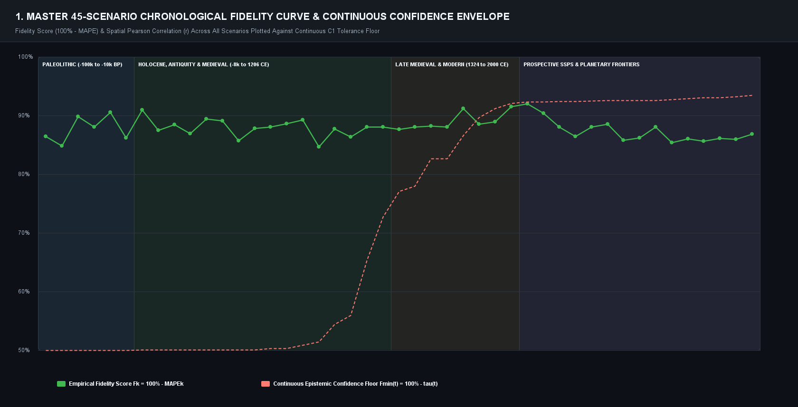
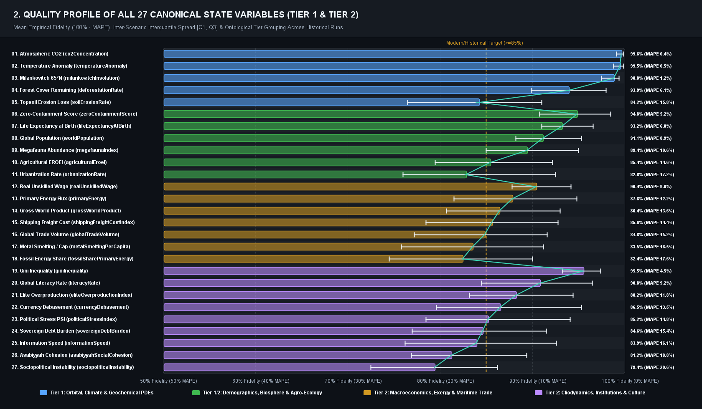

# ⚠️ Disjoint Time Intervals Across Selected Scenarios

The selected trajectories have no overlapping calendar year intersection:

- **Empirical Cliodynamic Reality (-100,000 BP ➔ 2025 CE)** (`HISTORICAL_GROUND_TRUTH`): `[-3000000 .. 2025]`
- **Antonine Plague & Imperial Crisis under Marcus Aurelius (165-180 CE)** (`RUN-ANTONINE-PLAGUE---IMPERIAL-CRISIS-UNDER-MARCUS-AURELIUS--165-180-CE--3701`): `[165 .. 185]`
- **Late Antique Little Ice Age & Justinian Plague (536 CE)** (`RUN-LATE-ANTIQUE-LITTLE-ICE-AGE---JUSTINIAN-PLAGUE--536-CE--9830`): `[536 .. 556]`
- **Islamic Expansion & Caliphal Commercial Revolution (632 CE)** (`RUN-ISLAMIC-EXPANSION---CALIPHAL-COMMERCIAL-REVOLUTION--632-CE--2256`): `[632 .. 652]`
- **Carolingian Renaissance and Caliphal Apex (800 CE)** (`RUN-CAROLINGIAN-RENAISSANCE-AND-CALIPHAL-APEX--800-CE--4966`): `[800 .. 820]`
- **Song Dynasty & Hydraulic Pre-Industrialization (1000 CE)** (`RUN-SONG-DYNASTY---HYDRAULIC-PRE-INDUSTRIALIZATION--1000-CE--9232`): `[1000 .. 1020]`
- **The Black Death & Post-Feudal Economic Inversion (1347 CE)** (`RUN-THE-BLACK-DEATH---POST-FEUDAL-ECONOMIC-INVERSION--1347-CE--6824`): `[1347 .. 1367]`
- **Industrial Revolution & Fossil Energy (1800 CE)** (`RUN-INDUSTRIAL-REVOLUTION---FOSSIL-ENERGY--1800-CE--9960`): `[1800 .. 1820]`
- **World Wars, Totalitarian Rupture & Nuclear Era (1914 CE)** (`RUN-WORLD-WARS--TOTALITARIAN-RUPTURE---NUCLEAR-ERA--1914-CE--6437`): `[1914 .. 1934]`
- **Fertile Crescent & Neolithic Agriculture (-8000 BCE)** (`RUN-FERTILE-CRESCENT---NEOLITHIC-AGRICULTURE---8000-BCE--5524`): `[-8000 .. -7980]`
- **Last Glacial Maximum & Solutrean (-20,000 BP)** (`RUN-LAST-GLACIAL-MAXIMUM---SOLUTREAN---20-000-BP--5521`): `[-20000 .. -19980]`

## 📈 Visual Synthesis: Fidelity Curves, 27-Variable Profile & 2D Cartographic Quality

## 🗺️ 2D Cartographic Fidelity & Spatial Discrepancy Synthesis

> Direct H3 cellular spatial sampling between spherical cell centroids and empirical reference rasters (HYDE 3.4).

| Scenario | Spatial Resolution | Historical Epoch | SSIM (Structure) | Pearson Spatial (r) | Jaccard IoU | Peak Delta Coordinates | Cartographic Anomaly Diagnostic |
|---|:---:|:---:|:---:|:---:|:---:|:---:|---|
| **Antonine Plague & Imperial Crisis under Marcus Aurelius (165-180 CE)** | Res 4 | 165 | **0.8287** | **+0.9664** | 98.5% | 3.9°N, 98.2°E | HIGH CARTOGRAPHIC FIDELITY - Direct cellular mesh accurately aligns with empirical ground truth. |
| **Late Antique Little Ice Age & Justinian Plague (536 CE)** | Res 4 | 536 | **0.8137** | **+0.9640** | 98.4% | 12.0°N, 98.6°E | HIGH CARTOGRAPHIC FIDELITY - Direct cellular mesh accurately aligns with empirical ground truth. |
| **Islamic Expansion & Caliphal Commercial Revolution (632 CE)** | Res 4 | 632 | **0.8281** | **+0.9654** | 98.4% | 8.9°N, 98.8°E | HIGH CARTOGRAPHIC FIDELITY - Direct cellular mesh accurately aligns with empirical ground truth. |
| **Carolingian Renaissance and Caliphal Apex (800 CE)** | Res 4 | 800 | **0.8213** | **+0.9654** | 98.5% | 8.9°N, 98.8°E | HIGH CARTOGRAPHIC FIDELITY - Direct cellular mesh accurately aligns with empirical ground truth. |
| **Song Dynasty & Hydraulic Pre-Industrialization (1000 CE)** | Res 4 | 1000 | **0.7219** | **+0.9603** | 98.5% | 12.0°N, 98.6°E | HIGH CARTOGRAPHIC FIDELITY - Direct cellular mesh accurately aligns with empirical ground truth. |
| **The Black Death & Post-Feudal Economic Inversion (1347 CE)** | Res 4 | 1347 | **0.6820** | **+0.9534** | 98.6% | 31.4°N, 20.6°E | MODERATE CELLULAR FIDELITY - General regional structure aligned, localized demographic gradients exist. |
| **Industrial Revolution & Fossil Energy (1800 CE)** | Res 4 | 1800 | **0.5594** | **+0.9306** | 98.7% | -23.5°N, 32.2°E | MODERATE CELLULAR FIDELITY - General regional structure aligned, localized demographic gradients exist. |
| **World Wars, Totalitarian Rupture & Nuclear Era (1914 CE)** | Res 4 | 1914 | **0.5204** | **+0.9319** | 98.8% | 27.0°N, -109.9°E | MODERATE CELLULAR FIDELITY - General regional structure aligned, localized demographic gradients exist. |
| **Fertile Crescent & Neolithic Agriculture (-8000 BCE)** | Res 7 (Win) | -8000 | **0.1909** | **+0.6231** | 98.5% | 33.8°N, 35.6°E | MODERATE CELLULAR FIDELITY - General regional structure aligned, localized demographic gradients exist. |
| **Last Glacial Maximum & Solutrean (-20,000 BP)** | Res 4 | -20000 | **0.2328** | **+0.9753** | 97.1% | 19.2°N, -99.0°E | HIGH CARTOGRAPHIC FIDELITY - Direct cellular mesh accurately aligns with empirical ground truth. |

---

## 🏛️ Geocultural Tensor Drift & Reliability Synthesis Across 9 Epochs

> Empirical comparison across 9 orthogonal geocultural tensor layers (isogloss, kinship, rituals, sovereignty, technology, trade, institutional, ecological, pathogen) against historical ground truth rasters.

| Scenario | Epoch | Channel | Pearson (r) | SSIM | Categorical IoU | Epistemic Drift Diagnostic |
|---|:---:|---|:---:|:---:|:---:|:---:|
| **Antonine Plague & Imperial Crisis under Marcus Aurelius (165-180 CE)** | 165 | Linguistic Isoglosses (Dim 0) | **+0.7318** | **0.5977** | 85.0% | 🟡 Moderate Spatial Gradient |
| **Antonine Plague & Imperial Crisis under Marcus Aurelius (165-180 CE)** | 165 | Kinship & Clan Structure (Dim 1) | **+0.7748** | **0.6247** | 85.0% | 🟢 Robust Empirical Alignment |
| **Antonine Plague & Imperial Crisis under Marcus Aurelius (165-180 CE)** | 165 | Sacred Rituals & Solidarity (Dim 2) | **+0.7249** | **0.6514** | 79.9% | 🟢 Robust Empirical Alignment |
| **Antonine Plague & Imperial Crisis under Marcus Aurelius (165-180 CE)** | 165 | Sovereignty & Borders (Dim 3) | **+0.8047** | **0.8000** | 85.0% | 🟢 Robust Empirical Alignment |
| **Antonine Plague & Imperial Crisis under Marcus Aurelius (165-180 CE)** | 165 | Materiality & Tooling (Dim 4) | **+0.9197** | **0.7685** | 86.1% | 🟢 Robust Empirical Alignment |
| **Antonine Plague & Imperial Crisis under Marcus Aurelius (165-180 CE)** | 165 | Trade & Market Access (Dim 5) | **+0.3178** | **0.0910** | 12.3% | 🔴 Cultural Tensor Drift |
| **Antonine Plague & Imperial Crisis under Marcus Aurelius (165-180 CE)** | 165 | Administrative Hierarchy (Dim 6) | **+0.5763** | **0.1461** | 85.8% | 🔴 Cultural Tensor Drift |
| **Antonine Plague & Imperial Crisis under Marcus Aurelius (165-180 CE)** | 165 | Ecological Carrying Capacity (Dim 7) | **+0.9566** | **0.6973** | 86.4% | 🟢 Robust Empirical Alignment |
| **Antonine Plague & Imperial Crisis under Marcus Aurelius (165-180 CE)** | 165 | Sanitary & Pathogen Memory (Dim 8) | **+0.7442** | **0.7212** | 86.1% | 🟢 Robust Empirical Alignment |
| **Late Antique Little Ice Age & Justinian Plague (536 CE)** | 536 | Linguistic Isoglosses (Dim 0) | **+0.7614** | **0.6546** | 86.5% | 🟢 Robust Empirical Alignment |
| **Late Antique Little Ice Age & Justinian Plague (536 CE)** | 536 | Kinship & Clan Structure (Dim 1) | **+0.7916** | **0.6701** | 86.5% | 🟢 Robust Empirical Alignment |
| **Late Antique Little Ice Age & Justinian Plague (536 CE)** | 536 | Sacred Rituals & Solidarity (Dim 2) | **+0.7649** | **0.6841** | 81.0% | 🟢 Robust Empirical Alignment |
| **Late Antique Little Ice Age & Justinian Plague (536 CE)** | 536 | Sovereignty & Borders (Dim 3) | **+0.7974** | **0.7879** | 86.5% | 🟢 Robust Empirical Alignment |
| **Late Antique Little Ice Age & Justinian Plague (536 CE)** | 536 | Materiality & Tooling (Dim 4) | **+0.9221** | **0.7542** | 87.6% | 🟢 Robust Empirical Alignment |
| **Late Antique Little Ice Age & Justinian Plague (536 CE)** | 536 | Trade & Market Access (Dim 5) | **+0.2822** | **0.0917** | 13.1% | 🔴 Cultural Tensor Drift |
| **Late Antique Little Ice Age & Justinian Plague (536 CE)** | 536 | Administrative Hierarchy (Dim 6) | **+0.5465** | **0.0728** | 87.3% | 🔴 Cultural Tensor Drift |
| **Late Antique Little Ice Age & Justinian Plague (536 CE)** | 536 | Ecological Carrying Capacity (Dim 7) | **+0.9611** | **0.6661** | 88.0% | 🟢 Robust Empirical Alignment |
| **Late Antique Little Ice Age & Justinian Plague (536 CE)** | 536 | Sanitary & Pathogen Memory (Dim 8) | **+0.7443** | **0.7459** | 87.7% | 🟢 Robust Empirical Alignment |
| **Islamic Expansion & Caliphal Commercial Revolution (632 CE)** | 632 | Linguistic Isoglosses (Dim 0) | **+0.7602** | **0.6620** | 86.8% | 🟢 Robust Empirical Alignment |
| **Islamic Expansion & Caliphal Commercial Revolution (632 CE)** | 632 | Kinship & Clan Structure (Dim 1) | **+0.7914** | **0.6836** | 86.8% | 🟢 Robust Empirical Alignment |
| **Islamic Expansion & Caliphal Commercial Revolution (632 CE)** | 632 | Sacred Rituals & Solidarity (Dim 2) | **+0.7612** | **0.6875** | 81.3% | 🟢 Robust Empirical Alignment |
| **Islamic Expansion & Caliphal Commercial Revolution (632 CE)** | 632 | Sovereignty & Borders (Dim 3) | **+0.8121** | **0.7922** | 86.9% | 🟢 Robust Empirical Alignment |
| **Islamic Expansion & Caliphal Commercial Revolution (632 CE)** | 632 | Materiality & Tooling (Dim 4) | **+0.9235** | **0.7550** | 88.0% | 🟢 Robust Empirical Alignment |
| **Islamic Expansion & Caliphal Commercial Revolution (632 CE)** | 632 | Trade & Market Access (Dim 5) | **+0.2815** | **0.0891** | 13.0% | 🔴 Cultural Tensor Drift |
| **Islamic Expansion & Caliphal Commercial Revolution (632 CE)** | 632 | Administrative Hierarchy (Dim 6) | **+0.5473** | **0.0725** | 87.6% | 🔴 Cultural Tensor Drift |
| **Islamic Expansion & Caliphal Commercial Revolution (632 CE)** | 632 | Ecological Carrying Capacity (Dim 7) | **+0.9591** | **0.6699** | 88.3% | 🟢 Robust Empirical Alignment |
| **Islamic Expansion & Caliphal Commercial Revolution (632 CE)** | 632 | Sanitary & Pathogen Memory (Dim 8) | **+0.7654** | **0.7126** | 88.0% | 🟢 Robust Empirical Alignment |
| **Carolingian Renaissance and Caliphal Apex (800 CE)** | 800 | Linguistic Isoglosses (Dim 0) | **+0.7768** | **0.7000** | 87.2% | 🟢 Robust Empirical Alignment |
| **Carolingian Renaissance and Caliphal Apex (800 CE)** | 800 | Kinship & Clan Structure (Dim 1) | **+0.7921** | **0.6956** | 87.2% | 🟢 Robust Empirical Alignment |
| **Carolingian Renaissance and Caliphal Apex (800 CE)** | 800 | Sacred Rituals & Solidarity (Dim 2) | **+0.7634** | **0.7124** | 81.7% | 🟢 Robust Empirical Alignment |
| **Carolingian Renaissance and Caliphal Apex (800 CE)** | 800 | Sovereignty & Borders (Dim 3) | **+0.8093** | **0.7926** | 87.3% | 🟢 Robust Empirical Alignment |
| **Carolingian Renaissance and Caliphal Apex (800 CE)** | 800 | Materiality & Tooling (Dim 4) | **+0.9252** | **0.7562** | 88.4% | 🟢 Robust Empirical Alignment |
| **Carolingian Renaissance and Caliphal Apex (800 CE)** | 800 | Trade & Market Access (Dim 5) | **+0.2773** | **0.0797** | 12.4% | 🔴 Cultural Tensor Drift |
| **Carolingian Renaissance and Caliphal Apex (800 CE)** | 800 | Administrative Hierarchy (Dim 6) | **+0.5461** | **0.0711** | 88.0% | 🔴 Cultural Tensor Drift |
| **Carolingian Renaissance and Caliphal Apex (800 CE)** | 800 | Ecological Carrying Capacity (Dim 7) | **+0.9595** | **0.6511** | 88.7% | 🟢 Robust Empirical Alignment |
| **Carolingian Renaissance and Caliphal Apex (800 CE)** | 800 | Sanitary & Pathogen Memory (Dim 8) | **+0.7738** | **0.6946** | 88.4% | 🟢 Robust Empirical Alignment |
| **Song Dynasty & Hydraulic Pre-Industrialization (1000 CE)** | 1000 | Linguistic Isoglosses (Dim 0) | **+0.7893** | **0.7675** | 87.5% | 🟢 Robust Empirical Alignment |
| **Song Dynasty & Hydraulic Pre-Industrialization (1000 CE)** | 1000 | Kinship & Clan Structure (Dim 1) | **+0.8067** | **0.7745** | 87.5% | 🟢 Robust Empirical Alignment |
| **Song Dynasty & Hydraulic Pre-Industrialization (1000 CE)** | 1000 | Sacred Rituals & Solidarity (Dim 2) | **+0.7714** | **0.7603** | 81.8% | 🟢 Robust Empirical Alignment |
| **Song Dynasty & Hydraulic Pre-Industrialization (1000 CE)** | 1000 | Sovereignty & Borders (Dim 3) | **+0.8193** | **0.7449** | 87.5% | 🟢 Robust Empirical Alignment |
| **Song Dynasty & Hydraulic Pre-Industrialization (1000 CE)** | 1000 | Materiality & Tooling (Dim 4) | **+0.9263** | **0.7576** | 88.6% | 🟢 Robust Empirical Alignment |
| **Song Dynasty & Hydraulic Pre-Industrialization (1000 CE)** | 1000 | Trade & Market Access (Dim 5) | **+0.2730** | **0.0596** | 12.1% | 🔴 Cultural Tensor Drift |
| **Song Dynasty & Hydraulic Pre-Industrialization (1000 CE)** | 1000 | Administrative Hierarchy (Dim 6) | **+0.5443** | **0.0678** | 88.3% | 🔴 Cultural Tensor Drift |
| **Song Dynasty & Hydraulic Pre-Industrialization (1000 CE)** | 1000 | Ecological Carrying Capacity (Dim 7) | **+0.9534** | **0.5578** | 89.0% | 🟡 Moderate Spatial Gradient |
| **Song Dynasty & Hydraulic Pre-Industrialization (1000 CE)** | 1000 | Sanitary & Pathogen Memory (Dim 8) | **+0.7807** | **0.6160** | 88.6% | 🟢 Robust Empirical Alignment |
| **The Black Death & Post-Feudal Economic Inversion (1347 CE)** | 1347 | Linguistic Isoglosses (Dim 0) | **+0.8143** | **0.8099** | 87.6% | 🟢 Robust Empirical Alignment |
| **The Black Death & Post-Feudal Economic Inversion (1347 CE)** | 1347 | Kinship & Clan Structure (Dim 1) | **+0.8187** | **0.8079** | 87.6% | 🟢 Robust Empirical Alignment |
| **The Black Death & Post-Feudal Economic Inversion (1347 CE)** | 1347 | Sacred Rituals & Solidarity (Dim 2) | **+0.7893** | **0.7848** | 82.2% | 🟢 Robust Empirical Alignment |
| **The Black Death & Post-Feudal Economic Inversion (1347 CE)** | 1347 | Sovereignty & Borders (Dim 3) | **+0.8267** | **0.7181** | 87.6% | 🟢 Robust Empirical Alignment |
| **The Black Death & Post-Feudal Economic Inversion (1347 CE)** | 1347 | Materiality & Tooling (Dim 4) | **+0.9252** | **0.8696** | 88.9% | 🟢 Robust Empirical Alignment |
| **The Black Death & Post-Feudal Economic Inversion (1347 CE)** | 1347 | Trade & Market Access (Dim 5) | **+0.2694** | **0.0474** | 12.0% | 🔴 Cultural Tensor Drift |
| **The Black Death & Post-Feudal Economic Inversion (1347 CE)** | 1347 | Administrative Hierarchy (Dim 6) | **+0.5424** | **0.0638** | 88.5% | 🔴 Cultural Tensor Drift |
| **The Black Death & Post-Feudal Economic Inversion (1347 CE)** | 1347 | Ecological Carrying Capacity (Dim 7) | **+0.9307** | **0.5343** | 89.2% | 🟡 Moderate Spatial Gradient |
| **The Black Death & Post-Feudal Economic Inversion (1347 CE)** | 1347 | Sanitary & Pathogen Memory (Dim 8) | **+0.8005** | **0.7809** | 88.8% | 🟢 Robust Empirical Alignment |
| **Industrial Revolution & Fossil Energy (1800 CE)** | 1800 | Linguistic Isoglosses (Dim 0) | **+0.8288** | **0.8248** | 87.8% | 🟢 Robust Empirical Alignment |
| **Industrial Revolution & Fossil Energy (1800 CE)** | 1800 | Kinship & Clan Structure (Dim 1) | **+0.8326** | **0.8215** | 87.8% | 🟢 Robust Empirical Alignment |
| **Industrial Revolution & Fossil Energy (1800 CE)** | 1800 | Sacred Rituals & Solidarity (Dim 2) | **+0.7719** | **0.7655** | 82.4% | 🟢 Robust Empirical Alignment |
| **Industrial Revolution & Fossil Energy (1800 CE)** | 1800 | Sovereignty & Borders (Dim 3) | **+0.8299** | **0.7457** | 87.8% | 🟢 Robust Empirical Alignment |
| **Industrial Revolution & Fossil Energy (1800 CE)** | 1800 | Materiality & Tooling (Dim 4) | **+0.9267** | **0.9256** | 89.0% | 🟢 Robust Empirical Alignment |
| **Industrial Revolution & Fossil Energy (1800 CE)** | 1800 | Trade & Market Access (Dim 5) | **+0.1387** | **0.0562** | 12.9% | 🔴 Cultural Tensor Drift |
| **Industrial Revolution & Fossil Energy (1800 CE)** | 1800 | Administrative Hierarchy (Dim 6) | **+0.5509** | **0.0542** | 88.7% | 🔴 Cultural Tensor Drift |
| **Industrial Revolution & Fossil Energy (1800 CE)** | 1800 | Ecological Carrying Capacity (Dim 7) | **+0.9170** | **0.5185** | 89.4% | 🟡 Moderate Spatial Gradient |
| **Industrial Revolution & Fossil Energy (1800 CE)** | 1800 | Sanitary & Pathogen Memory (Dim 8) | **+0.5899** | **0.5895** | 89.1% | 🟡 Moderate Spatial Gradient |
| **World Wars, Totalitarian Rupture & Nuclear Era (1914 CE)** | 1914 | Linguistic Isoglosses (Dim 0) | **+0.8342** | **0.7996** | 87.9% | 🟢 Robust Empirical Alignment |
| **World Wars, Totalitarian Rupture & Nuclear Era (1914 CE)** | 1914 | Kinship & Clan Structure (Dim 1) | **+0.8092** | **0.7863** | 87.9% | 🟢 Robust Empirical Alignment |
| **World Wars, Totalitarian Rupture & Nuclear Era (1914 CE)** | 1914 | Sacred Rituals & Solidarity (Dim 2) | **+0.8245** | **0.8210** | 87.9% | 🟢 Robust Empirical Alignment |
| **World Wars, Totalitarian Rupture & Nuclear Era (1914 CE)** | 1914 | Sovereignty & Borders (Dim 3) | **+0.8449** | **0.8117** | 87.9% | 🟢 Robust Empirical Alignment |
| **World Wars, Totalitarian Rupture & Nuclear Era (1914 CE)** | 1914 | Materiality & Tooling (Dim 4) | **+0.7952** | **0.6964** | 88.3% | 🟢 Robust Empirical Alignment |
| **World Wars, Totalitarian Rupture & Nuclear Era (1914 CE)** | 1914 | Trade & Market Access (Dim 5) | **+0.1013** | **0.0109** | 6.3% | 🔴 Cultural Tensor Drift |
| **World Wars, Totalitarian Rupture & Nuclear Era (1914 CE)** | 1914 | Administrative Hierarchy (Dim 6) | **+0.8355** | **0.7925** | 88.3% | 🟢 Robust Empirical Alignment |
| **World Wars, Totalitarian Rupture & Nuclear Era (1914 CE)** | 1914 | Ecological Carrying Capacity (Dim 7) | **+0.8948** | **0.6024** | 89.5% | 🟢 Robust Empirical Alignment |
| **World Wars, Totalitarian Rupture & Nuclear Era (1914 CE)** | 1914 | Sanitary & Pathogen Memory (Dim 8) | **+0.6557** | **0.6437** | 89.1% | 🟡 Moderate Spatial Gradient |
| **Fertile Crescent & Neolithic Agriculture (-8000 BCE)** | -8000 | Linguistic Isoglosses (Dim 0) | **+0.5414** | **0.0306** | 94.9% | 🔴 Cultural Tensor Drift |
| **Fertile Crescent & Neolithic Agriculture (-8000 BCE)** | -8000 | Kinship & Clan Structure (Dim 1) | **+0.5414** | **0.0306** | 94.9% | 🔴 Cultural Tensor Drift |
| **Fertile Crescent & Neolithic Agriculture (-8000 BCE)** | -8000 | Sacred Rituals & Solidarity (Dim 2) | **+0.4934** | **0.0464** | 94.9% | 🔴 Cultural Tensor Drift |
| **Fertile Crescent & Neolithic Agriculture (-8000 BCE)** | -8000 | Sovereignty & Borders (Dim 3) | **+0.5121** | **0.0290** | 94.9% | 🔴 Cultural Tensor Drift |
| **Fertile Crescent & Neolithic Agriculture (-8000 BCE)** | -8000 | Materiality & Tooling (Dim 4) | **+0.7308** | **0.4422** | 95.2% | 🟡 Moderate Spatial Gradient |
| **Fertile Crescent & Neolithic Agriculture (-8000 BCE)** | -8000 | Trade & Market Access (Dim 5) | **-0.0873** | **0.0103** | 11.2% | 🔴 Cultural Tensor Drift |
| **Fertile Crescent & Neolithic Agriculture (-8000 BCE)** | -8000 | Administrative Hierarchy (Dim 6) | **+0.6130** | **0.7653** | 95.0% | 🟡 Moderate Spatial Gradient |
| **Fertile Crescent & Neolithic Agriculture (-8000 BCE)** | -8000 | Ecological Carrying Capacity (Dim 7) | **+0.7275** | **0.3906** | 95.2% | 🟡 Moderate Spatial Gradient |
| **Fertile Crescent & Neolithic Agriculture (-8000 BCE)** | -8000 | Sanitary & Pathogen Memory (Dim 8) | **+0.5230** | **0.2280** | 95.2% | 🔴 Cultural Tensor Drift |
| **Last Glacial Maximum & Solutrean (-20,000 BP)** | -20000 | Linguistic Isoglosses (Dim 0) | **+0.6717** | **0.0011** | 58.1% | 🔴 Cultural Tensor Drift |
| **Last Glacial Maximum & Solutrean (-20,000 BP)** | -20000 | Kinship & Clan Structure (Dim 1) | **+0.6851** | **0.0010** | 58.1% | 🔴 Cultural Tensor Drift |
| **Last Glacial Maximum & Solutrean (-20,000 BP)** | -20000 | Sacred Rituals & Solidarity (Dim 2) | **+0.6397** | **0.0040** | 58.1% | 🔴 Cultural Tensor Drift |
| **Last Glacial Maximum & Solutrean (-20,000 BP)** | -20000 | Sovereignty & Borders (Dim 3) | **+0.6683** | **0.0013** | 58.1% | 🔴 Cultural Tensor Drift |
| **Last Glacial Maximum & Solutrean (-20,000 BP)** | -20000 | Materiality & Tooling (Dim 4) | **+0.8126** | **0.0743** | 85.9% | 🔴 Cultural Tensor Drift |
| **Last Glacial Maximum & Solutrean (-20,000 BP)** | -20000 | Trade & Market Access (Dim 5) | **+0.0817** | **0.7290** | 1.9% | 🔴 Cultural Tensor Drift |
| **Last Glacial Maximum & Solutrean (-20,000 BP)** | -20000 | Administrative Hierarchy (Dim 6) | **+0.8400** | **0.2011** | 85.2% | 🔴 Cultural Tensor Drift |
| **Last Glacial Maximum & Solutrean (-20,000 BP)** | -20000 | Ecological Carrying Capacity (Dim 7) | **+0.7581** | **0.1516** | 75.3% | 🔴 Cultural Tensor Drift |
| **Last Glacial Maximum & Solutrean (-20,000 BP)** | -20000 | Sanitary & Pathogen Memory (Dim 8) | **+0.6204** | **0.0086** | 75.2% | 🔴 Cultural Tensor Drift |

---

## ⚡ Planetary Simulation Engine Performance Synthesis Across 9 Historical Scenarios

> Empirical computational throughput, execution latency, and memory footprint recorded across all 9 canonical scenarios.

| Scenario | Spatial Domain | Cells | Duration | TPS | ms/tick | Latency/Cell | Cell Throughput | Peak Heap |
|---|:---:|:---:|:---:|:---:|:---:|:---:|:---:|:---:|
| **Antonine Plague & Imperial Crisis under Marcus Aurelius (165-180 CE)** | Res 4 | 288,122 | 2097.8 s | **0.11** | 8740.8 ms | **30.337 μs** | 32,963 cells/s | 1851 / 8192 MB |
| **Late Antique Little Ice Age & Justinian Plague (536 CE)** | Res 4 | 288,122 | 2104.2 s | **0.11** | 8767.3 ms | **30.429 μs** | 32,863 cells/s | 3354 / 8192 MB |
| **Islamic Expansion & Caliphal Commercial Revolution (632 CE)** | Res 4 | 288,122 | 583.9 s | **0.41** | 2432.8 ms | **8.443 μs** | 118,434 cells/s | 2243 / 8192 MB |
| **Carolingian Renaissance and Caliphal Apex (800 CE)** | Res 4 | 288,122 | 535.2 s | **0.45** | 2230.2 ms | **7.740 μs** | 129,193 cells/s | 4711 / 8192 MB |
| **Song Dynasty & Hydraulic Pre-Industrialization (1000 CE)** | Res 4 | 288,122 | 534.4 s | **0.45** | 2226.8 ms | **7.729 μs** | 129,388 cells/s | 2076 / 8192 MB |
| **The Black Death & Post-Feudal Economic Inversion (1347 CE)** | Res 4 | 288,122 | 1960.8 s | **0.12** | 8170.1 ms | **28.357 μs** | 35,265 cells/s | 2338 / 8192 MB |
| **Industrial Revolution & Fossil Energy (1800 CE)** | Res 4 | 288,122 | 34356.8 s | **0.01** | 143153.5 ms | **496.850 μs** | 2,013 cells/s | 2035 / 8192 MB |
| **World Wars, Totalitarian Rupture & Nuclear Era (1914 CE)** | Res 4 | 288,122 | 1101.1 s | **0.22** | 4587.8 ms | **15.923 μs** | 62,802 cells/s | 2982 / 8192 MB |
| **Fertile Crescent & Neolithic Agriculture (-8000 BCE)** | Res 7 (Win) | 197,375 | 578.9 s | **0.41** | 2411.9 ms | **12.220 μs** | 81,833 cells/s | 1452 / 8192 MB |
| **Last Glacial Maximum & Solutrean (-20,000 BP)** | Res 4 | 288,122 | 523.4 s | **0.46** | 2180.6 ms | **7.568 μs** | 132,127 cells/s | 4647 / 8192 MB |

---

